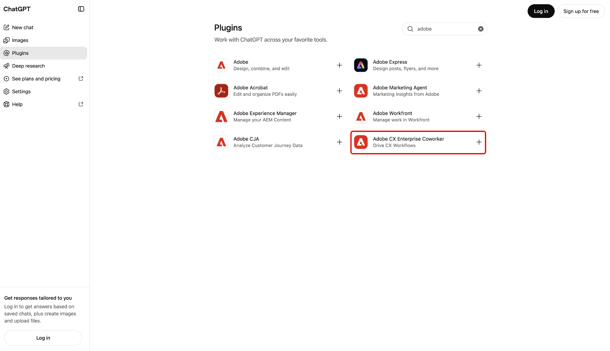

# Adobe CX Enterprise CoworkerのAI基盤

Adobe CX Enterprise CoworkerのAI機能を利用すれば、既存のAI ツールからマーケティングインサイトを獲得できます。 ツールを切り替えることなく、自然言語で質問できます。 各プラットフォームで、Adobe Adobe CX Enterprise Coworkerの商品情報を入手できます。

利用可能なプラットフォームとその設定手順については、[同僚の設定](#set-up-coworker)を参照してください。

AI プラットフォームにCoworkerを利用する追加コストはありません。 CX Enterprise Coworkerライセンスに含まれており、その使用は他のCoworker機能と同じAI クレジットから引き出されます。 詳しくは、[Adobe Experience Platformの担当者ジョブとAI クレジットの使用](https://experienceleague.adobe.com/ja/docs/cx-enterprise-ai/experience-cloud-ai/overview/ai-credit-consumption){target="_blank"}を参照してください。

<!-- TODO: architecture diagram pending from engineering. KT page notes "to be provided on 8/28"; still outstanding as of 8/31. Insert here once received. -->

## 前提条件 {#prerequisites}

CoworkerをAI プラットフォームで使用する前に、次の点を確認してください。

* Adobe CX Enterprise Coworkerのプロビジョニングと、Adobeでのアクセス権を設定できます。
* Adobe Experience Platformと、Adobe Real-Time CDP、Adobe Journey Optimizer、またはAdobe Customer Journey Analyticsの少なくとも1つ。
* 「[同僚を設定](#set-up-coworker)」に記載されているAI プラットフォームへのアクセス。

## データアクセスと権限 {#data-access-and-permissions}

AI プラットフォームの従業員は、Adobe IDに関連付けられた同じデータとアクセスレベルを反映しています。 Experience Platformとその関連ソリューションでは、クエリして表示できる内容が、すでに使用できる権限と一致します。 Coworkerはこれらの権限を継承するため、AI プラットフォーム統合に個別の権限の設定は必要ありません。 Coworkerは読み取り専用のインサイトを返し、顧客データを変更しません。 生成された要約や分析を確認してから、ビジネス上の意思決定に活用できます。

<!-- Confirmed by PM (Siddhartha Srivastava) on 2026-09-02 for Microsoft 365 Copilot, Claude, and ChatGPT. Validate this permissions model for each additional platform before adding its setup tab. -->

## 主なユースケース {#key-use-cases}

AI プラットフォームでAdobe Workfrontを利用することで、日常のツールから離れることなく、一般的なマーケティングワークフローを高速化できます。

| ユースケース | 説明 |
| --- | --- |
| キャンペーンの計画とレビュー | パートナーキャンペーンのレビューやオーディエンスの予測など、キャンペーンを計画する。 キャンペーンのパフォーマンスを長期的に比較し、コンバージョンを促進するタッチポイントを特定します。 |
| ジャーニーとキャンペーンの準備状況を監視する | アクティブなキャンペーンを確認および監視し、カスタマージャーニーを分析して、キャンペーンの準備状況を評価します。 ジャーニーのパフォーマンスとドロップオフを追跡し、最適化の機会を特定。 |
| 運用に関するインサイトの獲得 | 最もエンゲージメントの高いオーディエンスや最もエンゲージメントの高いオーディエンスを特定し、注力すべきオーディエンスを特定しましょう。また、セグメントの長期的な成長や縮小を追跡できます。 |
| ワークフローとコンテンツの最適化 | ワークフローを最適化し、CX キャンペーンに必要なアセットとコンテンツを特定する。 クエリやダッシュボードを手作業で作成することなく、キャンペーンのパフォーマンスに関するビジュアルレポートを生成できます。 |
| より迅速なコラボレーションと意思決定 | オーディエンス、キャンペーン、web トラフィックを検索するために、提案されたプロンプトを使用します。 プランニングミーティング中にチームとインサイトを共有し、プランやデッキを確認しながらリアルタイムで高度な質問に答えます。 |

<!-- Use cases approved by PM Siddhartha Srivastava on 2026-08-31 and confirmed for Microsoft 365 Copilot, Claude, and ChatGPT on 2026-09-02. Validate applicability for each additional platform before adding its setup tab. -->

## 同僚の設定 {#set-up-coworker}

設定の手順については、使用可能なプラットフォームを選択してください。 セットアップ後、[&#x200B; サンプルプロンプト &#x200B;](#example-prompts)を試してください。

>[!BEGINTABS]

>[!TAB Microsoft 365 コパイロット ]

[!DNL Adobe CX Enterprise Coworker for Copilot]を使用して、[!DNL Microsoft 365 Copilot]でマーケティングインサイトを取得します。

開始する前に、[!DNL Microsoft 365 Copilot]へのアクセス権があることを確認してください。

**組織の共同作業者の設定**

エンドユーザーが[!DNL Microsoft 365 Copilot]でCoworkerにアクセスするには、管理者がこれらの手順を完了する必要があります。

1. [!DNL Microsoft 365 admin center]で、テナント設定で、外部パブリッシャーによって構築されたアプリとエージェントが許可されていることを確認します。
1. [!DNL Microsoft 365 admin center]と[!DNL Teams admin center]の両方で&#x200B;**[!UICONTROL Adobe CX Enterprise Coworker]**&#x200B;を承認します。 通常、[!DNL Microsoft Commercial Marketplace]または組織の&#x200B;**[!UICONTROL 統合アプリ]** リストからエージェントを見つけることができます。
1. エンドユーザーにエージェントをデプロイします。 特定のユーザーやグループ、または組織全体にデプロイできます。 有効にするユーザーの数は、設定やコストには影響しません。

>[!NOTE]
>
>[!DNL Microsoft]が新しい権限を必要とするCoworkerへの更新をリリースした場合、管理者はユーザーにロールアウトする前に[!DNL Agent Registry]で更新を承認する必要があります。

[!DNL Copilot]&#x200B;**の**&#x200B;同僚へのアクセス

管理者がCoworkerを有効にすると、[!DNL Teams]、[!DNL Word]、[!DNL Excel]、[!DNL PowerPoint]、およびweb チャットを含む[!DNL Microsoft 365 Copilot]個のサーフェスでアクセスできます。

[!DNL Microsoft 365 Copilot]で、**[!UICONTROL エージェント]**&#x200B;を選択してから、**[!UICONTROL その他のエージェント]**&#x200B;を選択します。

次に、エージェントカタログで「**[!UICONTROL Adobe CX Enterprise Coworker]**」を選択します。

最後に、**[!UICONTROL Add]**&#x200B;を選択して、担当者に同僚を追加します。

「追加」ボタンがハイライト表示されたMicrosoft 365 コパイロットの

>[!TAB ChatGPT]

[!DNL Adobe CX Enterprise Coworker for ChatGPT]を使用して、[!DNL ChatGPT]でマーケティングインサイトを取得します。

開始する前に、[!DNL ChatGPT]へのアクセス権があることを確認してください。

**組織の共同作業者の設定**

* [!DNL ChatGPT]管理者に、選択したユーザーまたは組織全体に対して&#x200B;**[!UICONTROL Adobe CX Enterprise Coworker]**&#x200B;を承認するように依頼します。

[!DNL ChatGPT]&#x200B;**の**&#x200B;同僚へのアクセス

[!DNL ChatGPT]で、「**[!UICONTROL プラグイン]**」を選択します。

プラグインをハイライト表示した

次に、プラグインカタログで「**[!UICONTROL Adobe CX Enterprise Coworker]**」を見つけて選択します。

最後に、**[!UICONTROL プラグインをインストール]**&#x200B;を選択して、Coworkerを[!DNL ChatGPT]に追加します。

「プラグインをインストール」ボタンがハイライト表示されたChatGPTの

>[!TAB  クロード ]

[!DNL Claude]でCoworkerを使用してマーケティングインサイトを取得します。

開始する前に、[!DNL Claude]へのアクセス権があることを確認してください。

**組織の共同作業者の設定**

* [!DNL Claude]管理者に、選択したユーザーまたは組織全体に対して&#x200B;**[!UICONTROL Adobe CX Enterprise Coworker]**&#x200B;を承認するように依頼します。

[!DNL Claude]&#x200B;**の**&#x200B;同僚へのアクセス

1. [!DNL Claude]で、**[!UICONTROL カスタマイズ]**&#x200B;を選択します。

   カスタマイズがハイライト表示された

1. **[!UICONTROL Connectors]**、**[!UICONTROL Discover]**&#x200B;を選択し、**[!UICONTROL Search]**&#x200B;を使用してAdobe CX Enterprise Coworkerを検索します。

   

1. 「**[!UICONTROL Adobe CX Enterprise Coworker]**」を選択し、「**[!UICONTROL クロードに接続]**」を選択します。

   

1. Adobeの資格情報でログインして、Coworkerを[!DNL Claude]に接続します。

>[!ENDTABS]

<!-- Setup steps above reflect the real customer-facing flow confirmed by PM (Siddhartha Srivastava) on 2026-09-02: an org admin approves the connector or plugin, then end users find and add it in their platform's catalog and sign in. The previous version of this file described a manual MCP-connector setup for ChatGPT (Settings > Connectors > paste server URL) -- PM clarified that flow is for internal testing only, not the customer path, so it was removed here. -->

## サンプルプロンプト {#example-prompts}

サポートされているプラットフォームでCoworkerを設定した後、これらのプロンプトを試すか、自然言語で独自のプロンプトを記述します。

* 上位5つのオーディエンスを表示します。
* 先月の指標を表示します。
* アクティブなWorkfront プロジェクトを表示します。
* ロイヤルティオーディエンスでジャーニーを示す。

## 既知の制限事項 {#known-limitations}

AI プラットフォームの同僚は、あらゆる統合パターンをサポートしているわけではありません。

* CoworkerをMCPを使用して独自のエージェンティックハーネスに接続することはできません。

## AI プラットフォームでの同僚のトラブルシューティング {#troubleshoot}

AI プラットフォームでCoworkerを使用する際に問題が発生した場合は、次のステップをお試しください。

* エラーが表示された場合は、ログアウトして、Adobeの資格情報を使用して再度ログインします。 再認証によって、ほとんどの問題が解決されます。
* Coworkerまたは特定のデータにアクセスできない場合は、Adobe管理者に連絡して、製品へのアクセスと権限を確認してください。

<!--
Editorial maintenance, 2026-10-27:
Only approved platforms with validated setup guidance belong in the rendered tab set.
Remaining platforms to add: Gemini, Amazon Quick, IBM, and Databricks.

To add an approved platform:
* Confirm approval and obtain access to the customer flow.
* Validate prerequisites, organization approval, catalog discovery, listing name, installation, and Adobe sign-in.
* Confirm the shared licensing, permissions, use cases, prompts, limitations, and troubleshooting guidance applies.
* Add one tab before ENDTABS, following the existing order: introduction, platform prerequisites, organization setup, and user access.
* Document any platform-specific requirements or exceptions within that tab.
* Preview the tab and verify its links and image references.
Keep the introduction, metadata, and shared prerequisites free of platform lists so adding a tab does not require duplicate updates.

Gemini draft scope:
No setup steps are confirmed. Validate the complete customer flow and all shared guidance before adding the tab.
Do not infer the flow from another platform.
-->
