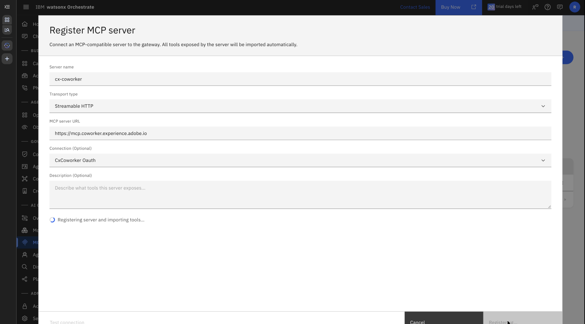

# Adobe CX Enterprise CoworkerのAI基盤

Adobe CX Enterprise CoworkerのAI機能を利用すれば、既存のAI ツールからマーケティングインサイトを獲得できます。 ツールを切り替えることなく、自然言語で質問できます。 各プラットフォームで、Adobe Adobe CX Enterprise Coworkerの商品情報を入手できます。

利用可能なプラットフォームとその設定手順については、[同僚の設定](#set-up-coworker)を参照してください。

AI プラットフォームにCoworkerを利用する追加コストはありません。 CX Enterprise Coworkerライセンスに含まれており、その使用は他のCoworker機能と同じAI クレジットから引き出されます。 詳しくは、[Adobe Experience Platformの担当者ジョブとAI クレジットの使用](https://experienceleague.adobe.com/ja/docs/cx-enterprise-ai/experience-cloud-ai/overview/ai-credit-consumption){target="_blank"}を参照してください。

<!-- TODO: architecture diagram pending from engineering. KT page notes "to be provided on 8/28"; still outstanding as of 8/31. Insert here once received. -->

## 前提条件 {#prerequisites}

CoworkerをAI プラットフォームで使用する前に、次の点を確認してください。

* Adobe CX Enterprise Coworkerのプロビジョニングと、Adobeでのアクセス権を設定できます。
* Adobe Experience Platformと、Adobe Real-Time CDP、Adobe Journey Optimizer、またはAdobe Customer Journey Analyticsの少なくとも1つ。
* 「[同僚を設定](#set-up-coworker)」に記載されているAI プラットフォームへのアクセス。

## データアクセスと権限 {#data-access-and-permissions}

AI プラットフォームの従業員は、Adobe IDに関連付けられた同じデータとアクセスレベルを反映しています。 Experience Platformとその関連ソリューションでは、クエリして表示できる内容が、すでに使用できる権限と一致します。 Coworkerはこれらの権限を継承するため、AI プラットフォーム統合に個別の権限の設定は必要ありません。 Coworkerは読み取り専用のインサイトを返し、顧客データを変更しません。 生成された要約や分析を確認してから、ビジネス上の意思決定に活用できます。

<!-- Confirmed by PM (Siddhartha Srivastava) on 2026-09-02 for Microsoft 365 Copilot, Claude, and ChatGPT. Validate this permissions model for each additional platform before adding its setup section. -->

## 主なユースケース {#key-use-cases}

AI プラットフォームでAdobe Workfrontを利用することで、日常のツールから離れることなく、一般的なマーケティングワークフローを高速化できます。

| ユースケース | 説明 |
| --- | --- |
| キャンペーンの計画とレビュー | パートナーキャンペーンのレビューやオーディエンスの予測など、キャンペーンを計画する。 キャンペーンのパフォーマンスを長期的に比較し、コンバージョンを促進するタッチポイントを特定します。 |
| ジャーニーとキャンペーンの準備状況を監視する | アクティブなキャンペーンを確認および監視し、カスタマージャーニーを分析して、キャンペーンの準備状況を評価します。 ジャーニーのパフォーマンスとドロップオフを追跡し、最適化の機会を特定。 |
| 運用に関するインサイトの獲得 | 最もエンゲージメントの高いオーディエンスや最もエンゲージメントの高いオーディエンスを特定し、注力すべきオーディエンスを特定しましょう。また、セグメントの長期的な成長や縮小を追跡できます。 |
| ワークフローとコンテンツの最適化 | ワークフローを最適化し、CX キャンペーンに必要なアセットとコンテンツを特定する。 クエリやダッシュボードを手作業で作成することなく、キャンペーンのパフォーマンスに関するビジュアルレポートを生成できます。 |
| より迅速なコラボレーションと意思決定 | オーディエンス、キャンペーン、web トラフィックを検索するために、提案されたプロンプトを使用します。 プランニングミーティング中にチームとインサイトを共有し、プランやデッキを確認しながらリアルタイムで高度な質問に答えます。 |

<!-- Use cases approved by PM Siddhartha Srivastava on 2026-08-31 and confirmed for Microsoft 365 Copilot, Claude, and ChatGPT on 2026-09-02. Validate applicability for each additional platform before adding its setup section. -->

## 同僚の設定 {#set-up-coworker}

設定の手順については、使用可能なプラットフォームを選択してください。 セットアップ後、[ サンプルプロンプト ](#example-prompts)を試してください。

* [Microsoft 365 コパイロット](#microsoft-365-copilot)
* [ChatGPT](#chatgpt)
* [クロード](#claude)
* [ジェミニ・エンタープライズ](#gemini-enterprise)
* [Amazon クイック](#amazon-quick)
* [IBM watsonx Orchestrate](#ibm-watsonx-orchestrate)
* [Databricks](#databricks)

### [!DNL Microsoft 365 Copilot] {#microsoft-365-copilot}

[!DNL Adobe CX Enterprise Coworker for Copilot]を使用して、[!DNL Microsoft 365 Copilot]でマーケティングインサイトを取得します。

開始する前に、[!DNL Microsoft 365 Copilot]へのアクセス権があることを確認してください。

#### 組織アクセスの設定 {#copilot-organization-setup}

エンドユーザーが[!DNL Microsoft 365 Copilot]でCoworkerにアクセスするには、管理者がこれらの手順を完了する必要があります。

1. [!DNL Microsoft 365 admin center]で、テナント設定で、外部パブリッシャーによって構築されたアプリとエージェントが許可されていることを確認します。
1. [!DNL Microsoft 365 admin center]と[!DNL Teams admin center]の両方で&#x200B;**[!UICONTROL Adobe CX Enterprise Coworker]**&#x200B;を承認します。 通常、[!DNL Microsoft Commercial Marketplace]または組織の&#x200B;**[!UICONTROL 統合アプリ]** リストからエージェントを見つけることができます。
1. エンドユーザーにエージェントをデプロイします。 特定のユーザーやグループ、または組織全体にデプロイできます。 有効にするユーザーの数は、設定やコストには影響しません。

>[!NOTE]
>
>[!DNL Microsoft]が新しい権限を必要とするCoworkerへの更新をリリースした場合、管理者はユーザーにロールアウトする前に[!DNL Agent Registry]で更新を承認する必要があります。

#### 同僚にアクセス {#copilot-access}

管理者がCoworkerを有効にすると、[!DNL Teams]、[!DNL Word]、[!DNL Excel]、[!DNL PowerPoint]、およびweb チャットを含む[!DNL Microsoft 365 Copilot]個のサーフェスでアクセスできます。

[!DNL Microsoft 365 Copilot]で、**[!UICONTROL エージェント]**&#x200B;を選択してから、**[!UICONTROL その他のエージェント]**&#x200B;を選択します。

次に、エージェントカタログで「**[!UICONTROL Adobe CX Enterprise Coworker]**」を選択します。

最後に、**[!UICONTROL Add]**&#x200B;を選択して、担当者に同僚を追加します。

「追加」ボタンがハイライト表示されたMicrosoft 365 コパイロットの

### [!DNL ChatGPT] {#chatgpt}

[!DNL Adobe CX Enterprise Coworker for ChatGPT]を使用して、[!DNL ChatGPT]でマーケティングインサイトを取得します。

開始する前に、[!DNL ChatGPT]へのアクセス権があることを確認してください。

#### 組織アクセスの設定 {#chatgpt-organization-setup}

管理者は、ユーザーが追加する前にCoworkerを承認する必要があります。

* [!DNL ChatGPT]管理者に、選択したユーザーまたは組織全体に対して&#x200B;**[!UICONTROL Adobe CX Enterprise Coworker]**&#x200B;を承認するように依頼します。

#### 同僚にアクセス {#chatgpt-access}

[!DNL ChatGPT]で、「**[!UICONTROL プラグイン]**」を選択します。

プラグインをハイライト表示した

次に、プラグインカタログで「**[!UICONTROL Adobe CX Enterprise Coworker]**」を見つけて選択します。

最後に、**[!UICONTROL プラグインをインストール]**&#x200B;を選択して、Coworkerを[!DNL ChatGPT]に追加します。

「プラグインをインストール」ボタンがハイライト表示されたChatGPTの

### [!DNL Claude] {#claude}

[!DNL Claude]でCoworkerを使用してマーケティングインサイトを取得します。

開始する前に、[!DNL Claude]へのアクセス権があることを確認してください。

#### 組織アクセスの設定 {#claude-organization-setup}

管理者は、ユーザーが追加する前にCoworkerを承認する必要があります。

* [!DNL Claude]管理者に、選択したユーザーまたは組織全体に対して&#x200B;**[!UICONTROL Adobe CX Enterprise Coworker]**&#x200B;を承認するように依頼します。

#### 同僚にアクセス {#claude-access}

1. [!DNL Claude]で、**[!UICONTROL カスタマイズ]**&#x200B;を選択します。

   カスタマイズがハイライト表示された

1. **[!UICONTROL Connectors]**、**[!UICONTROL Discover]**&#x200B;を選択し、**[!UICONTROL Search]**&#x200B;を使用してAdobe CX Enterprise Coworkerを検索します。

   

1. 「**[!UICONTROL Adobe CX Enterprise Coworker]**」を選択し、「**[!UICONTROL クロードに接続]**」を選択します。

   

1. Adobeの資格情報でログインして、Coworkerを[!DNL Claude]に接続します。

### [!DNL Gemini Enterprise] {#gemini-enterprise}

[!DNL Gemini Enterprise]でCoworkerを使用してマーケティングインサイトを取得します。

開始する前に、[!DNL Gemini Enterprise]へのアクセス権があることを確認してください。

#### 組織アクセスの設定 {#gemini-organization-setup}

[!DNL Gemini Enterprise]管理者は、次の手順を実行して、Coworkerを組織で利用できるようにします。

1. [Gemini Enterprise AI Agents Marketplace](https://console.cloud.google.com/marketplace/browse?filter=solution-type:ai-agent-service)に移動します。
1. Adobe CX Enterprise Coworkerを検索し、**[!UICONTROL Adobe CX Enterprise Coworker]** エージェントカードを選択します。
1. エージェントカードで、**[!UICONTROL セールスへのお問い合わせ]**&#x200B;を選択します。

   {width="700"}

1. Adobe Adobeにリクエストを送信するには、フォームに記入してください。

   {width="600"}

   Adobeでは、無料でプライベートオファーを作成し、リンクを電子メールで送信します。

1. メールされたリンクを開き、プライベートオファーを承認します。

   オファーを承認すると、Adobeで[!DNL Gemini Enterprise] アカウントの担当者が有効になります。

1. 選択したユーザーまたは組織内のすべてのエンタープライズユーザーにエージェントを公開します。

#### 同僚にアクセス {#gemini-access}

管理者がCoworkerを公開したら、[!DNL Gemini Enterprise]で開いて質問を開始します。

1. [!DNL Gemini Enterprise]で、**[!UICONTROL Agents]** カタログに移動します。
1. Adobe CX Enterprise Coworkerを検索します。
1. **[!UICONTROL Adobe CX Enterprise Coworker]**&#x200B;を選択し、プロンプトを入力して開始します。

アイデアについては、[主要なユースケース ](#key-use-cases)と[例プロンプト ](#example-prompts)を参照してください。

### [!DNL Amazon Quick] {#amazon-quick}

[!DNL Amazon Quick]でCoworkerを使用してマーケティングインサイトを取得します。

開始する前に、[!DNL Amazon Quick]とAdobe アカウントへのアクセス権があることを確認してください。

#### Connect Coworker {#amazon-quick-connection}

モデル コンテキスト プロトコル （MCP）を使用して[!DNL Amazon Quick]の同僚を接続します。 Adobeは、この接続に対して[!DNL Amazon Quick]を既に承認しています。

1. [!DNL Amazon Quick]で、**[!UICONTROL コネクタ]**&#x200B;に移動します。
1. MCPを検索し、コネクタ設定を開きます。
1. MCP サーバーのURLとして`https://mcp.coworker.experience.adobe.io`を入力します。

   接続が完了して登録するまでに数分かかります。

1. 設定プロンプトに従い、Adobeの資格情報でログインします。
1. 質問を開始する前に、接続が成功したことを確認してください。

#### 同僚にアクセス {#amazon-quick-access}

Coworkerを接続した後、[!DNL Amazon Quick]で使用して、Adobe データについて質問します。

アイデアについては、[主要なユースケース ](#key-use-cases)と[例プロンプト ](#example-prompts)を参照してください。

### [!DNL IBM watsonx Orchestrate] {#ibm-watsonx-orchestrate}

[!DNL IBM watsonx Orchestrate]でCoworkerを使用してマーケティングインサイトを取得します。

開始する前に、[!DNL IBM watsonx Orchestrate]とAdobe アカウントへのアクセス権があることを確認してください。

また、接続を管理し、MCP サーバーを登録し、エージェントを編集するための権限も必要です。 設定する前に、Adobe担当者にOAuth クライアント設定を確認してください。

#### 従業員接続の作成 {#ibm-connection}

OAuthを使用してWorkfrontに接続し、Adobe アカウントで認証します。 次の手順では、ドラフト環境でテスト用に接続を準備します。

1. [!DNL IBM watsonx Orchestrate]で、**[!UICONTROL 接続]**&#x200B;に移動し、**[!UICONTROL 接続を追加]**&#x200B;を選択します。
1. **[!UICONTROL 接続ID]**、**[!UICONTROL 表示名]**、およびオプションの&#x200B;**[!UICONTROL 接続の説明]**&#x200B;を入力し、**[!UICONTROL 保存して続行]**&#x200B;を選択します。
1. **[!UICONTROL ドラフト環境を設定]**&#x200B;で、**[!UICONTROL 認証タイプ]**&#x200B;として&#x200B;**[!UICONTROL OAuth2認証コード]**&#x200B;を選択します。
1. 接続設定を入力します。

   | フィールド | 値 |
   | --- | --- |
   | [!UICONTROL  サーバーURL] | `https://mcp.coworker.experience.adobe.io` |
   | [!UICONTROL  トークン URL] | OAuth クライアントのトークンエンドポイントが確認されました。 |
   | [!UICONTROL 認証URL] | OAuth クライアントの認証エンドポイントが確認されました。 |
   | [!UICONTROL クライアント ID] | 承認済みのOAuth クライアント ID。 |
   | [!UICONTROL クライアント秘密鍵] | 承認済みのOAuth クライアントシークレット。 |

   {width="700"}

1. **[!UICONTROL PKCE]**&#x200B;と&#x200B;**[!UICONTROL メンバー資格情報]**&#x200B;を選択してから、**[!UICONTROL 次へ]**&#x200B;を選択します。
1. **[!UICONTROL ライブ環境の設定]**&#x200B;を完了し、**[!UICONTROL 終了]**&#x200B;を選択して接続を保存します。

<!-- Confirm the customer process for obtaining OAuth settings before publication. -->

#### Adobeでログイン {#ibm-sign-in}

Adobe IDとの接続を認証するために、メンバーの資格情報を追加します。

1. **[!UICONTROL 設定]** > **[!UICONTROL メンバー資格情報]**&#x200B;に移動し、**[!UICONTROL メンバー資格情報の追加]**&#x200B;を選択します。
1. 同僚との接続を選択し、**[!UICONTROL 資格情報の設定]**&#x200B;に進みます。
1. 「**[!UICONTROL 接続して保存]**」を選択し、プロンプトが表示されたらAdobeの資格情報を使用してログインします。
1. [!DNL IBM watsonx Orchestrate]に戻り、資格情報が正常に追加されたことを確認します。

#### MCP サーバーの登録 {#ibm-register-server}

モデル コンテキスト プロトコル （MCP）を通じて共同作業者を登録し、そのツールを[!DNL IBM watsonx Orchestrate]に読み込みます。

1. **[!UICONTROL AI GATEWAY]** > **[!UICONTROL MCP サーバー]**&#x200B;に移動し、**[!UICONTROL サーバー登録]**&#x200B;を選択します。
1. サーバー設定を入力します。

   | フィールド | 値 |
   | --- | --- |
   | [!UICONTROL  サーバー名] | `cx-coworker`などのわかりやすい名前。 |
   | [!UICONTROL  トランスポートの種類] | [!UICONTROL  ストリーミング可能なHTTP] |
   | [!UICONTROL MCP サーバーのURL] | `https://mcp.coworker.experience.adobe.io` |
   | [!UICONTROL 接続] | 認証した同僚の接続。 |

1. 「**[!UICONTROL 登録]**」を選択し、サーバーの登録とツールの読み込みが完了するのを待ちます。

   {width="700"}

#### エージェントにツールを追加 {#ibm-agent-tools}

インポートしたツールをエージェントに追加し、エージェントをデプロイする前に接続をテストします。

1. **[!UICONTROL アクティブなインベントリ]** > **[!UICONTROL エージェント]**&#x200B;に移動し、設定するエージェントを開きます。
1. **[!UICONTROL ビルド]**&#x200B;で、**[!UICONTROL ツール]**&#x200B;を選択し、**[!UICONTROL ツールを追加]**&#x200B;します。
1. **[!UICONTROL MCP サーバー]**&#x200B;を選択し、登録済みのCoworker サーバーからツールを見つけます。
1. 必要な同僚ツールを選択し、**[!UICONTROL エージェントに追加]**&#x200B;を選択します。
1. **[!UICONTROL ドラフトプレビュー]**&#x200B;にプロンプトを入力し、応答を確認して、接続が機能することを確認します。

アイデアについては、[主要なユースケース ](#key-use-cases)と[例プロンプト ](#example-prompts)を参照してください。

### [!DNL Databricks] {#databricks}

[!DNL Databricks Genie One]でCoworkerを使用してマーケティングインサイトを取得します。

開始する前に、[!DNL Databricks Genie One]とAdobe アカウントへのアクセス権があることを確認してください。 また、選択した[!DNL Unity Catalog] カタログとスキーマにMCP サービスをインストールするための権限も必要です。

設定する前に、Adobe担当者にOAuth クライアント設定を確認してください。

#### Coworkerのインストール {#databricks-install}

[!DNL Databricks Marketplace]からCoworker MCP サービスをインストールします。

1. [!DNL Databricks]で、**[!UICONTROL Marketplace]**&#x200B;に移動し、Adobe Coworkerを検索します。
1. 「**[!UICONTROL Adobe CX Enterprise Coworker]**」を選択し、「**[!UICONTROL インストール]**」を選択します。
1. **[!UICONTROL カタログ]**&#x200B;と&#x200B;**[!UICONTROL スキーマ]**&#x200B;を選択し、**[!UICONTROL MCP サービス名]**&#x200B;を入力します。
1. 次の値を含め、リストで指定された接続設定を保持します。

   | フィールド | 値 |
   | --- | --- |
   | [!UICONTROL ホスト] | `https://mcp.coworker.experience.adobe.io` |
   | [!UICONTROL 基本パス ] | `/mcp` |
   | [!UICONTROL 資格情報の種類] | [!UICONTROL OAuth U2M] |

   カタログ、スキーマ、接続、資格情報フィールドを含むAdobe CX Enterprise Coworkerの{width="700"}

1. **[!UICONTROL クライアント ID]**&#x200B;と&#x200B;**[!UICONTROL クライアント シークレット]**&#x200B;を入力します。
1. 条件を確認して同意し、**[!UICONTROL インストール]**&#x200B;を選択します。

<!-- Confirm the customer process for obtaining OAuth settings before publication. -->

#### Adobe アカウントを連携する {#databricks-adobe-connection}

各ユーザーは、Adobe アカウントでログインします。 同僚のリクエストは、そのユーザーのAdobe権限を使用します。

1. **[!UICONTROL カタログ]**&#x200B;で、選択したカタログとスキーマの下にあるインストール済みのCoworker サービスを開きます。
1. プロンプトが表示されたら、Adobeのログインを完了します。
1. サービス **[!UICONTROL Status]**&#x200B;が&#x200B;**[!UICONTROL Active]**&#x200B;であり、そのツールが一覧表示されていることを確認します。
1. **[!UICONTROL 開始]**&#x200B;で、**[!UICONTROL Genie]**、**[!UICONTROL Genie One]**&#x200B;を選択し、**[!UICONTROL Genie One]**&#x200B;に追加を選択します。

#### 同僚にアクセス {#databricks-access}

[!DNL Genie One]で質問する前に、コネクタが使用可能であることを確認してください。

1. [!DNL Genie One]で、**[!UICONTROL カスタマイズ]** > **[!UICONTROL コネクタ]**&#x200B;に移動し、同僚コネクタを開きます。
1. コネクタに&#x200B;**[!UICONTROL Connected]**&#x200B;が表示されていることを確認します。 組織のポリシーに従って、ツールの承認設定を確認します。

   Databricks Genie Oneの{width="700"}

1. **[!UICONTROL 新しいチャット]**&#x200B;を選択し、「Adobe Coworkerを使用して、公開されたオーディエンスを一覧表示する」などのプロンプトを入力します。

アイデアについては、[主要なユースケース ](#key-use-cases)と[例プロンプト ](#example-prompts)を参照してください。

<!-- Setup steps for Microsoft 365 Copilot, ChatGPT, and Claude reflect the real customer-facing flow confirmed by PM (Siddhartha Srivastava) on 2026-09-02: an org admin approves the connector or plugin, then end users find and add it in their platform's catalog and sign in. The previous version of this file described a manual MCP-connector setup for ChatGPT (Settings > Connectors > paste server URL) -- PM clarified that flow is for internal testing only, not the customer path, so it was removed here. -->

<!-- Amazon Quick setup follows PM guidance from the October 28, 2026 email, "Coworker in AI Platforms screenshots - Gemini / Amazon Quick." End users connect through MCP and sign in with Adobe credentials. -->

## サンプルプロンプト {#example-prompts}

サポートされているプラットフォームでCoworkerを設定した後、これらのプロンプトを試すか、自然言語で独自のプロンプトを記述します。

* 上位5つのオーディエンスを表示します。
* 先月の指標を表示します。
* アクティブなWorkfront プロジェクトを表示します。
* ロイヤルティオーディエンスでジャーニーを示す。

## 既知の制限事項 {#known-limitations}

AI プラットフォームのCoworkerは、Coworker インターフェイスで使用できるすべての機能をサポートしているわけではありません。

* このドキュメントに記載されているサポートされているAI プラットフォーム以外のカスタムエージェンティックハーネスにCoworkerを接続することはできません。 MCPを通じて、その他のAI プラットフォームやエージェンティックハーネスに関するサポートをリクエストする場合は、Adobeの担当者にお問い合わせください。
* Claudeを使用してCoworkerにアクセスする場合、Firefly Image Generation スキルは使用できません。 このスキルは、このドキュメントに記載されているCoworker インターフェイスおよびその他のサポートされているAI プラットフォームで引き続き使用できます。 Firefly Image Generation スキルを使用するには、Coworker インターフェイスまたはサポートされている他のAI プラットフォームからCoworkerにアクセスします。

## AI プラットフォームでの同僚のトラブルシューティング {#troubleshoot}

AI プラットフォームでCoworkerを使用する際に問題が発生した場合は、次のステップをお試しください。

* エラーが表示された場合は、ログアウトして、Adobeの資格情報を使用して再度ログインします。 再認証によって、ほとんどの問題が解決されます。
* Coworkerまたは特定のデータにアクセスできない場合は、Adobe管理者に連絡して、製品へのアクセスと権限を確認してください。

<!--
Editorial maintenance, 2026-10-27:
Only approved platforms with validated setup guidance belong in the platform sections.
Databricks setup follows the supplied "Adobe Coworker in Genie One.mp4" walkthrough. Confirm marketplace availability and customer OAuth provisioning before publication.

To add an approved platform:
* Confirm approval and obtain access to the customer flow.
* Validate prerequisites, organization approval, catalog discovery, listing name, installation, and Adobe sign-in.
* Confirm the shared licensing, permissions, use cases, prompts, limitations, and troubleshooting guidance applies.
* Add an H3 platform section with an explicit anchor under Set up Coworker and add it to the linked platform list.
* Follow the existing order: introduction, platform prerequisites, setup tasks, and user access. Use H4 task headings with unique anchors.
* Document any platform-specific requirements or exceptions within that section.
* Preview the section and verify its links and image references.
Keep the article introduction, metadata, and shared prerequisites free of platform lists so adding a section does not require duplicate updates.

Gemini Enterprise follow-up:
Administrator setup and end user access steps are documented. Confirm applicability of the shared guidance before expanding the section.
-->
