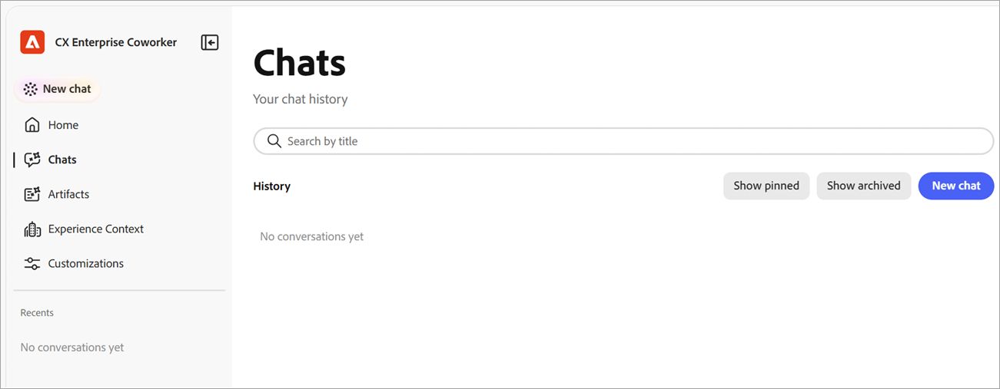
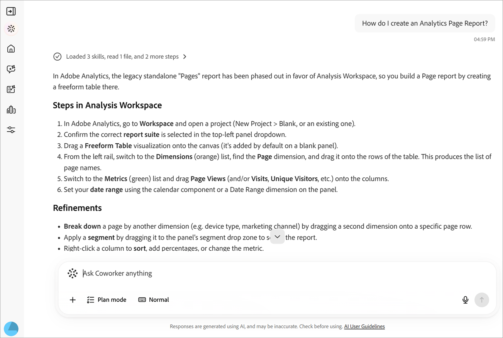

# 同僚とのチャットを始める {#ui-guide}

Coworker Chatでは、Adobe CX Enterpriseのデータやツールを使用して、必要なものを平易な言葉で求めることができます。 このページを使用して、同僚チャットを開き、最初のメッセージを送信し、作業方法を設定します。

## 対象

[!DNL Coworker] [!UICONTROL  チャット ]は、一部[!DNL CX Enterprise]個のアプリケーションで、没入型エクスペリエンス、ページ全体ワークスペース、製品内エクスペリエンスとして利用できます。

次の表に、各エクスペリエンスの利用場所を示します。

| CX Enterpriseアプリ | 没入感のある体験 | 製品体験 |
|---|---|---|
| Real-Time CDP | 今すぐ利用可能 | 近日リリース予定 |
| Adobe Journey Optimizer | 今すぐ利用可能 | 近日リリース予定 |
| Customer Journey Analytics | 今すぐ利用可能 | 今すぐ利用可能 |
| Workfront | 今すぐ利用可能 | 今すぐ利用可能 |
| Target | 今すぐ利用可能 | 今すぐ利用可能 |
| AEM | 今すぐ利用可能 | 今すぐ利用可能 |
| Marketo Engage | 今すぐ利用可能 | 近日リリース予定 |

## [!DNL Coworker]にログイン {#sign-in}

Adobeの資格情報を使用して[!DNL Coworker]にログインします。

1. [Adobe IDを使用して](https://experienceleague.adobe.com/en/docs/core-services/interface/experience-cloud#sign-in-to-cx-enterprise)CX Enterpriseにログインします。

   ログイン後、[!DNL CX Enterprise] アプリケーションメニューから、または直接リンクを使用して[!DNL Coworker]を開くことができます。

   * [!DNL CX Enterprise]内から、アプリケーションセレクターメニューをクリックし、**[!DNL Coworker]**&#x200B;をクリックします。

   * 直接リンクを使用するには、[https://experience.adobe.com/#/coworker](https://experience.adobe.com/#/coworker)に移動します。

1. チャットを開始するには、ナビゲーションパネルの「**[!UICONTROL 新しいチャット]**」をクリックします。

## 同僚とのチャットの基本を学ぶ

>[!VIDEO](https://video.tv.adobe.com/v/3498558?learn=on)

## 同僚の環境設定の指定 {#preferences}

インターフェイスの左下では、チャットでやり取りするデータ、スキル、接続されたツールを決定するオプションや環境設定を指定できます。

| 設定/ オプション | これを使用すると、次の操作を実行できます。 |
| --- | --- |
| アカウント名とメールアドレス | ログインしているAdobe アカウントを確認します。 |
| **[!UICONTROL 通知]** （ベル アイコン） | [通知](https://experienceleague.adobe.com/en/docs/core-services/interface/features/account-preferences#subscribe-to-notifications-in-experience-cloud)を表示します。 |
| **[!UICONTROL テーマ]** | 明るいテーマと暗いテーマを切り替えます。 |
| **[!UICONTROL アプリ設定]** | アカウントの詳細とワークスペースの設定を表示します。 |
| **[!UICONTROL 環境設定]** | アカウント [環境設定](https://experienceleague.adobe.com/ja/docs/core-services/interface/features/account-preferences)を開きます。 矢印は、ページが同僚の外で開くことを示します。 |
| **[!UICONTROL 組織]** | 作業するIMS [組織](https://experienceleague.adobe.com/ja/docs/core-services/interface/administration/organizations)を選択します。 メニューには現在の組織が表示され、チェックマークはリスト内で選択した組織を識別します。 |
| **[!UICONTROL サンドボックス]** | 作業するExperience Platform [ サンドボックス ](https://experienceleague.adobe.com/ja/docs/experience-platform/sandbox/home)を選択します。 メニューには、現在のサンドボックスとそのタイプ（例：**Prod**）が表示されます。 |
| **[!UICONTROL CX アプリケーション]** | アカウントに接続されている別のCX Enterprise アプリケーションに移動します。 |
| **[!UICONTROL ログアウト]** | Adobe アカウントからログアウトします。 |

## Workfrontの機能の詳細 {#interface-features}

Coworkerには、左側のナビゲーションパネルと、画面の残りの部分を埋めるチャットウィンドウの2つの主要な領域があります。 ナビゲーションパネルを折りたたんでアイコンのみを表示するには、製品名の横にある折りたたみアイコンをクリックします。

* ナビゲーションレール：

  

* チャットウィンドウ（**[!UICONTROL Chats]** ページを開いたときに表示）:

  

ナビゲーションパネルから、次の機能を使用して同僚とチャットし、最近の作業に戻ることができます。

| オプション | これを使用すると、次の操作を実行できます。 |
| --- | --- |
| **[!UICONTROL 新しいチャット]** | 会話を始める。 [!UICONTROL 同僚チャット ]は、現在のチャットを履歴に保存します。 |
| **[!UICONTROL ホーム]** | 挨拶、入力ボックス、および提案されたプロンプトに戻ります。 |
| **[!UICONTROL チャット]** | 過去の会話を検索、ピン留め、アーカイブ、削除できます。 |
| **[!UICONTROL アーティファクト]** | 会話でCoworker Chatが作成したアーティファクトを開きます。 |
| **[!UICONTROL エクスペリエンスコンテキスト]** | Adobe Workfrontを、既存のAdobeアプリケーション（Marketo Engageなど）や他のエンタープライズシステムと連携させることで、あらゆる関連する顧客データやアカウントデータにアクセスし、分析することができます。 |
| **[!UICONTROL カスタマイズ]** | スキル、統合、マーケットプレイス、プラグイン、メモリを管理します。 |
| **[!UICONTROL 最近]** | 最新の会話を開きます。 「**[!UICONTROL すべて表示]**」をクリックして、チャットページを開きます。 |
| **[!UICONTROL ピン留め]** | スターにした会話を開きます。 「**[!UICONTROL すべて表示]**」をクリックして、チャットページに表示します。 |

## Coworker に何でも尋ねる {#message}

Coworkerのホームページでは、Coworker Chatがサンドボックスで実行できることに基づいて、質問を入力したり、提案されたプロンプトを選択したりできます。

同僚に質問するには：

1. [同僚](#sign-in)を開きます。
1. 次のいずれかを実行します。

   * **[!UICONTROL 自分に対して提案]**&#x200B;の下にあるプロンプトを選択します。 Coworker Chatは入力ボックスに入力ボックスを追加し、編集できるようにします。
   * 自分のリクエストを「**[!UICONTROL 同僚に質問]**」ボックスに入力します。

1. （オプション）コンテキストを追加したり、同僚のチャットがどのように応答するかを選択したり、メッセージを指示したりします。 「[ コンテキストを追加して応答スタイルを選択](#input-options)」を参照してください。
1. 「**[!UICONTROL 送信]**」をクリックします。

>[!TIP]
>
>推奨プロンプトには、サンドボックス間のスキーマの移動、ジャーニー内の異常値の検出、データセットの検証など、Coworker Chatがサポートするタスクの種類が表示されます。

Coworker Chatをサンドボックス内の特定のオブジェクトに向けるには、入力ボックスに「**+**」と入力し、スキーマ、ジャーニー、データセット、またはその他のオブジェクトをクリックします。 これはエンティティ言及と呼ばれます。 Coworker Chatにどのオブジェクトを意味するのかを正確に伝えます。

## コンテキストを追加し、応答スタイルを選択する {#input-options}

入力ボックスの下にあるツールバーで、添付ファイル、Coworker Chatによるタスクへのアプローチ、およびタスクの表示量を制御します。

| コントロール | これを使用すると、次の操作を実行できます。 |
| --- | --- |
| **[!UICONTROL +]** （添付） | メッセージにファイルまたはサンドボックスオブジェクトを追加します。 |
| **[!UICONTROL プラン モード]** | Adobe Workfrontを利用する前に、ステップバイステップ計画を策定しましょう。 |
| **[!UICONTROL 文字起こしビュー]** （**[!UICONTROL 標準]**&#x200B;など、現在のビューでラベル付き） | Coworker Chatのアクティビティを選択します。 |
| **[!UICONTROL マイク]** | メッセージを決定。 もう一度クリックして、録画を停止します。 |
| **[!UICONTROL 送信]** （矢印アイコン） | メッセージを送信。 メッセージを入力するまで、コントロールは使用できません。 共同作業者チャットが応答している間、この制御は&#x200B;**[!UICONTROL 停止]**&#x200B;になり、応答が中断されます。 |

### ファイルまたはオブジェクトの添付

共同作業チャットで作業に必要な情報が必要な場合は、ファイルまたはオブジェクトを添付します。

1. 入力ボックスで「**[!UICONTROL +]**」をクリックします。
1. 次のいずれかをクリックします。

   * **[!UICONTROL ファイルを添付]**：同僚チャットで読み取りおよび参照するためのファイルをアップロードします。
   * **[!UICONTROL データまたはオブジェクトを追加]**: データセットやスキーマなど、サンドボックス内のオブジェクトを参照するので、Coworker Chatはライブデータに対して動作します。

### 共同作業者チャットの実行前に計画を確認する {#plan-mode}

複雑なタスクやデータを変更するタスクには、計画モードを使用します。 プランモードがオンの場合、Coworker Chatはプランを提案し、承認を待ってから実行します。 プランモードがオフになっている場合、同僚チャットはすぐに作業を開始します。

1. 入力ツールバーの「**[!UICONTROL プランモード]**」をクリックしてオンにします。
1. メッセージを送信。
1. 計画を確認し、承認して続行します。

### 文字起こしビューの選択

文字起こしビューは、会話にCoworker Chatの推論とツールのアクティビティがどれくらい表示されるかを制御します。

1. 入力ツールバーで、文字起こしビューコントロールをクリックします。 現在のビュー（**[!UICONTROL 標準]**&#x200B;など）が表示されます。
1. ビューをクリックします。

   | 表示 | 表示される内容 |
   | --- | --- |
   | **[!UICONTROL 標準]** | 主要な思考ステップとツール活動の概要。 |
   | **[!UICONTROL フォーカス]** | ほとんど答えです。 同僚チャットでは、ほとんどの中間ステップが非表示になります。 |
   | **[!UICONTROL 詳細]** | あらゆる思考ステップ、スキルの読み込み、ファイルの読み込み、クエリ。 |

## 回答をレビュー

Coworker Chatは進行状況を確認し、回答を返します。 レスポンスには、理由、使用したツールの記録、アーティファクト、概要などが含まれます。

応答が長い場合は、応答の上に表示される矢印をクリックして、最後までジャンプします。 Coworker Chatでは、入力ボックスの下に次の通知が表示されます。「応答はAIを使用して生成され、不正確になる可能性があります。 使用する前に確認してください。」 アクションを起こす前に、回答を確認します。

### アクティビティをフォロー

Coworker Chatは機能しますが、その仕組みを追跡し、検証することもできます。 **[!UICONTROL 標準]** ビューでは、そのアクティビティの1行の概要が回答の上に表示されます。例えば、「3つのスキルを読み込み、1つのファイルを読み込み、さらに2つの手順」などです。 概要をクリックして展開し、任意のエントリを展開して詳細を表示します。 エントリは次のとおりです。

* **考え**：同僚のチャットの推論と時間を含む折りたたみ可能なブロック。
* **読み込まれたスキル**: タスクに使用される特殊機能Coworker Chat。
* **ファイルの読み取り**&#x200B;および&#x200B;**実行1 クエリ**: Coworker Chatが読み取ったファイルと実行したクエリ。それぞれにかかった時間が表示されます。

>[!TIP]
>
>**[!UICONTROL 文字起こし表示]**&#x200B;を&#x200B;**[!UICONTROL 詳細]**&#x200B;に設定して各ステップを表示するか、**[!UICONTROL フォーカス]**&#x200B;に設定して非表示にします。

### アーティファクトの操作

同僚チャットは、応答にアーティファクトカードとして、オーディエンステーブルなどの結果を表示します。 テーブルアーティファクトは、カードからCSV ファイルとしてダウンロードできます。 応答に複数のアーティファクトが含まれる場合は、**[!UICONTROL 前]**&#x200B;と&#x200B;**[!UICONTROL 次]**&#x200B;を使用して、それらの間を移動します。

### 概要の使用

アーティファクトの下では、同僚のチャットが結果の意味を説明し、注目すべき結果を強調表示し、フォローアップのアクションを提案します。 これらの提案を使用して、会話を続行します。

### 回答の評価とコピー

各応答には、フィードバックの提供やコンテンツの再利用に利用できる制御が含まれています。

* **[!UICONTROL 親指を上げる]**&#x200B;または&#x200B;**[!UICONTROL 親指を下げる]**&#x200B;をクリックして、応答を評価します。 あなたの評価は、将来の回答を改善するのに役立ちます。
* 「**[!UICONTROL コピー]**」をクリックし、「**[!UICONTROL マークダウンとしてコピー]**」を選択して書式を維持するか、「**[!UICONTROL プレーンテキストとしてコピー]**」を選択して削除します。

## チャットの管理

チャット履歴は過去の会話を保存しているので、以前の会話に戻すことができます。 ナビゲーションパネルの&#x200B;**[!UICONTROL チャット]**&#x200B;をクリックして開きます。 会話は日付ごとにグループ化され、各行にはタイトルとターン数が表示されます。

チャットページでは、次のことができます。

* **[!UICONTROL タイトルで検索]**&#x200B;に名前を入力して、会話を検索します。
* **[!UICONTROL ピン留めを表示]**&#x200B;をクリックすると、スター付きの会話のみが表示されます。
* 「**[!UICONTROL アーカイブ済み会話を表示]**」をクリックして、アーカイブ済み会話を表示します。
* **[!UICONTROL 新しいチャット]**&#x200B;をクリックして、会話を開始します。

会話を固定、名前変更、アーカイブ、または削除するには、その行の行メニュー（**[!UICONTROL ...]**）をクリックし、オプションを選択します。

## 同僚とのチャットのカスタマイズ

[!UICONTROL  カスタマイズ ]は、[!UICONTROL 同僚チャット ]の機能を制御する場所です。 ナビゲーションパネルで「**[!UICONTROL カスタマイズ]**」をクリックし、タブを選択します：**[!UICONTROL スキル]**、**[!UICONTROL 統合]**、**[!UICONTROL マーケットプレイス]**、**[!UICONTROL プラグイン]**、または&#x200B;**[!UICONTROL メモリ]**。

### スキルの追加と表示

スキルとは、Coworker Chatが該当する場合に自動的に使用する特殊な機能です。 チャットで&#x200B;**/**&#x200B;と入力して、自分でスキルを開始することもできます。 「**[!UICONTROL スキル]**」タブには、インストールされているすべてのスキルが一覧表示されます。

1. 「**[!UICONTROL スキル]**」タブで、「**[!UICONTROL スキルを追加]**」をクリックして、新しいソースからスキルをインストールします。
1. **[!UICONTROL 検索]**に名前を入力して、スキルを見つけます。
表示トグルを使用して、グリッド レイアウトとリスト レイアウトを切り替えます。
1. スキルを選択すると、それが属するプラグイン、Coworker Chatが使用するプラグイン、およびそれが含まれるファイルが表示されます。

1. （オプション）「**[!UICONTROL View SKILL.md]**」をクリックして完全なスキル定義を読み取るか、「**[!UICONTROL Source]**&#x200B;を削除」をクリックしてスキルをアンインストールします。

### サーバーへの接続 {#server}

Server a integrationは、Coworker Chatを、Adobe Journey Optimizer、Real-Time CDP、Target、Workfrontなどの外部ツールやサービスに接続します。

1. **[!UICONTROL カスタマイズ]** > **[!UICONTROL ユーザー]** > **[!UICONTROL 統合]**&#x200B;に移動します

   

   「**[!UICONTROL 統合]**」タブには、接続されているサーバーとアクティブな接続数が一覧表示されます。 各カードには、サーバー名、そのエンドポイント、およびそれが提供するものを説明するタグが表示されます。

1. カスタマイズで、**[!UICONTROL サーバーを追加]**&#x200B;をクリックします。

   

1. 次のフィールドとオプションを入力します。

   * **[!UICONTROL サーバー名]** （必須）：統合のリストでサーバーを識別する名前（例：`github`または`slack`）を入力します。
   * **[!UICONTROL SourceのURLまたはコマンド]** （必須）:Coworker Chatが接続するアドレス（例：`https://mcp.example.com/sse`）を入力します。
   * **[!UICONTROL 接続タイプ]**: サーバーがCoworker Chatとの通信に使用するプロトコル（**[!UICONTROL SSE]** （サーバー送信イベント）または&#x200B;**[!UICONTROL HTTP]**）を選択します。 デフォルトは&#x200B;**[!UICONTROL SSE]**&#x200B;です。
   * **[!UICONTROL ツールのタイムアウト （秒）]**：このサーバー上のツールがリクエストを停止するまでの応答をCoworker Chatが待機する時間を設定します。 デフォルトは60秒です。
   * **[!UICONTROL 認証]**: Coworker ChatがIDをサーバーに証明する方法を選択します。 デフォルトは&#x200B;**[!UICONTROL None]**&#x200B;で、資格情報は送信されません。 サーバーに資格情報が必要な場合は、別の方法を選択します。
   * **[!UICONTROL ヘッダー]**:「**[!UICONTROL ヘッダーを追加]**」をクリックして、API キーなどの追加のHTTP ヘッダーを、すべてのリクエストと共にサーバーに送信します。 このオプションはオプションです。

1. 「**[!UICONTROL 追加]**」をクリックします。

### マーケットプレイスを追加

マーケットプレイスとは、参照してインストールできるプラグインのレジストリのことです。 「**[!UICONTROL マーケットプレイス]**」タブで、「**[!UICONTROL マーケットプレイスを追加]**」をクリックして、新しいマーケットプレイスを登録します。 **[!UICONTROL 検索]**&#x200B;を使用するか、グループで絞り込んでリストを絞り込みます。 **Ready** ステータスのマーケットプレイスをインストールできます。

### プラグインを管理

プラグインは、スキルとサーバーをバンドルして、それらを一緒にインストールして管理できるようにします。 「**[!UICONTROL プラグイン]**」タブに、インストール済みのプラグインが表示されます。

* 「**[!UICONTROL マーケットプレイスを参照]**」をクリックして、新しいプラグインを探します。
* マーケットプレイスでフィルタリングして、各プラグインのソースを確認できます。
* 「**[!UICONTROL アンインストール]**」をクリックして、プラグインとそのバンドルを削除します。

### メモリを管理

メモリにより、同僚のチャットは会話の全体でユーザーの好みを記憶できるため、応答は時間の経過とともに関連性を維持します。 「**[!UICONTROL メモリ]**」タブを使用して、保持する内容を制御します。

1. カスタマイズ ページの&#x200B;**[!UICONTROL メモリ]**&#x200B;をクリックします。
1. **[!UICONTROL メモリを有効にする]**&#x200B;をオンにします。 セッション間でCoworker Chatが記憶されないようにするには、これをオフにします。
1. **[!UICONTROL 保存された環境設定]**&#x200B;で、共同作業者チャットが保存した内容を確認します。 各エントリを編集、削除または検査したり、カテゴリ別にエントリをフィルタリングしたりできます。
1. **[!UICONTROL 保存済みメモリ履歴]**&#x200B;を使用して、メモリの変更のタイムラインを表示します。

