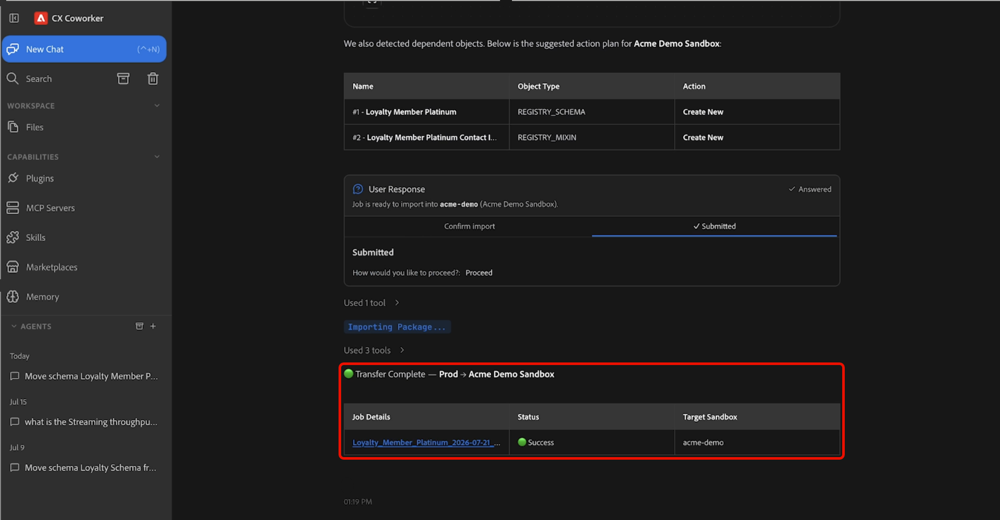

# エージェント型スキルのサンドボックスツール

>[!AVAILABILITY]
>
>サンドボックスツール エージェンティックスキルは、Adobe CX Enterprise Coworkerにアクセスできるすべてのお客様が利用できます。 利用可能なすべての機能を使用するには、次の権限が必要です。
>
>**Manage-sandbox**&#x200B;または&#x200B;**View-sandbox**：これらの権限を使用すると、サンドボックスツールのエージェント型スキルを使用して、Coworkerで直接サンドボックスを表示できます。
>
>**Manage-package**：この権限を使用すると、サンドボックスツールのエージェント型スキルを使用して、Coworkerで直接パッケージを作成できます。

サンドボックスツール エージェンティックスキルを使用して、自然言語で達成したい目標を記述することで、Adobe Experience Platform環境全体でサポートされているオブジェクトタイプを移動します。 Coworkerを使用すると、必要なメタデータの検索、依存関係の自動特定、移行パッケージの作成、オブジェクトの移行を会話型エクスペリエンスで行うことができます。

>[!VIDEO](https://video.tv.adobe.com/v/3496709?captions=jpn&learn=on)

## 前提条件 {#prerequisites}

始める前に、次のことを確認してください。

- 適切な組織やサンドボックスにAdobe Experience Platformからアクセスできます。
- 検出または移行するオブジェクトへのアクセス。
- CoworkerにインストールされたAdobe CXO プラグイン。

プラグインのインストール手順については、[Coworker UI ガイド &#x200B;](https://experienceleague.adobe.com/ja/docs/cx-enterprise-ai/experience-cloud-ai/coworker/chat/ui-guide)を参照してください。

## エージェント型スキルのサンドボックスツールの使用 {#use-sandbox-tooling-agentic-skills}

自然言語を使用して、Coworkerを通じてサンドボックスツールのエージェント型スキルを操作します。 目標をできるだけ明確に記述する： 特定のリクエストは最も優れた結果を生み出します。一方、プロンプトが曖昧であったり過剰に短かったりすると、質の低い結果が返されたり、エージェントが呼び出されないことがあります。

サンドボックスツールのエージェント型スキルを使用するには：

1. **[!UICONTROL CX Coworker]**&#x200B;に移動します。
1. 達成したい目標を明確に記述します。 次に例を示します。

   *&quot;スキーマ ロイヤルティ メンバーのプラチナを現在のサンドボックスからAcme デモ サンドボックスに移動します。&quot;*

1. 結果テーブルを確認して、ソースとターゲットのサンドボックスを表示します。 続行する準備ができたら、**[!UICONTROL 続行]**&#x200B;を選択し、**[!UICONTROL 送信]**&#x200B;を選択して確認します。

   

1. 移行する1つ以上のオブジェクトを選択し、**[!UICONTROL 送信]**&#x200B;を選択します。

   送信を強調表示する

1. エージェントが操作アクションを識別するオブジェクトと依存関係を確認し、*新規作成*&#x200B;または&#x200B;*既存の*&#x200B;を使用します。 移行を開始する準備ができたら、**[!UICONTROL 続行]**&#x200B;を選択し、**[!UICONTROL 送信]**&#x200B;を選択して確認します。 移行が完了するまでに数分かかる場合があります。

   

1. 移行が完了すると、選択したオブジェクトがターゲットサンドボックスで使用できるようになります。

   

Coworkerの使用について詳しくは、[Coworker UI ガイド &#x200B;](https://experienceleague.adobe.com/ja/docs/cx-enterprise-ai/experience-cloud-ai/coworker/chat/ui-guide)を参照してください。

## サポートされるユースケース {#supported-use-cases}

サンドボックス管理とメタデータの移行を簡素化するために、サンドボックスツールのエージェント型スキルを使用する一般的な方法について説明します。

### サンドボックス間でのオブジェクトメタデータの移動

複数のAdobe Experience Platform サンドボックスを管理するサンドボックス管理者は、ユーザーインターフェイスを手動で移動する代わりに、自然言語リクエストを使用してオブジェクトメタデータを移行できます。

Coworkerを使用すると、サポートされているAdobe Experience Platform オブジェクトと関連するメタデータを、あるサンドボックスから別のサンドボックスに自然言語で移行できます。 サンドボックスツール エージェンティックスキルは、依存関係を自動的に識別し、必要なオブジェクトをパッケージ化し、環境間で信頼性の高い移行を確実に行うのに役立ちます。

次に例を示します。

- 「スキーマ Luma Loyalty Members Platinumを現在のサンドボックスから実稼動サンドボックスに移動します。」

### 複数のサンドボックスへのオブジェクトの昇格（Beta）

>[!NOTE]
>
>マルチサンドボックス管理は現在Betaにあり、スキーマとデータセットのみをサポートしています。

サンドボックス管理者は、1つのワークフローで、ソースサンドボックスから複数のターゲットサンドボックスにサポート対象オブジェクトを昇格できます。 各サンドボックスにパッケージを個別に読み込むのではなく、Coworkerを使用してターゲットサンドボックスを選択し、提案された変更を確認し、環境全体で一貫性のある設定をデプロイします。 マルチサンドボックス管理では、依存関係を自動的に解決し、変更のプレビューをプロモーションの開始前に表示します。

次に例を示します。

- 「地域のすべてのサンドボックスにロイヤルティメンバースキーマを宣伝する」

### サンドボックス間でのオーディエンスのプロモーション

サンドボックス管理者は、手動で再作成または再構成することなく、環境間でオーディエンスをプロモートできます。

次に例を示します。

- 「ステージングサンドボックスに「オーディエンス名」オーディエンスを昇格します。」

サンドボックスツール エージェンティックスキルは、指定されたオーディエンスを特定し、その依存関係を検証し、必要なすべてのオブジェクトをターゲットサンドボックスに移行します。

## サンプルプロンプト {#example-prompts}

サンドボックスツールのエージェント型スキルを操作する場合は、次のプロンプトを例として使用します。

### スキーマプロンプト

スキーマ名と宛先サンドボックスがわかっている場合は、これらのプロンプトを使用します。

- 「現在のサンドボックスから実稼動サンドボックスにスキーマ「スキーマ名」を移動します。」

### オーディエンスプロンプト

オーディエンス名がわかっている場合は、これらのプロンプトを使用します。

- 「ステージングサンドボックスに「オーディエンス名」オーディエンスを昇格します。」

## 次の手順 {#next-steps}

このガイドでは、サンドボックスツールのエージェント型スキルを使用して、サポートされているオブジェクトをサンドボックス間で検索、パッケージ化、移行する方法を説明します。

サンドボックスツールについて詳しくは、[&#x200B; サンドボックスツールガイド &#x200B;](https://experienceleague.adobe.com/ja/docs/experience-platform/sandbox/ui/sandbox-tooling)を参照してください。

