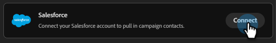

# Salesforceに接続 {#salesforce}

Coworker for teamsを使用すると、Salesforce アカウントを接続してリードと連絡先にアクセスできます。

>[!PREREQUISITES]
>
>このコネクタを使用するには、まず次の要素が必要です。
>
>* アクティブなSalesforce アカウント
>* Salesforceの次の権限：`api`、`sobjects.Contact.read`、`sobjects.Campaign.read`、`sobjects.CampaignMember.read`
>* Salesforce インスタンス URL、[&#x200B; クライアント ID、およびクライアント シークレット &#x200B;](https://help.salesforce.com/s/articleView?id=xcloud.remoteaccess_oauth_client_credentials_flow.htm&type=5#:~:text=DESCRIPTION-,client_id,-The%20consumer%20key){target="_blank"}を便利に使用できます

## つながる方法

1. [Coworker for teamsのホームページ &#x200B;](https://coworker-campaigns.experience.adobe.com/){target="_blank"}で、**Context**&#x200B;をクリックし、**Connectors**&#x200B;を選択します。

   

1. 「**統合を追加**」をクリックします。

   

   >[!NOTE]
   >
   >最初の統合ではない場合は、「コネクタを追加」というボタンが表示されます。

1. Salesforce行で、**Connect**&#x200B;をクリックします。

   

1. Salesforce **インスタンス URL**、**クライアント ID**、**クライアントシークレット**&#x200B;を入力します。 「**接続**」をクリックします。

   >[!NOTE]
   >
   >* Salesforceでは、Client ID = Consumer KeyおよびClient secret = Consumer Secretです。
   >
   >* Salesforce アカウントでは、ブラウザーのアドレスバーでインスタンス URLを見つけるか、**設定** > **会社設定** > **マイドメイン**&#x200B;に移動します。

   

接続後、Salesforceはコネクターリストに表示され、Salesforceから同期するリードまたは連絡先リストをリンクするときに選択できます。

**切断するには：**

1. コネクタ画面で、Salesforce タイルを見つけ、**管理**&#x200B;をクリックします。

   「管理」ボタンがハイライト表示されたSalesforceと接続されていることを示す

1. 「**切断**」をクリックします（現時点ではクライアント秘密鍵を再入力する必要はありません）。

   

1. 「**切断**」をもう一度クリックして確認します。

   
