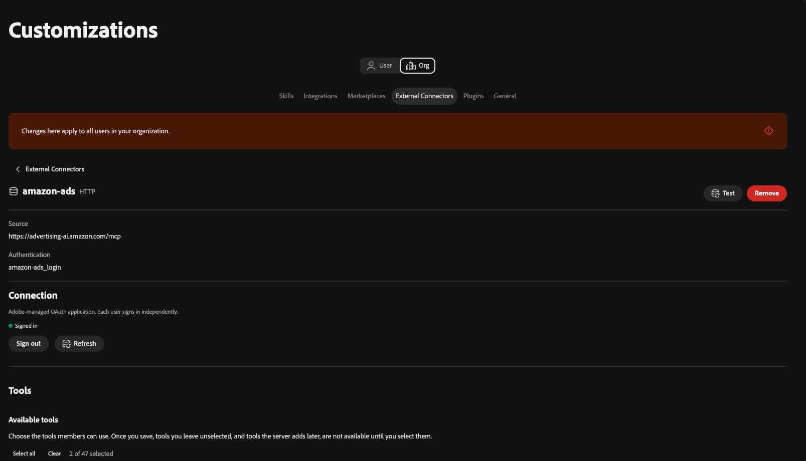

# Amazon Ads外部コネクタ {#amazon-ads}

[!DNL Amazon Ads]外部コネクタを使用して、Adobe CX Enterprise Coworkerで[!DNL Amazon Ads] データを操作します。 コネクタを設定したら、Coworkerにアクセスできる広告アカウントを確認し、キャンペーン、レポート、請求、その他のアカウント情報を確認します。 コネクタは、[!DNL Amazon]によってホストされているモデル コンテキスト プロトコル （MCP） サーバーです。

>[!AVAILABILITY]
>
>[!DNL Amazon Ads]外部コネクタはベータ版です。 ドキュメントと機能は変更される場合があります。

## コネクタ設定 {#connector-configuration}

コネクタ設定プロセスには、次の3つの部分があります。

* **[!DNL Amazon]準備：** [!DNL Amazon Ads] アカウント管理者は、各メンバーに必要な広告アカウントへのアクセス権を付与します。 組織が独自のOAuth アプリを使用する場合、アプリ所有者はその承認を確認し、Coworker リダイレクト URLを登録します。
* **組織の設定：**&#x200B;共同作業者の管理者は、組織全体に対して1回コネクタを設定します。 管理者は、地域、OAuth アプリケーション、およびメンバーが使用できるツールを選択します。
* **メンバーのログイン：**&#x200B;各メンバーは、自分の[!DNL Amazon] アカウントでログインします。 メンバーは、自分の[!DNL Amazon] アカウントが使用する権限を持つ広告アカウントのみにアクセスできます。

組織設定を保存しても、メンバーはログインせず、[!DNL Amazon Ads]権限も付与されません。 各メンバーは既に[!DNL Amazon Ads]で必要なアクセス権を持っており、個別にサインインする必要があります。

## 前提条件 {#prerequisites}

始める前に、次の項目を確認してください。

* **同僚アクセス：**&#x200B;組織コネクタを管理する権限を持つアカウントで、[!DNL Amazon Ads] コネクタが使用可能な組織内にあります。
* **Advertising アカウント：**&#x200B;使用する予定の広告アカウントとそのリージョン [!DNL Amazon Ads]、およびそれらのアカウントに必要な権限を持つメンバー。 詳しくは、[広告アカウントへのアクセス権の付与](#grant-member-access)を参照してください。
* **OAuth アプリケーションの決定：**&#x200B;次のオプションのいずれかを選択します。
  * **Adobeで管理されているOAuth アプリケーション：** Adobeは、アプリ登録とその資格情報を管理します。 管理対象アプリは、ご使用の環境で利用できる必要があります。
  * **独自のOAuth アプリケーション：** [!DNL Amazon Ads] API用に承認された[!DNL Login with Amazon] アプリ、そのOAuth クライアント IDとクライアント秘密鍵、およびそのセキュリティ プロファイルを編集できる管理者。 登録されたセキュリティプロファイルだけでは[!DNL Amazon Ads] API承認を付与できません。

ガイド付き設定では、組織ごとに1つの[!DNL Amazon Ads]接続と1つの地域をサポートしています。 各メンバーは、自分の[!DNL Amazon] アカウントでログインします。 Adobeで管理されているアプリは、共有アプリの登録であり、共有[!DNL Amazon] アカウントではありません。

## Amazon アクセスの準備 {#prepare-amazon}

Coworkerでコネクタを設定する前に、[!DNL Amazon]でアプリとアカウントへのアクセスを準備してください。 アプリの設定と広告データへのアクセスは分離されています。 コネクタを使用するメンバーは、アプリを編集する権限を必要としません。

### アプリの承認を確認 {#confirm-app-approval}

独自のOAuth アプリケーションを使用する場合は、アプリケーション所有者に正しい[!DNL Login with Amazon] セキュリティ プロファイルとその[!DNL Amazon Ads] API承認を確認するように依頼します。 セキュリティ プロファイルを作成するか、[!DNL Amazon]開発者コンソールでアプリを表示しても、[!DNL Amazon Ads] API承認は置き換えられません。 詳しくは、[!DNL Amazon Ads] ドキュメントの「[Amazon Ads MCPの概要](https://advertising.amazon.com/API/docs/en-us/mcp/get-started)」および「[OAuth](https://advertising.amazon.com/API/docs/en-us/mcp/oauth)を使用したAds MCP Serverへの接続」を参照してください。

自分のアプリの場合、Coworkerは次の設定を自動的に適用します。 これらの値は、設定ダイアログには入力しません。

| 設定 | 値 |
| --- | --- |
| 認証 URL | `https://lwa.amazon.com/ap/oa` |
| トークン URL | `https://api.amazon.com/auth/o2/token` |
| 要求された範囲 | `advertising::campaign_management` |
| コード交換用プルーフキー（PKCE） | 有効 |
| トークンエンドポイントクライアント認証 | `client_secret_post`様を機密クライアントとして |
| 動的なクライアント登録 | サポートなし |
| トランスポートとツールのタイムアウト | ストリーミング可能なHTTP、60秒 |

Adobeで管理されているOAuth アプリケーションを使用する場合、Adobeはアプリの登録とその資格情報を管理します。 この手順を完了したり、アプリの資格情報を入力したりする必要はありません。

### リダイレクト URLを登録 {#register-redirect-url}

独自のOAuth アプリケーションを使用する場合は、[!DNL Login with Amazon] アプリにCoworker リダイレクト URLを登録します。

1. Coworkerで、[Configure the connector for your organization](#configure-organization)の説明に従って、**[!UICONTROL Configure Amazon Ads for your organization]** ダイアログを開きます。 「**[!UICONTROL 独自のOAuth アプリケーションを使用]**」を選択して&#x200B;**[!UICONTROL リダイレクト URL]**&#x200B;を表示し、完全な値をコピーします。
1. [Amazon コンソールを使用してログイン ](https://developer.amazon.com/loginwithamazon/console/site/lwa/overview.html)で、アプリのセキュリティプロファイルを見つけます。 **[!UICONTROL 管理]** / **[!UICONTROL Web設定]**&#x200B;を選択し、**[!UICONTROL 編集]**&#x200B;を選択します。
1. **[!UICONTROL 許可されたリターン URL]**&#x200B;の下に完全なリダイレクト URLを追加し、保存します。 他のチームがアプリを共有する場合は、設定を変更する前に、既存のURLを保持し、アプリ所有者から承認を得る必要があります。
1. 同じセキュリティプロファイルのOAuth クライアント IDとクライアントシークレットに注意してください。 コネクタを[設定](#configure-organization)するときに入力します。

設定している環境の同僚ダイアログからリダイレクト URLを常にコピーします。 自分でURLを作成したり、ブラウザーでCoworker ページのURLを使用したり、別の環境やMCP クライアントからリダイレクト URLを再利用したりしないでください。 詳しくは、[!DNL Amazon] ドキュメントの「[Amazonでログインする登録](https://developer.amazon.com/docs/login-with-amazon/register-web.html)」を参照してください。

>[!NOTE]
>
>**[!UICONTROL リダイレクト URL]**&#x200B;にパス `/connectors/oauth/callback`のみが表示されている場合、ご使用の環境では、このコネクタのログインはまだサポートされていません。 パスの一部を登録したり、ホスト名を推測したりしないでください。 アドビ担当者にお問い合わせください。

### 広告アカウントへのアクセス権を付与 {#grant-member-access}

[!DNL Amazon Ads] アカウント管理者は、各メンバーを必要な広告アカウントに招待します。

1. [Amazon Ads コンソール ](https://advertising.amazon.com/)を開き、**[!UICONTROL アカウントの変更]**&#x200B;を選択して、広告主またはマネージャーのアカウントを選択します。
1. **[!UICONTROL 管理]** > **[!UICONTROL アカウントのアクセスと設定]** > **[!UICONTROL ユーザー]** > **[!UICONTROL ユーザーの招待]**&#x200B;を選択します。 正確なオプションは、アカウントのタイプによって異なります。 メンバーの[!DNL Amazon] アカウントを、予定しているタスクに対する最低限の権限で招待します。
1. マネージャーアカウントの場合、アクセスがマネージャーアカウント全体をカバーしているか、選択したリンクされた広告主のみをカバーしているかを確認します。 メンバーに、Coworkerに使用するのと同じ[!DNL Amazon] アカウントで招待を受け入れるように依頼します。
1. メンバーが[!DNL Amazon Ads]で広告主を選択できることを確認してください。 承認された社内レコードに、予想されるアカウント名、地域、および広告主IDを記録しておくと、後でCoworkerでアクセスを確認できます。

計画するタスクをサポートする最小権限の役割を選択します。 アクセス確認を成功させるためだけに、管理者にアクセス権を付与しないでください。 [!DNL Amazon Marketing Cloud] インスタンスへのアクセスは、広告主キャンペーンへのアクセスとは別です。 詳しくは、次の[!DNL Amazon Ads] ドキュメントを参照してください。

* [Manager アカウントでのユーザーの管理](https://advertising.amazon.com/help/G4M4JGKGV2VAY9JC)
* [アカウントにユーザーを追加または削除する](https://advertising.amazon.com/help/GDQVHVQMY9F88PCA)
* [アカウント権限について](https://advertising.amazon.com/help/GM4EFDQQPG9LGL3F)
* [Amazon Ads API権限](https://advertising.amazon.com/API/docs/en-us/guides/account-management/permissions)

## 組織のコネクタの設定 {#configure-organization}

管理者は、組織内のすべてのユーザーが[!DNL Amazon Ads] コネクタを利用できるようにします。 組織ページの変更は、組織内のすべてのユーザーに適用されます。 メンバーは、**[!UICONTROL User]** スコープから組織接続を設定できません。

1. **[!UICONTROL カスタマイズ]**&#x200B;を開き、**[!UICONTROL 組織]**&#x200B;を選択してから、**[!UICONTROL 外部コネクタ]**&#x200B;を選択します。 **[!UICONTROL Amazon Ads]** カードで、**[!UICONTROL Configure]**&#x200B;を選択します。

   組織の&#x200B;**[!UICONTROL Amazon Adsの設定]** ダイアログが開き、**[!UICONTROL 接続の詳細]**、**[!UICONTROL ユーザーが利用できるツール]**、および&#x200B;**[!UICONTROL アクセスと権限]**&#x200B;のセクションが表示されます。 設定を保存すると、カードに&#x200B;**[!UICONTROL 設定が保存され]**、**[!UICONTROL 設定]**&#x200B;が&#x200B;**[!UICONTROL 設定を表示]**&#x200B;に変更されたことが表示されます。

1. **[!UICONTROL Amazon Ads region]**&#x200B;で、広告アカウントに一致するリージョンを選択します。 Coworkerは、選択範囲の下の領域のMCP サーバーのURLを表示します。

   | 地域 | MCP サーバーURL |
   | --- | --- |
   | [!UICONTROL 北米] （デフォルト） | `https://advertising-ai.amazon.com/mcp` |
   | [!UICONTROL  ヨーロッパ ] | `https://advertising-ai-eu.amazon.com/mcp` |
   | [!UICONTROL 極東] | `https://advertising-ai-fe.amazon.com/mcp` |

   ガイド付き設定により、1つの領域が保存されます。 後で領域を切り替えるには、接続を削除して、もう一度設定します。 その後、すべてのメンバーが再度ログインする必要があるので、作業中の接続を中断する前に変更を計画してください。

1. **[!UICONTROL OAuth アプリケーション]**&#x200B;を選択します。

   * **[!UICONTROL Adobeで管理されているOAuth アプリケーション ]:** Adobeは[!DNL Amazon Ads] アプリを提供しているので、アプリの資格情報を入力する必要はありません。 各メンバーは自分の[!DNL Amazon] アカウントでログインし、Adobe アプリを承認します。

     {width="500" zoomable="yes"}

   * **[!UICONTROL 独自のOAuth アプリケーションを使用]:**&#x200B;各メンバーは、独自の[!DNL Amazon] アカウントで組織アプリを承認します。 **[!UICONTROL お使いのAmazon アプリケーション]**&#x200B;で、次の手順を実行します。

     1. **[!UICONTROL リダイレクト URL]**&#x200B;がアプリに登録されていることを確認してください。 詳しくは、[ リダイレクト URLの登録](#register-redirect-url)を参照してください。
     1. **[!UICONTROL Amazon アプリ ID]**&#x200B;と&#x200B;**[!UICONTROL Amazon アプリ シークレット]**&#x200B;を入力します。 **[!UICONTROL Amazon アプリ ID]** フィールドは、広告主ID、マネージャーアカウント ID、または[!DNL Amazon] アプリケーション IDではなく、OAuth クライアント IDを取得します。 共同作業者は、組織の秘密鍵として入力した値を保存します。
     1. 保存された資格情報を代わりに再利用するには、**[!UICONTROL 既存の秘密鍵を使用]**&#x200B;を選択します。 次に、アプリ ID ]**を保持する**[!UICONTROL &#x200B;秘密鍵と、アプリ秘密鍵&#x200B;]**を保持する**[!UICONTROL &#x200B;秘密鍵を選択します。 組織にまだシークレットがない場合は、**[!UICONTROL 設定]**/**[!UICONTROL シークレット]**&#x200B;にシークレットを追加します。

     両方の資格情報が必要です。 安全なフィールドにのみ資格情報の値を入力してください。 プレーン値フィールドに秘密参照を入力しないでください。

1. ユーザーが利用できる&#x200B;**[!UICONTROL ツール]**&#x200B;の下で、各ツールグループを展開し、組織に必要なツールを選択します。 デフォルトでは、`ads_accounts-list_ads_accounts`と`ads_accounts-get_ads_account`のツールのみが選択されています。 すべてのツールを一度に変更するには、**[!UICONTROL すべてを選択]**&#x200B;または&#x200B;**[!UICONTROL すべてをクリア]**&#x200B;を使用します。 少なくとも1つのツールを選択してください。

   最初のアクセス確認のために、2つのアカウントツールから開始します。 キャンペーンツールとレポートツールは、組織が必要とし、承認する場合にのみ選択します。 詳しくは、[ ツールグループ ](#tool-groups)を参照してください。

1. **[!UICONTROL 接続を保存]**&#x200B;を選択し、保存された&#x200B;**[!UICONTROL amazon-ads]** コネクタの詳細を確認します。

   | 設定 | 説明 |
   | --- | --- |
   | **[!UICONTROL ソース]** | 選択した地域のMCP サーバーのURL。 |
   | **[!UICONTROL 認証]** | 認証方法`amazon-ads_login`。 |
   | **[!UICONTROL ツールのタイムアウト]** | 同僚がツールの応答を待つ時間。 |
   | **[!UICONTROL 接続]** | 使用中のOAuth アプリケーションと独自のサインインステータス。 |
   | **[!UICONTROL ツール]** | メンバー用に選択されたツールで、**[!UICONTROL すべてを選択]**&#x200B;および&#x200B;**[!UICONTROL クリア]** コントロールと選択されたツールの数が含まれています。 |

   {width="700" zoomable="yes"}

保存中は、あなたまたはメンバーが[!DNL Amazon]にログインしていません。 コネクタの詳細の&#x200B;**[!UICONTROL 接続]** ステータスは、組織ではなく、自分の接続を参照します。 接続を確認するには、コネクタの詳細ページで「**[!UICONTROL ログイン]**」を選択し、自分の[!DNL Amazon] アカウントでログインしてから「**[!UICONTROL テスト]**」を選択します。 結果は、**[!UICONTROL 接続が成功しました]**&#x200B;または&#x200B;**[!UICONTROL 接続が失敗しました]**&#x200B;と表示され、ツールまたはエラーが返されます。 成功した結果は、特定の広告主操作へのアクセスを確認しません。

後でメンバーが利用できるツールを変更するには、**[!UICONTROL 利用可能なツール]**&#x200B;の下の選択を&#x200B;**[!UICONTROL すべて選択]**&#x200B;または&#x200B;**[!UICONTROL クリア]**&#x200B;し、**[!UICONTROL ツール選択を保存]**&#x200B;を選択して更新します。 少なくとも1つのツールを選択したままにする必要があります。 メンバーはツール選択を変更できません。

組織へのコネクタの提供を停止するには、コネクタの詳細ページで「**[!UICONTROL 削除]**」を選択します。

### ツールグループ {#tool-groups}

[!DNL Amazon Ads] コネクタは、ツールを次のグループに整理します。

| ツールグループ | ツール | ツールの機能 |
| --- | --- | --- |
| [!UICONTROL  キャンペーンの管理とターゲティング ] | 7 | キャンペーン、広告グループ、広告、ターゲット、ポートフォリオ、その関連を照会し、製品の適格性をチェックできます。 |
| [!UICONTROL  アカウントと組織] | 6 | 広告アカウントの一覧表示と取得、広告主とアカウントのリンクのクエリ、マネージャーアカウント、テストアカウント。 |
| [!UICONTROL  ユーザーアクセスとセキュリティ ] | 5 | ユーザー、役割、権限、招待状を一覧表示し、招待状を取得します。 |
| [!UICONTROL レポートと分析] | 1 | レポートを取得します。 レポート作成は含まれていません。 |
| [!UICONTROL Amazon Marketing Cloud] | 6 | ワークフローとデータソースの読み取り、既存の実行のステータスとダウンロード URL。 ワークフロー実行は含まれません。 |
| [!UICONTROL 請求と財務の概要] | 4 | 請求書、請求書の概要、請求プロファイルの使用状況、および請求通知を読み取ります。 |
| [!UICONTROL Amazon ライブ ] | 12 | チャネル、放送、ライブストリーム、メディア、カルーセル、プロモーションコード情報を読み取ります。 |
| [!UICONTROL 実施要件とオファー] | 6 | プログラムと製品の適格性、プロモーションオファーと報酬、条件トークン情報をご確認ください。 |

各グループのツールは、[!DNL Amazon]がコネクタを更新すると変更される可能性があります。 ガイド付き設定では、すべてのツールを選択した場合でも、選択したツールの正確なリストが保存されます。 選択せずに残したツールと、後でサーバーが追加したツールは、ユーザーが選択するまでメンバーは使用できません。

>[!IMPORTANT]
>
>セットアップツールリストは、データを読み取るためにキュレートされますが、コネクタ全体は読み取り専用ではありません。 メンバーは、セットアップ リストよりも幅広い`advertising::campaign_management` スコープを承認します。 接続をテストする際、ツールリストには、サーバーが返すツールも含めることができます。 その他のツールを選択する前に、各ツールの定義とメンバーの[!DNL Amazon Ads]権限を確認してください。

## メンバーとしてログイン {#sign-in-as-a-member}

管理者がコネクタを設定すると、各メンバーは自分の[!DNL Amazon] アカウントでサインインします。 ログインにアプリの秘密鍵またはアクセストークンは必要ありません。

>[!NOTE]
>
>コネクタから、お使いの環境でログインと&#x200B;**[!UICONTROL テスト]**&#x200B;がまだ利用できないことが通知された場合は、ここで停止します。 組織の設定だけでは、メンバーのログインを利用できません。 アドビ担当者にお問い合わせください。

1. **[!UICONTROL カスタマイズ]**&#x200B;を開き、**[!UICONTROL ユーザー]**&#x200B;を選択してから、**[!UICONTROL 外部コネクタ]**&#x200B;を選択します。 **[!UICONTROL Amazon Ads]** カードを検索します。

1. カードに「**[!UICONTROL 未設定]**」と表示されている場合は、管理者に「[ コネクタを設定](#configure-organization)」するように依頼します。 メンバーはコネクタを設定できません。

1. カードに「**[!UICONTROL ログインしていません]**」と表示されたら、「**[!UICONTROL ログイン]**」を選択します。 サインイン ポップアップを許可してから、広告アカウントにアクセスできる[!DNL Amazon] アカウントでログインします。

1. 多要素認証（MFA）などの[!DNL Amazon]認証プロンプトと同意プロンプトを完了します。 承認する前に、アプリ名と必要なアクセス権を確認してください。

   Adobeで管理されるアプリを使用すると、Adobe アプリを認証できます。 独自の組織アプリでは、代わりにそのアプリを承認します。

   >[!IMPORTANT]
   >
   >アプリを認識し、組織がリクエストされたアクセスを承認した場合にのみ続行します。

1. 同僚に戻り、カードに&#x200B;**[!UICONTROL ログイン]**&#x200B;と表示されていることを確認します。 **[!UICONTROL 詳細を表示]**&#x200B;を選択し、管理者&#x200B;]**が有効にした**[!UICONTROL  ツールを確認します。 メンバーはツールを表示できますが、ツールを変更したり、組織接続を削除したりすることはできません。

1. **[!UICONTROL テスト]**&#x200B;を選択して、ツールの検出と接続ステータスを確認します。

閉じたポップアップだけでは、ログインが成功したことを確認できません。 テストが成功しても、すべての広告主、キャンペーン、レポート、または[!DNL Amazon Marketing Cloud] インスタンスへのアクセスが確認されるわけではありません。 管理者がログインすると、他のメンバーはログインしません。

[!DNL Amazon] アカウントをコネクタから切断するには、**[!UICONTROL ログアウト]**&#x200B;を選択します。

## 広告アカウントへのアクセスを確認する {#check-account-access}

使用できる広告アカウントを確認するには、読み取り専用チェックを実行します。 承認済みテストアカウントを使用し、管理者が`ads_accounts-list_ads_accounts`および`ads_accounts-get_ads_account` ツールを有効にしていることを確認してください。 チャットを開始し、プロンプトを入力します。

プロンプトの例：

* 「Amazon Adsを使用して、設定済みのリージョンでアクセスできる広告アカウントを5つまでリストアップします。 これらのフィールドが返された場合は、アカウント名、アカウント ID、および地域のみを表示します。 ワークフローの作成、更新、削除、起動、実行、レポートの生成、権限の変更は行わないでください。 リストの制限がサポートされていない場合は、5つの結果のみを要約し、追加のページを要求しないでください。」

結果に期待するアカウントが含まれていることを確認します。 詳細を表示するには、結果のアカウント IDを使用して、Coworkerにそのアカウントの詳細を取得するように依頼します。 アカウント IDを推測しないでください。また、ログインをテストするためだけにキャンペーンをリクエストしないでください。

空のアカウントリストは、必ずしもコネクタが機能していないことを意味するわけではありません。 ログインした[!DNL Amazon] アカウント、許可された招待、マネージャーアカウントがカバーするリンクされた広告主、設定された地域を確認します。 キャンペーンのないテストアカウントは、空のキャンペーンリストを返すこともできます。 必要なツールが有効になっていない場合は、管理者に問い合わせてください。 代用としてデータを変更するツールを使用しないでください。

## アクセスのトラブルシューティング {#troubleshoot-access}

[!DNL Amazon Ads] データにアクセスできない場合は、管理者に次の点を確認してください。

| 問題 | 確認すべきこと |
| --- | --- |
| **[!UICONTROL Amazon Ads]** カードまたは&#x200B;**[!UICONTROL Configure]**&#x200B;がありません | コネクタが組織で使用可能であること、および組織コネクタを管理する権限があることを確認します。 メンバーは組織の設定を待つ必要があります。 |
| Adobeで管理されている設定は保存されますが、ログインは失敗します | Adobeの担当者に問い合わせて、Adobeで管理されるアプリがお客様の環境で利用できることを確認してください。 保存が成功しても、この内容は確認されません。 |
| リダイレクト URLが一致しません | 共同作業者ダイアログの完全な&#x200B;**[!UICONTROL リダイレクト URL]**&#x200B;と、スキーム、ホスト、パスを含む[!DNL Login with Amazon]の&#x200B;**[!UICONTROL 許可リターン URL]**&#x200B;を比較します。 別のMCP クライアント、地域、環境からのリダイレクト URL、またはブラウザーのCoworker ページのURLは使用しないでください。 |
| **[!UICONTROL リダイレクト URL]**&#x200B;には`/connectors/oauth/callback`のみが表示されます | ご使用の環境では、完全なリダイレクト URLがまだ表示されていないか、ログインと&#x200B;**[!UICONTROL テスト]**&#x200B;をサポートしていません。 パスの一部を登録したり、ホスト名を推測したりしないでください。 アドビ担当者にお問い合わせください。 |
| 独自のOAuth アプリ設定を保存することはできません | OAuth クライアント IDとクライアントシークレットの両方を入力し、少なくとも1つのツールを選択したままにします。 **[!UICONTROL Amazon アプリケーション ID]**&#x200B;が、広告主IDまたは[!DNL Amazon] アプリケーション IDではなく、OAuth クライアント IDであることを確認してください。 |
| 同意またはアプリの認証に失敗する | [!DNL Amazon Ads] APIの承認、セキュリティプロファイル、クライアント IDとシークレットペアリング、リダイレクト URL登録、同意画面に表示されるアプリを確認します。 ヘルプを求める際に、同意URL、認証コード、トークンを共有しないでください。 |
| ログインしていますが、アカウントまたはツールが拒否または空です | ログインした[!DNL Amazon] アカウント、承認済みの招待、マネージャーアカウントがカバーするリンクされた広告主、設定済みの地域、タスクに必要な権限を確認します。 アプリやパートナーツールへのアクセスが、広告主のアクセスを確認しない。 [!DNL Amazon Marketing Cloud]へのアクセスは個別です。 |
| [!DNL Amazon Ads]は、現在のアカウントがページにアクセスできないことを示しています | 「**[!UICONTROL アカウントを変更]**」を選択し、広告主またはマネージャーのアカウントを選択します。 アカウントが見つからない場合は、管理者に依頼して、招待を承認したことと、アカウントに割り当てられていることを確認してもらいます。 アカウントが存在するがユーザー管理が利用できない場合は、管理者に役割を確認するように依頼します。 |
| ツールが見つからないか利用できません | 組織のツール選択、サーバーが返すツール、および[!DNL Amazon Ads]権限を確認してください。 後でサーバーが追加するツールは、自動的には選択されません。 デフォルトでは、2つのアカウントツールのみが有効になっています。 |
| **[!UICONTROL テスト]**&#x200B;は、同じ名前の個人用コネクタを報告します | 同じ名前の個人用コネクタは、組織コネクタよりも優先されます。 手順に従って、競合する個人コネクタのみを削除または名前変更し、所有者の承認を得る必要があります。 |
| サインインポップアップがブロックされているか、完了していないか、ステータスが更新されない | ポップアップを許可してから同僚に戻り、ステータスとエラーの詳細を確認します。 ポップアップが閉じたり、ランディングページが表示されたりするので、成功を想定しないでください。 |
| ツールがタイムアウトするか、ログインを繰り返す必要があります | 60秒の&#x200B;**[!UICONTROL ツールのタイムアウト]**、エラーの詳細、ネットワークと[!DNL Amazon]の可用性、アプリの設定を確認します。 |
| 同僚は、セットアップが有効になっていないか、新しい秘密鍵がまだセットアップ中であると言います | Adobe担当者に状況を確認します。 資格情報を繰り返し作成しないでください。また、失敗した保存を成功したものとして扱わないでください。 |

サポートにお問い合わせの際は、エラーテキスト、エラーの時刻、環境、選択した地域、OAuth アプリケーションオプションのみを含めてください。 アプリの秘密鍵、アクセストークン、認証コード、認証ヘッダー、同意またはリダイレクトクエリパラメーター、顧客アカウントデータは共有しないでください。
