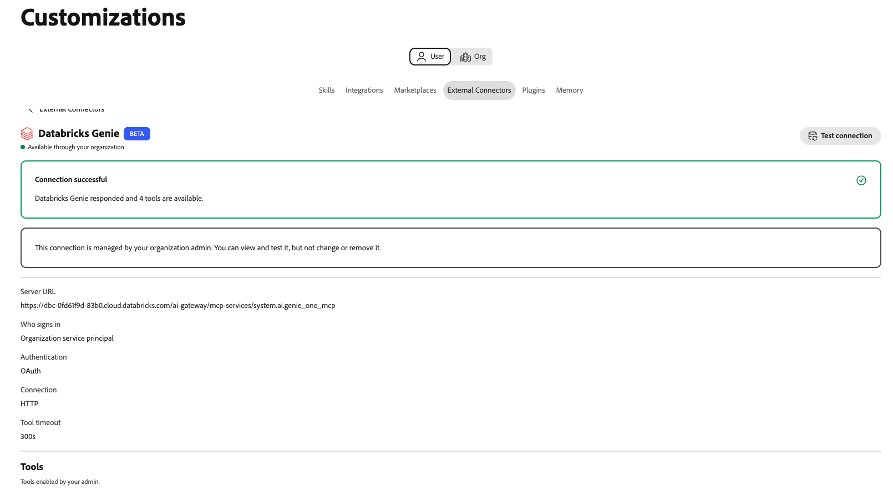

# Databricks Genie外部コネクタ {#databricks-genie}

[!DNL Databricks Genie]外部コネクタを使用して、Adobe CX Enterprise Coworkerの平易な言葉で[!DNL Databricks] データについて質問します。 [!DNL Genie]はSQLを書き込み、チャットで回答を返します。 コネクターは、Coworkerを[!DNL Databricks] ワークスペースの[!DNL Genie One] Model Context Protocol （MCP） サーバーにリンクします。

>[!AVAILABILITY]
>
>[!DNL Databricks Genie]外部コネクタはベータ版です。 ドキュメントと機能は変更される場合があります。

## コネクタ設定 {#connector-configuration}

コネクタ設定プロセスには、次の2つの別々の部分があります。

* **組織の設定：**&#x200B;管理者はCoworkerを[!DNL Databricks] ワークスペースに接続し、ユーザーがログインする方法を選択し、メンバーが使用できるツールを選択します。
* **メンバーのアクセス：**&#x200B;のメンバーは、サインインオプションに応じて、共有組織IDまたは自分の[!DNL Databricks] IDのいずれかで接続を使用します。

管理者は、次のいずれかのログインオプションを選択します。

| オプション | 管理者が提供すること | アクセスの仕組み |
| --- | --- | --- |
| **[!UICONTROL 組織サービスプリンシパル]** | [!DNL Databricks] サービス プリンシパルのクライアント IDとクライアント秘密鍵。 | すべてのメンバーは、サービスプリンシパルの権限を使用します。 メンバーは[!DNL Databricks]にログインしていません。 |
| **[!UICONTROL 各人が]**&#x200B;にサインインします | [!DNL Databricks] OAuth アプリ接続のクライアント IDと、オプションのクライアント秘密鍵。 | 各メンバーは自分の[!DNL Databricks] IDでログインし、アクセスは[!DNL Databricks]権限に従います。 |

いずれのオプションも、選択したIDがまだ持っていない[!DNL Databricks]権限を付与しません。 [!DNL Databricks]は、すべてのリクエストに[!DNL Unity Catalog]権限を適用します。

## 前提条件 {#prerequisites}

このコネクタは[!DNL Databricks Genie One]で動作します。 従来の[!DNL Genie] スペース MCP URLはサポートされていません。 [!DNL Databricks SQL] サーバーなどの別の[!DNL Databricks] MCP サーバーを接続するには、統合として個別に追加します。

始める前に、次の項目を確認してください。

* **組織のセットアップ用：** Coworkerで組織コネクタを管理する権限を持つアカウント。
* **[!DNL Databricks] ワークスペースの場合：** [!DNL Genie One]が使用可能なワークスペースのHTTPS URL。
* **サービスプリンシパルオプションの場合：** [!DNL Databricks] サービスプリンシパルのクライアント IDとクライアントシークレット。
* **個人ごとのサインインオプションの場合：** [!DNL Databricks] OAuth アプリ接続とそのクライアント ID。 また、Coworker リダイレクト URLを登録できる[!DNL Databricks]管理者が必要です。
* **使用するIDに対する[!DNL Databricks] アクセス権限：** Workspace、[!DNL Genie]およびデータ権限。 共同作業者はこれらの権限を付与しません。

>[!IMPORTANT]
>
>スクリーンショット、チャット、サポートチケットでクライアントの秘密鍵、アクセストークン、その他の資格情報を絶対に共有しない。

手順については、次の[!DNL Databricks] ドキュメントを参照してください。

* [Genie One MCP](https://docs.databricks.com/aws/en/agents/mcp-tools/genie-mcp){target="_blank"}
* [パートナーOAuth アプリケーションを有効または無効にする](https://docs.databricks.com/aws/en/integrations/enable-disable-oauth){target="_blank"}
* [OAuthを使用したDatabricksへのサービスプリンシパルアクセスの認証](https://docs.databricks.com/aws/en/dev-tools/auth/oauth-m2m){target="_blank"}

## 組織のコネクタの設定 {#configure-organization}

管理者は、組織内のすべてのユーザーが[!DNL Databricks Genie] コネクタを利用できるようにします。 組織ページの変更は、組織内のすべてのユーザーに適用されます。 この接続を追加できるのは、組織管理者のみです。 メンバーは、**[!UICONTROL ユーザー]** ビューから設定できません。

1. **[!UICONTROL カスタマイズ]**&#x200B;を開き、**[!UICONTROL 組織]**&#x200B;を選択してから、**[!UICONTROL 外部コネクタ]**&#x200B;を選択します。 **[!UICONTROL Databricks Genie]** カードで、**[!UICONTROL Configure]**&#x200B;を選択します。

1. **[!UICONTROL Connect Databricks Genie]** ダイアログで、ワークスペース URLまたは[!DNL Genie One] MCP URLを&#x200B;**[!UICONTROL サーバーURL]**&#x200B;に入力します。 Coworkerは、次の形式でソースを保存します。

   ```text
   https://<workspace-host>/ai-gateway/mcp-services/system.ai.genie_one_mcp
   ```

   独自のワークスペースのURLを使用します。 Coworkerは、HTTPSを使用しない、またはサポートされていないパスを使用するURLを拒否します。 `/api/2.0/mcp/genie/<space-id>`などの従来の[!DNL Genie] スペース URLはサポートされていません。

1. **[!UICONTROL 誰がログインしますか？]**&#x200B;で、サインインオプションを選択し、設定を完了します。

   {width="500" zoomable="yes"}

   * **[!UICONTROL 組織サービス プリンシパル ]:**&#x200B;要求では、サービス プリンシパルの権限が使用されます。 このオプションは、一元管理または自動アクセスに使用します。 メンバーは[!DNL Databricks]にログインしていません。

     | 設定 | 説明 |
     | --- | --- |
     | **[!UICONTROL サービス プリンシパル クライアント ID]** | 必須。 [!DNL Databricks] サービス プリンシパルのクライアント ID。 サービスプリンシパルを設定するには、ダイアログで「**[!UICONTROL サービスプリンシパル OAuth]**&#x200B;の設定方法」を選択します。 |
     | **[!UICONTROL サービスプリンシパルクライアントシークレット]** | 必須。 サービスプリンシパルのクライアント秘密鍵。 Coworkerは秘密鍵を安全に保存し、組織サービス プリンシパルに使用します。 |

   * **[!UICONTROL 各ユーザーが]:**&#x200B;にサインインすると、各ユーザーの[!DNL Databricks]権限が使用されます。 このオプションは、管理されたユーザー駆動型アクセスに使用します。 各メンバーは、独自の[!DNL Databricks] IDでアプリを認証します。

     | 設定 | 説明 |
     | --- | --- |
     | **[!UICONTROL リダイレクト URL]** | 読み取り専用： このURLをコピーし、[!DNL Databricks] アカウントコンソールでCoworkerをOAuth アプリ接続として登録するときに追加します。 手順については、ダイアログで「**[!UICONTROL OAuth アプリ接続を追加する方法]**」を選択します。 リダイレクト URLは環境によって異なるので、必ずダイアログからコピーしてください。 |
     | **[!UICONTROL OAuth アプリ クライアント ID]** | 必須。 アプリ接続の作成後に[!DNL Databricks]が表示するクライアント ID。 共同作業者は、各人を[!DNL Databricks]のサインインページに送信するために使用します。 |
     | **[!UICONTROL OAuth アプリ クライアント秘密鍵]** | オプション。 秘密鍵を入力できるのは、アプリ接続を機密クライアントとして作成した場合のみです。 クライアントシークレットがない場合、アプリはパブリッククライアント設定を使用します。 |

   Coworkerは、ワークスペースからOAuth URLとスコープを取得します。 認証タイプと接続プロトコルは固定され、読み取り専用です。 OAuth アプリの組織の承認プロセスとアクセス要求に従います。

   >[!IMPORTANT]
   >
   >組織サービスプリンシパルでは、この接続を使用するすべてのユーザーがサービスプリンシパルの権限を使用して動作します。

1. **[!UICONTROL ユーザーが利用できるツール]**&#x200B;で、メンバーが使用できるツールを選択します。 コネクタには次のツールが用意されており、すべてデフォルトで使用できます。

   | ツール | 説明 |
   | --- | --- |
   | `genie_ask` | [!DNL Genie]さんに質問します。 |
   | `genie_poll_response` | まだ処理中の応答のステータスを確認します。 |
   | `genie_get_query_result` | クエリ結果を取得します。 |
   | `genie_cancel_response` | 応答をキャンセルします。 |

   組織内のすべてのユーザーのツールをブロックするには、そのタグを削除します。 Coworkerは、削除されたツールを組織の除外として保存します。 少なくとも1つのツールを有効にしておく必要があります。 ツールを削除すると、「**[!UICONTROL すべてのツールを復元]**」オプションが表示されます。 これを選択して除外をクリアし、すべてのツールを再度使用できるようにします。

   {width="500" zoomable="yes"}

   メンバーは、有効のままにしたツールのみを表示して使用できます。また、ツールの選択を変更することはできません。 ツールを有効にしても、メンバーに追加の[!DNL Databricks]権限が付与されません。 ツールのタイムアウトは300秒に固定されています。

1. **[!UICONTROL アクセスと権限]**&#x200B;を確認し、**[!UICONTROL 接続を保存]**&#x200B;を選択します。 **[!UICONTROL Databricks Genie]** カードに&#x200B;**[!UICONTROL 設定が保存されました]**。

   ワークスペース、認証、有効なツール、およびツールのタイムアウトを確認するには、**[!UICONTROL 設定を表示]**&#x200B;を選択します。 次に、**[!UICONTROL テスト]**&#x200B;を選択して、接続を確認します。

   {width="700" zoomable="yes"}

テストが成功しても、選択したIDに必要な[!DNL Databricks]権限があることを確認できません。

## コネクタをメンバーとして使用 {#use-as-member}

管理者がコネクタを設定したら、独自の&#x200B;**[!UICONTROL カスタマイズ]** ビューからコネクタを開きます。 メンバーは接続を表示およびテストできますが、変更または削除することはできません。

1. **[!UICONTROL カスタマイズ]**&#x200B;を開き、**[!UICONTROL ユーザー]**&#x200B;を選択してから、**[!UICONTROL 外部コネクタ]**&#x200B;を選択します。

1. **[!UICONTROL Databricks Genie]** カードを検索します。 組織がコネクタを設定していない場合、カードに「**[!UICONTROL 未設定]**」と「**[!UICONTROL まだ利用できません」と表示されます。 管理者がこの設定を行う必要があります。]** メンバーに&#x200B;**[!UICONTROL Configure]** ボタンはないので、管理者に[ コネクタの設定](#configure-organization)を依頼してください。

1. 組織でサービス プリンシパルを使用している場合、カードには&#x200B;**[!UICONTROL 組織を通じて使用可能]**&#x200B;と表示されます。 ログインする必要はありません。 接続を確認するには、コネクタの詳細を開き、**[!UICONTROL 接続をテスト]**&#x200B;を選択します。

   テストが成功すると、**[!UICONTROL 接続が成功]**&#x200B;し、使用可能なツールの数が表示されます。

   {width="700" zoomable="yes"}

1. 組織で個人ログインを使用している場合、カードには&#x200B;**[!UICONTROL ログインが必要]**&#x200B;と表示されます。 コネクタを開き、サインインを開始し、目的のアカウントで[!DNL Databricks]にサインインします。 必要なシングルサインオン（SSO）または多要素認証（MFA）の手順を完了します。

1. Coworkerに戻ったら、コネクタに&#x200B;**[!UICONTROL Connected]**&#x200B;が表示されていることを確認します。 管理者が有効にしたツールを確認し、必要に応じて&#x200B;**[!UICONTROL 接続をテスト]**&#x200B;を選択します。

メンバービューは読み取り専用です。 管理者が有効にした接続ステータスとツールが表示されます。 組織のOAuth クライアントシークレットを入力したり、ツールの選択を変更したりすることはありません。 接続が失敗した場合、コネクタの詳細にエラーと技術的な詳細が表示されます。 技術情報をコピーして、管理者と共有します。

接続ステータスでは、特定のデータへのアクセスは保証されません。 [!DNL Databricks] ワークスペース、[!DNL Genie]およびデータ権限は引き続き適用されます。

## アクセスのトラブルシューティング {#troubleshoot-access}

設定、ログイン、またはアクセスに失敗した場合は、管理者に次の点を確認してください。

| 問題 | 確認すべきこと |
| --- | --- |
| サーバーURLが拒否されました | URLはHTTPSを使用し、ワークスペースのオリジンまたは正確な[!DNL Genie One] MCP URLです。 従来の[!DNL Genie] スペース パスおよびその他のサポートされていないパスを削除します。 |
| OAuth ログインが失敗するか、リダイレクト URLが一致しません | [!DNL Databricks] OAuth アプリ接続には、同じCoworker環境からの正確なリダイレクト URLがあります。 クライアント IDと、使用する場合はクライアントの秘密鍵が正しい。 |
| サービスプリンシパル接続が失敗する | クライアント IDとクライアント秘密鍵は目的のサービス プリンシパルに属し、クライアント秘密鍵は有効であり、サービス プリンシパルはワークスペースにアクセスできます。 |
| サインインは成功しましたが、[!DNL Genie]要求が失敗しました | メンバーまたはサービス プリンシパルに、必要なワークスペース、[!DNL Genie]、およびデータ権限があります。 管理者は、技術的な詳細と有効なツールを確認できます。 |
| メンバーはコネクタを表示または設定できません | 管理者は、最初に&#x200B;**[!UICONTROL 組織]** ビューで[!DNL Databricks Genie]を設定する必要があります。 メンバーはこの接続を作成できません。 |
