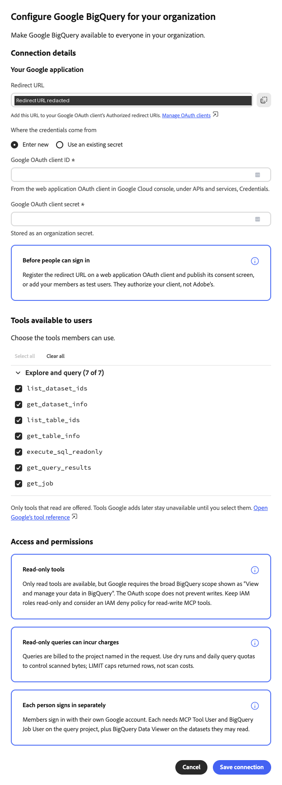
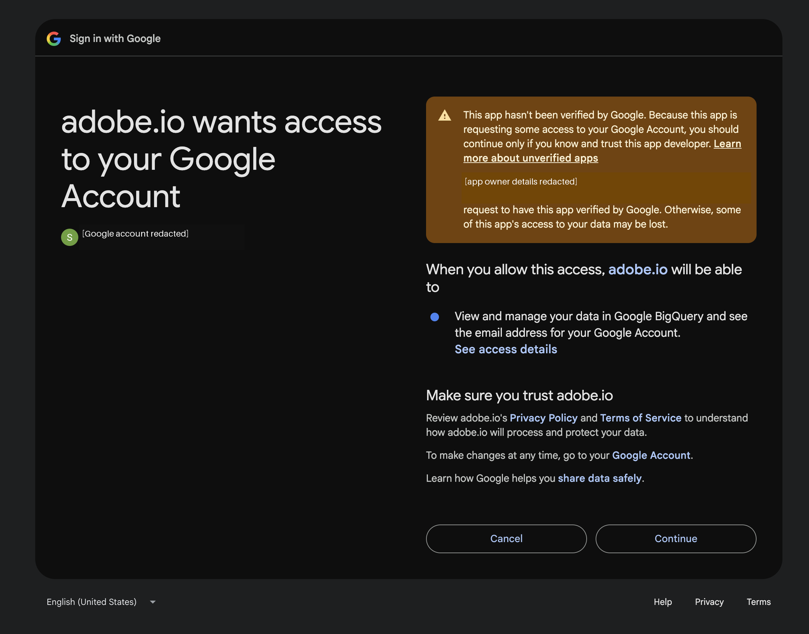
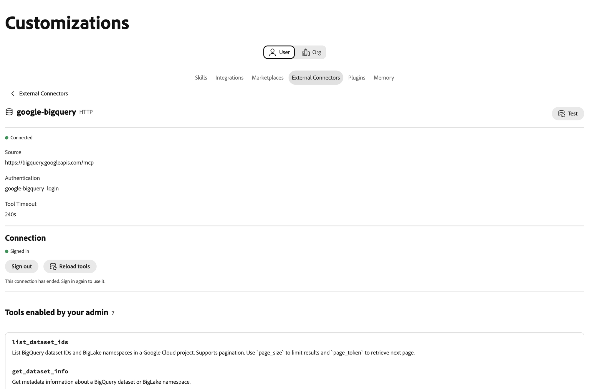

# Google BigQuery外部コネクタ {#google-bigquery}

[!DNL Google BigQuery]外部コネクタを使用して、Adobe CX Enterprise Coworkerで[!DNL BigQuery] データを検索およびクエリします。 コネクタを設定したら、Coworkerにデータセットとテーブルのリストを要求し、テーブルスキーマを説明し、読み取り専用のSQL クエリを実行します。 コネクタは、[!DNL Google]が`https://bigquery.googleapis.com/mcp`にホストするモデル コンテキスト プロトコル （MCP） サーバーです。

>[!AVAILABILITY]
>
>[!DNL Google BigQuery]外部コネクタはベータ版です。 ドキュメントと機能は変更される場合があります。

## コネクタ設定 {#connector-configuration}

コネクタ設定プロセスには、次の3つの部分があります。

* **[!DNL Google Cloud]の準備：** [!DNL Google Cloud]の管理者がクエリプロジェクトを準備し、[!DNL BigQuery] APIを有効にし、必要なIDおよびアクセス管理（IAM）の役割をメンバーに付与します。
* **組織の設定：**&#x200B;共同作業者の管理者は、組織全体に対して1回コネクタを設定します。 管理者は、組織の[!DNL Google] OAuth アプリを接続し、メンバーが使用できるツールを選択します。
* **メンバーのログイン：**&#x200B;各メンバーは、自分の[!DNL Google] アカウントでログインします。 メンバーは、自分の[!DNL Google] IDがアクセスできるプロジェクトとデータセットのみにアクセスできます。

コネクターは、組織が所有するOAuth アプリを使用します。 Adobeは、このコネクタに[!DNL Google] OAuth アプリを提供していません。 組織設定を保存しても、メンバーはログインせず、[!DNL BigQuery]権限も付与されません。 [!DNL Google] ログインが成功しても、[!DNL Google Cloud] IAMがデータへのアクセスを制御するため、データセットへのアクセスは許可されません。

## 前提条件 {#prerequisites}

始める前に、次の項目を確認してください。

* **[!DNL Google Cloud]の準備：**&#x200B;の場合APIを有効にし、IAM役割を付与し、[!DNL Google Auth Platform]でOAuth クライアントを作成できる[!DNL Google Cloud]の管理者。
* **組織のセットアップ用：** Coworkerで組織コネクタを管理する権限を持つアカウント。 また、[!DNL Google] OAuth web アプリケーションクライアントのクライアント IDとクライアント秘密鍵、またはそれらを含む既存の組織の秘密鍵も必要です。
* **メンバーログインの場合：** OAuth アプリのオーディエンスが許可し、必要なIAM役割を持つ[!DNL Google] ID。

クエリプロジェクトのIDと、メンバーが読む必要のあるデータセットを把握します。 クエリプロジェクトはクエリジョブを実行し、その料金を支払います。 データは別のプロジェクトに存在する可能性があり、OAuth クライアントも別のプロジェクトに属する可能性があります。 パイロット版の場合、1つのプロジェクトでOAuth クライアント、クエリジョブ、データセットを保持できます。

## [!DNL Google Cloud]を準備 {#prepare-google-cloud}

Coworkerでコネクタを設定する前に、[!DNL Google Cloud]でプロジェクトとメンバーのアクセス権を準備してください。 OAuth アプリの作成とデータアクセスの許可は別々のタスクです。 コネクタを使用するメンバーは、OAuth アプリを編集する権限を必要としません。

### クエリプロジェクトの準備 {#prepare-query-project}

[!DNL Google Cloud]管理者が、クエリジョブを実行するプロジェクトを準備します。

1. [Google Cloud Console](https://console.cloud.google.com/)で、プロジェクトを選択または作成します。
1. まだ有効になっていない場合は、[!DNL BigQuery] APIを有効にします。 APIを有効にすると、[!DNL BigQuery] リモート MCP サーバーも有効になります。
1. 請求または[BigQuery サンドボックス ](https://docs.cloud.google.com/bigquery/docs/sandbox)を選択し、クエリプロジェクトに対して日次[ カスタムクエリクォータ ](https://docs.cloud.google.com/bigquery/docs/custom-quotas)を適切に設定します。

>[!IMPORTANT]
>
>読み取り専用のクエリには、引き続き料金が発生する可能性があります。 [!DNL BigQuery]のコストは、クエリが返す行数ではなく、スキャンするバイト数に依存します。 `LIMIT`句は、返される行を制御しますが、通常、スキャンされたバイト数を減らすことはありません。 ドライラン、明示的な列、パーティションフィルター、毎日のクエリクォータを使用して、コストを管理します。

詳細については、[!DNL Google Cloud] ドキュメントの「[BigQuery リモート MCP サーバーを使用する](https://docs.cloud.google.com/bigquery/docs/use-bigquery-mcp)」を参照してください。

### IAMの役割を付与 {#grant-iam-roles}

メンバーの[!DNL Google] IDに次の役割を付与します。 可能であれば管理グループを使用し、データセットレベルのデータアクセスを優先します。

| 役割 | 付与する場所 | 目的 |
| --- | --- | --- |
| [!UICONTROL MCP ツール ユーザー] （`roles/mcp.toolUser`） | MCP呼び出しに使用されるプロジェクト | MCP ツールの呼び出しを行います。 |
| [!UICONTROL BigQuery ジョブ ユーザー] （`roles/bigquery.jobUser`） | クエリプロジェクト | クエリジョブを実行します。 |
| [!UICONTROL BigQuery Data Viewer] （`roles/bigquery.dataViewer`） | 許可されたデータセットやデータプロジェクトは | データとメタデータの読み取り： |

この読み取り専用コネクタを使用する場合にのみ、[!UICONTROL BigQuery Data Editor]、[!UICONTROL BigQuery Data Owner]、または[!UICONTROL BigQuery Admin]を付与しないでください。 追加のセーフガードとして、読み取り/書き込みMCP ツールに対する[拒否ポリシー](https://docs.cloud.google.com/mcp/prevent-read-write-tool-use)を検討します。 他の[!DNL Google]個のMCP クライアントとサービスに影響を与える可能性があるため、最初に拒否ポリシーの範囲を確認するように[!DNL Google Cloud]管理者に依頼します。 詳しくは、[BigQuery IAMの役割と権限](https://docs.cloud.google.com/bigquery/docs/access-control)を参照してください。

## 組織のコネクタの設定 {#configure-organization}

管理者は、組織内のすべてのユーザーが[!DNL Google BigQuery] コネクタを利用できるようにします。 組織ページの変更は、組織内のすべてのユーザーに適用されます。

1. **[!UICONTROL カスタマイズ]**&#x200B;を開き、**[!UICONTROL 組織]**&#x200B;を選択してから、**[!UICONTROL 外部コネクタ]**&#x200B;を選択します。 **[!UICONTROL Google BigQuery]** カードで、**[!UICONTROL Configure]**&#x200B;を選択します。

   コネクタが既に設定されている場合、カードには代わりに&#x200B;**[!UICONTROL 設定を表示]**&#x200B;が表示されます。

1. 組織の&#x200B;**[!UICONTROL Google BigQueryの設定]** ダイアログで、**[!UICONTROL お使いのGoogle アプリケーション]**&#x200B;の下の&#x200B;**[!UICONTROL リダイレクト URL]**&#x200B;をコピーします。

   リダイレクト URLは環境と地域によって異なるので、必ずダイアログから正確な値をコピーしてください。 ブラウザーのCoworker ページのURLまたは[!DNL BigQuery] MCP サーバーのURLは使用しないでください。 1つのOAuth クライアントが複数の環境を提供する場合は、必要なリダイレクト URLをそれぞれ個別に登録します。

1. [Google Auth Platform](https://console.cloud.google.com/auth/overview)で、組織のOAuth クライアントを準備します。

   1. **[!UICONTROL Branding]**&#x200B;と&#x200B;**[!UICONTROL Audience]**&#x200B;を設定します。 テストの外部アプリの場合は、対象のメンバーをテストユーザーとして追加します。 より幅広く使用する前に、[!DNL Google]の公開と検証の要件を完了してください。
   1. **[!UICONTROL データアクセス]**&#x200B;で、`https://www.googleapis.com/auth/bigquery` スコープを追加します。
   1. **[!UICONTROL Clients]**&#x200B;の下で、**[!UICONTROL Web アプリケーション]**&#x200B;のアプリケーション タイプを持つOAuth クライアントを作成または選択します。
   1. **[!UICONTROL 承認済みリダイレクト URI]**&#x200B;にコピーしたリダイレクト URLを追加します。
   1. 組織の承認済み秘密処理プロセスを通じて、**[!UICONTROL クライアント ID]**&#x200B;と&#x200B;**[!UICONTROL クライアント秘密鍵]**&#x200B;を取得します。

   このアプリは、Adobeが提供するアプリではなく、組織が所有するアプリです。 スクリーンショット、チャット、ドキュメントからクライアントを守ります。

1. **[!UICONTROL 資格情報の取得元]**&#x200B;の下で、次のいずれかのオプションを選択します。

   * **[!UICONTROL Enter new]:** **[!UICONTROL Google OAuth クライアント ID]**&#x200B;と&#x200B;**[!UICONTROL Google OAuth クライアント シークレット]**&#x200B;を入力します。 共同作業者は、組織の秘密鍵として入力した値を保存します。
   * **[!UICONTROL 既存のシークレットを使用]:** クライアント IDとクライアント シークレットを含む保存済みの組織シークレットを選択します。

   組織コネクタに個人の秘密鍵を使用しないでください。

   {width="500" zoomable="yes"}

1. **[!UICONTROL 探索とクエリ]** ツール グループを展開します。 7つのツールをすべて選択するか、メンバーに必要なツールのみを選択します。 少なくとも1つのツールを選択してください。 詳しくは、[使用可能なツール ](#available-tools)を参照してください。

   **[!UICONTROL アクセスと権限]**&#x200B;の下の通知を確認します。

   * **[!UICONTROL 読み取り専用ツール ]:** OAuth スコープは広く、それ自体の変更を妨げません。 メンバーのIAM役割を読み取り専用に保ちます。
   * **[!UICONTROL 読み取り専用のクエリには料金が発生する可能性があります]:** ドライランとクエリクォータを使用します。 `LIMIT`句は、必ずしもスキャンされたバイトではなく、返される行を制御します。
   * **[!UICONTROL 各自が個別にログインします]:**&#x200B;すべてのメンバーに必要なIAM ロールが必要です。

   **[!UICONTROL 接続を保存]**&#x200B;を選択します。 組織カードに、**[!UICONTROL 設定が保存されました]**、**[!UICONTROL 設定を表示]**&#x200B;と表示されます。

設定を保存すると、自分またはメンバーが[!DNL Google]にログインできません。 保存しても、誰でもデータセットをクエリできるとは限りません。 自分でコネクタを使用するには、[ メンバーとしてログイン ](#sign-in-as-a-member)の手順に従います。

### 利用可能なツール {#available-tools}

[!DNL Google BigQuery] コネクタには、次の読み取り専用ツールが用意されています。

| ツール | 説明 |
| --- | --- |
| `list_dataset_ids` | 指定したプロジェクト内のデータセットのリストを表示します。 |
| `get_dataset_info` | データセットのメタデータの読み取り。 |
| `list_table_ids` | データセット内のテーブルとビューを一覧表示します。 |
| `get_table_info` | テーブルのスキーマとメタデータを読み取ります。 |
| `execute_sql_readonly` | 読み取り専用のSQL クエリまたはドライ実行を実行して、クエリがスキャンするバイトを推定します。 |
| `get_query_results` | クエリの結果を取得するか、実行中のクエリを確認します。 |
| `get_job` | クエリジョブのステータス、エラー、統計を確認します。 |

クエリワークフローの場合は、`execute_sql_readonly`、`get_query_results`、`get_job`を一緒に選択しておくと、長時間実行されるクエリジョブに従うことができます。 共同作業者は、[!DNL BigQuery] MCP サーバーから`execute_sql`および`cancel_job` ツールを提供していません。 [!DNL Google]が後でサーバーに追加するツールは、自動的には有効になっていません。 ツールの詳細については、[BigQuery MCP リファレンス ](https://docs.cloud.google.com/bigquery/docs/reference/mcp)を参照してください。

ツールを使用する場合は、次の制限を考慮してください。

* [!DNL Google]は、クエリ結果に対して3,000行の制限があり、デフォルトのクエリタイムアウトが3分であることを文書化します。 コネクタを使用して完全なテーブルを書き出さないでください。
* ツールはプロジェクトを一覧表示できません。 リクエストに既知のプロジェクト IDを指定します。
* 読み取り専用SQLは、[!DNL Google Drive]個の外部テーブルのデータやリソースを変更するステートメントや、クエリをサポートしていません。
* クエリ結果、スキーマ、データセットアクセスリスト、SQLは、チャットに表示できます。 アクセスが組織のデータ処理ポリシーに従っていることを確認します。

## メンバーとしてログイン {#sign-in-as-a-member}

管理者がコネクタを設定すると、各メンバーは自分の[!DNL Google] アカウントでサインインします。 ログインにOAuth クライアントシークレットは必要ありません。

1. **[!UICONTROL カスタマイズ]**&#x200B;を開き、**[!UICONTROL ユーザー]**&#x200B;を選択してから、**[!UICONTROL 外部コネクタ]**&#x200B;を選択します。 **[!UICONTROL ログインしていない]**&#x200B;と表示されている&#x200B;**[!UICONTROL Google BigQuery]** カードで、**[!UICONTROL ログイン]**&#x200B;を選択します。

   カードで管理者がコネクタを設定する必要があると表示された場合は、管理者に[ コネクタを設定](#configure-organization)するように依頼します。

1. [!DNL Google] **[!UICONTROL アカウントを選択]**&#x200B;画面で、必要なIAM アクセスを持つアカウントを選択するか、**[!UICONTROL 別のアカウントを使用]**&#x200B;を選択します。 次に、シングルサインオン（SSO）や多要素認証（MFA）など、組織が必要とするサインインステップを完了します。

   このアカウントは、Coworkerに使用するアカウントとは異なる場合があります。

   {width="500" zoomable="yes"}

1. [!DNL Google]さんが&#x200B;**[!UICONTROL Googleがこのアプリを確認していない]**&#x200B;と表示した場合は、管理者にアプリとその所有者を確認してください。 テスト アプリの組織ポリシーで許可されている場合にのみ続行します。 それ以外の場合は、**[!UICONTROL 安全に戻る]**&#x200B;を選択し、アプリ所有者にオーディエンス、公開、または検証要件の解決を依頼します。

   {width="500" zoomable="yes"}

   同意画面で、アプリ名とリクエストされたアクセス権を確認します。 次に、**[!UICONTROL 続行]**&#x200B;を選択して、[!DNL Google]同意フローを完了します。

   [!DNL Google]様は、[!DNL BigQuery] データの表示と管理、および[!DNL Google] アカウントの電子メールアドレスの表示に対する権限を求めています。 Coworkerでは読み取り専用のツールのみが提供されますが、これは標準の[!DNL BigQuery] スコープです。

   スクリーンショットでは、アプリの名前はadobe.ioです。 組織のアプリには独自の名前が表示されます。 この名前は、AdobeがOAuth アプリを提供するという意味ではありません。

   >[!IMPORTANT]
   >
   >アプリを認識し、組織がリクエストされたアクセスを承認した場合にのみ続行します。

   {width="500" zoomable="yes"}

1. Coworkerに戻り、コネクタの詳細で管理者&#x200B;]**が有効にした**[!UICONTROL  ツールを確認します。 メンバーはツールを表示できますが、ツールの選択を変更することはできません。 接続を確認するには、**[!UICONTROL テスト]**&#x200B;を選択します。

   メンバーの{width="700" zoomable="yes"}

サインイン、テスト、またはツールリストが成功しても、特定のデータセットをクエリできることが確認されません。 アクセスを確認するには、[BigQuery アクセスを確認してください](#check-bigquery-access)。 Coworkerで接続が終了したことが確認された場合は、再度ログインします。

## [!DNL BigQuery]へのアクセスを確認する {#check-bigquery-access}

データを読み取れることを確認するには、新しいチャットを開始し、読み取り専用プロンプトを入力します。 プレースホルダーを、[!DNL Google] IDがアクセスできるプロジェクトとテーブルに置き換えます。

プロンプトの例：

* 「プロジェクト `YOUR_PROJECT_ID`のデータセットをリスト化します。」
* 「クエリジョブに`YOUR_QUERY_PROJECT_ID`を使用して、`YOUR_DATA_PROJECT.YOUR_DATASET.YOUR_TABLE`のスキーマを検査し、ドライランでスキャンを推定してから、集計サマリーを返します。」

結果にデータセットまたはデータが含まれていることを確認します。 生のテーブルコンテンツのリクエストよりも、明示的な列、集計、パーティションフィルターを優先します。 リクエストでプロジェクトに名前を付けても、サインイン IDが変更されたり、そのプロジェクトへのアクセス権が付与されたりすることはありません。

## アクセスのトラブルシューティング {#troubleshoot-access}

ログインまたはアクセスに失敗した場合は、管理者に次の点を確認してください。

| 問題 | 確認すべきこと |
| --- | --- |
| カードには、コネクタが設定されていないか、管理者が設定する必要があることが示されています | 組織設定は、アクティブな組織に保存されます。 |
| `redirect_uri_mismatch` | 同僚ダイアログからの正確な&#x200B;**[!UICONTROL リダイレクト URL]**&#x200B;は、web アプリケーションクライアントの&#x200B;**[!UICONTROL 承認済みリダイレクト URI]**&#x200B;に登録されています。 |
| `invalid_client` | クライアント IDとクライアント秘密鍵はWeb アプリケーションクライアントに属し、選択した組織の秘密鍵は正しいです。 |
| `access_denied`、または[!DNL Google]さんがアプリを確認していないという警告 | アプリ所有者は、オーディエンス、テストユーザーの適格性、検証ステータスを確認します。 認識できないアプリは承認しないでください。 |
| 接続が終了したか、トークンの有効期限が切れています | メンバーとして再度ログインします。 |
| `mcp.tools.call`への権限が拒否されました | [!UICONTROL MCP ツール ユーザー]の役割、および適用されるすべてのIAM拒否ポリシー。 |
| `bigquery.jobs.create`への権限が拒否されました | クエリ プロジェクトの[!UICONTROL BigQuery ジョブ ユーザー]の役割。 |
| テーブルへのアクセスが拒否されました | データセット上の[!UICONTROL BigQuery Data Viewer]の役割と、ログインした[!DNL Google] アカウント。 |
| `SERVICE_DISABLED` | エラーが特定したプロジェクトで[!DNL BigQuery] APIが有効になっています。 |
| 日次クエリの割り当てを超えています | プロジェクト管理者を含む、プロジェクトのクエリクォータ。 |
| データの挿入、更新、削除、作成、または削除のリクエストが失敗する | コネクタは読み取り専用で、データまたはリソースの変更をサポートしていません。 |

サポートに連絡する際は、クライアントシークレット、アクセストークン、認証コード、顧客データを共有しないでください。
