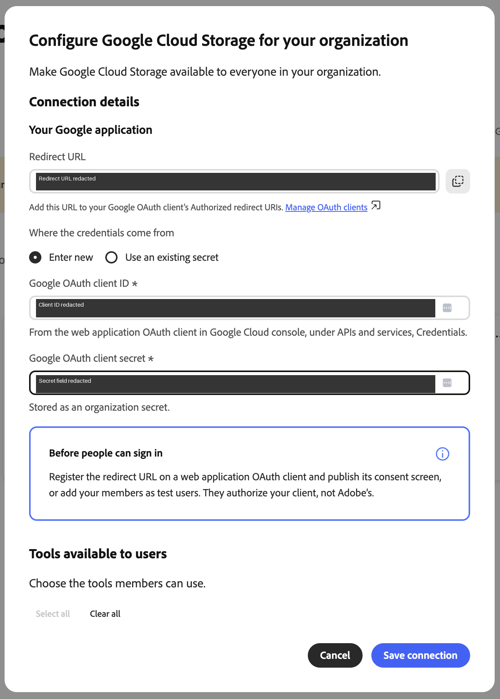

# Google Cloud Storage外部コネクタ {#google-cloud-storage}

[!DNL Google Cloud Storage]外部コネクタを使用して、Adobe CX Enterprise Coworkerで[!DNL Cloud Storage] データを読み取ります。 コネクタを設定したら、Coworkerに既知のプロジェクトのバケットのリスト化、接頭辞によるオブジェクトのリスト化、バケットとオブジェクトのメタデータの検査、承認済みファイルの読み取りを依頼します。 コネクタは、[!DNL Google]によってホストされているモデル コンテキスト プロトコル （MCP） サーバーです。

>[!AVAILABILITY]
>
>[!DNL Google Cloud Storage]外部コネクタはベータ版です。 ドキュメントと機能は変更される場合があります。

## コネクタ設定 {#connector-configuration}

コネクタ設定プロセスには、次の3つの部分があります。

* **[!DNL Google Cloud]の準備：** [!DNL Google Cloud]の管理者が、メンバーの請求、[!DNL Cloud Storage] API、およびIDおよびアクセス管理（IAM）の役割を準備します。 管理者は、組織が所有するOAuth クライアントも準備します。
* **組織の設定：**&#x200B;共同作業者の管理者は、組織全体に対して1回コネクタを設定します。 管理者は、Coworker リダイレクト URLを登録し、OAuth クライアント資格情報を入力し、メンバーが使用できるツールを選択します。
* **メンバーのログイン：**&#x200B;各メンバーは、自分の[!DNL Google] アカウントでログインします。 メンバーは、[!DNL Google Cloud] IAMがアカウントに許可しているバケットとオブジェクトのみにアクセスできます。

コネクタは読み取り専用です。 `https://www.googleapis.com/auth/devstorage.read_only` スコープを要求し、読み取りツールのみを提供します。 お客様の組織は、独自の[!DNL Google] OAuth アプリケーションを提供しています。 このコネクタには、Adobeで管理されているOAuth アプリケーションはありません。

組織設定を保存しても、メンバーはログインせず、[!DNL Cloud Storage]権限も付与されません。 各メンバーには、必要なIAM アクセスが既に付与されており、個別にサインインする必要があります。

## 前提条件 {#prerequisites}

始める前に、次の項目を確認してください。

* **準備：**&#x200B;請求と[!DNL Cloud Storage] APIが有効になっているプロジェクト、承認済みデータを含むバケット、メンバーに対するIAM付与、および&#x200B;**[!UICONTROL Web アプリケーション]** タイプの[!DNL Google]OAuth クライアント。[!DNL Google Cloud]
* **組織のセットアップ用：** Coworkerで組織コネクタを管理する権限を持つアカウント。 また、OAuth クライアント IDとクライアント秘密鍵、またはそれらを含む既存の組織シークレットも必要です。
* **メンバーのログイン：** OAuth アプリケーション オーディエンスと[!DNL Google Cloud] IAMの両方が許可する[!DNL Google] アカウント。

プロジェクト IDと、メンバーが読み取る予定のグループを把握する。 コネクタには、プロジェクトを一覧表示するツールがありません。 OAuth クライアントは、バケットとは異なるプロジェクトに属することができます。

## Google Cloudの準備 {#prepare-google-cloud}

Coworkerでコネクタを設定する前に、[!DNL Google Cloud] プロジェクトとメンバーのアクセス権を準備します。 [!DNL Google] ログインが成功しても、ストレージ権限は付与されません。

### プロジェクトとIAMの準備 {#prepare-project-iam}

[!DNL Google Cloud]管理者は次の手順を完了します。

1. [Google Cloud コンソール ](https://console.cloud.google.com/)でプロジェクトを選択または作成します。
1. バケットを含む各プロジェクトの請求先アカウントをリンクします。

   読み取り専用アクセスは無料ではありません。 ストレージ、操作、検索、ネットワーク料金は引き続き適用されます。 詳しくは、[ クラウドストレージの価格](https://cloud.google.com/storage/pricing)を参照してください。

1. 関連する各プロジェクトで&#x200B;**[!UICONTROL クラウドストレージ API]**&#x200B;を有効にします。 OAuth クライアントが別のプロジェクトに属している場合は、そのプロジェクトでもAPIを有効にします。
1. 次の表で、メンバーに最小権限の役割を付与します。 個々のアカウントよりも管理グループを好む。

| 役割 | 付与する場所 | 目的 |
| --- | --- | --- |
| [!UICONTROL MCP ツール ユーザー] （`roles/mcp.toolUser`） | MCP呼び出しに使用されるプロジェクト | MCP ツール呼び出しを行います（`mcp.tools.call`）。 |
| [!UICONTROL  ストレージバケットビューア ] （`roles/storage.bucketViewer`）またはカスタム読み取り専用の役割 | バケットを含むプロジェクト | バケットを一覧表示し、バケットのメタデータ （`storage.buckets.list`および`storage.buckets.get`）を読み取ります。 |
| [!UICONTROL  ストレージオブジェクトビューア ] （`roles/storage.objectViewer`） | メンバーがすべてのバケットを読み取れる場合は、許可された各バケット、またはプロジェクト | オブジェクトのリスト、オブジェクト メタデータの読み取り、オブジェクトのコンテンツの読み取り（`storage.objects.list`および`storage.objects.get`）。 |

[!UICONTROL  ストレージ管理者]にバケットの一覧表示のみを許可しないでください。 バケットをリストする権限を持たないメンバーは、名前を指定しても承認済みバケットを読むことができます。 詳しくは、[!DNL Google Cloud] ドキュメントの[ クラウドストレージ IAM ロール ](https://docs.cloud.google.com/storage/docs/access-control/iam-roles)を参照してください。

[!DNL Google]は、他のMCP クライアントの読み取り/書き込みMCP ツールをブロックするオプションのIAM拒否ポリシーも提供しています。 Coworker コネクタでは、既に読み取り専用のツール選択と読み取り専用のスコープが使用されています。 ポリシーを適用する前に、プロジェクト全体の効果を[!DNL Google Cloud]管理者と確認してください。 詳しくは、[読み取り/書き込みMCP ツールの使用を禁止](https://docs.cloud.google.com/mcp/prevent-read-write-tool-use)を参照してください。

### 接続設定 {#connection-settings}

共同作業者は次の接続設定を使用します。 これらの値は、設定ダイアログには入力しません。

| 設定 | 値 |
| --- | --- |
| MCP サーバーURL | `https://storage.googleapis.com/storage/mcp` （グローバルエンドポイントのみ） |
| 運輸 | ストリーマブル HTTP |
| 認証サーバー | `https://accounts.google.com/` |
| 要求された範囲 | `https://www.googleapis.com/auth/devstorage.read_only` |

詳しくは、[!DNL Google Cloud] ドキュメントの「[Cloud Storage リモート MCP サーバーの使用](https://docs.cloud.google.com/storage/docs/use-cloud-storage-mcp)」および「[Google MCP サーバーへの認証](https://docs.cloud.google.com/mcp/authenticate-mcp)」を参照してください。

## 組織のコネクタの設定 {#configure-organization}

管理者は、組織内のすべてのユーザーが[!DNL Google Cloud Storage] コネクタを利用できるようにします。 組織ページの変更は、組織内のすべてのメンバーに適用されます。

1. **[!UICONTROL カスタマイズ]**&#x200B;を開き、**[!UICONTROL 組織]**&#x200B;を選択してから、**[!UICONTROL 外部コネクタ]**&#x200B;を選択します。 **[!UICONTROL Google Cloud Storage]** カードで、**[!UICONTROL Configure]**&#x200B;を選択します。

   コネクタが既に設定されている場合は、代わりに保存されている設定を開きます。

1. 組織の&#x200B;**[!UICONTROL Google Cloud Storageの設定]** ダイアログの&#x200B;**[!UICONTROL Google アプリケーション]**&#x200B;の下に、完全な&#x200B;**[!UICONTROL リダイレクト URL]**&#x200B;をコピーします。

   リダイレクト URLは、環境と地域によって異なります。 ダイアログから正確な値を常にコピーします。 ブラウザーのCoworker ページのURL、MCP サーバーのURL、または別の環境からのリダイレクト URLは使用しないでください。

1. [Google Auth Platform](https://console.cloud.google.com/auth/overview)で組織用のOAuth クライアントを準備します。

   1. 組織の&#x200B;**[!UICONTROL Branding]**&#x200B;と&#x200B;**[!UICONTROL Audience]**&#x200B;を設定します。 テストの外部アプリの場合は、対象のメンバーをテストユーザーとして追加します。 広く使用する前に、適用される[!DNL Google]の公開と検証の要件を完了してください。
   1. **[!UICONTROL データアクセス]**&#x200B;で、`https://www.googleapis.com/auth/devstorage.read_only`の範囲を含めます。 コネクタには、読み取り/書き込み範囲やフルコントロール範囲は必要ありません。
   1. **[!UICONTROL Clients]**&#x200B;で、**[!UICONTROL Application type]**&#x200B;が&#x200B;**[!UICONTROL Web アプリケーション]**&#x200B;に設定されたOAuth クライアントを作成または選択します。
   1. **[!UICONTROL 承認済みリダイレクト URI]**&#x200B;にコピーしたリダイレクト URLを追加します。 1つのクライアントが複数の環境を提供する場合は、各環境のリダイレクト URLを登録します。
   1. 組織の承認済み秘密処理プロセスを通じて、**[!UICONTROL クライアント ID]**&#x200B;と&#x200B;**[!UICONTROL クライアント秘密鍵]**&#x200B;を取得します。

   メンバーは、組織が所有するこのOAuth アプリケーションを承認します。 チャット、チケット、ドキュメントなどに関する資格情報は避けましょう。

1. **[!UICONTROL 資格情報の取得元]**&#x200B;の下で、次のいずれかのオプションを選択します。

   * **[!UICONTROL Enter new]:** **[!UICONTROL Google OAuth クライアント ID]**&#x200B;と&#x200B;**[!UICONTROL Google OAuth クライアント シークレット]**&#x200B;を入力します。 共同作業者は、組織の秘密鍵として入力した値を保存します。
   * **[!UICONTROL 既存のシークレットを使用]:** クライアント IDとクライアント シークレットを保持する保存された組織シークレットを選択します。

   組織コネクタに個人の秘密鍵を使用しないでください。

   {width="500" zoomable="yes"}が表示されます。

1. **[!UICONTROL 参照して読みます（5/5）]**&#x200B;を展開します。 5つのツールをすべて選択するか、メンバーが必要なツールのみを選択します。 少なくとも1つのツールを選択してください。 詳しくは、[使用可能なツール ](#available-tools)を参照してください。

   **[!UICONTROL アクセスと権限]**&#x200B;で、**[!UICONTROL 読み取り専用アクセス]**&#x200B;と&#x200B;**[!UICONTROL 各人が個別にサインインする]**&#x200B;通知を確認します。 次に、**[!UICONTROL 接続を保存]**&#x200B;を選択します。

   {width="500" zoomable="yes"}

1. 保存された&#x200B;**[!UICONTROL google-cloud-storage]** コネクタの詳細を確認します。

   | 設定 | 説明 |
   | --- | --- |
   | **[!UICONTROL ソース]** | MCP サーバーのURL `https://storage.googleapis.com/storage/mcp`。 |
   | **[!UICONTROL 認証]** | 認証方法`google-cloud-storage_login`。 |
   | **[!UICONTROL 接続]** | 自分のサインインステータス。 |
   | **[!UICONTROL ツール]** | メンバー用に選択されたツールで、**[!UICONTROL すべてを選択]**&#x200B;および&#x200B;**[!UICONTROL クリア]** コントロールと選択されたツールの数が含まれています。 |

   {width="700" zoomable="yes"}

コネクタの詳細に関する&#x200B;**[!UICONTROL ログインしていない]**&#x200B;状態は、組織ではなく、自分の接続を参照しています。 組織の設定を保存しても、自分やメンバーはログインせず、バケットへのアクセスも確認されません。 自分でコネクタを使用するには、[ メンバーとしてログイン ](#sign-in-as-a-member)の手順に従います。

後でメンバーが使用できるツールを変更するには、コネクタの詳細ページで選択を更新し、**[!UICONTROL ツール選択の保存]**&#x200B;を選択します。 メンバーはツール選択を変更できません。

組織へのコネクタの提供を停止するには、コネクタの詳細ページで「**[!UICONTROL 削除]**」を選択します。

### 利用可能なツール {#available-tools}

[!DNL Google Cloud Storage] コネクタは、**[!UICONTROL 参照および読み取り]** グループに次の読み取り専用ツールを提供します。

| ツール | 説明 | 必要な権限 |
| --- | --- | --- |
| `list_buckets` | 既知の[!DNL Google Cloud] プロジェクト内のバケットをリスト化し、プレフィックスのフィルタリングとページネーションを使用します。 | プロジェクトの`storage.buckets.list` |
| `list_objects` | 許可されたバケット内のオブジェクトとプレフィックスのリストを表示します。 デフォルトでは、リストは再帰的ではありません。 | バケットの`storage.objects.list` |
| `get_bucket_metadata` | 場所、ストレージクラス、保持、バージョン管理などのバケット設定を読み取ります。 | `storage.buckets.get` |
| `get_object_metadata` | オブジェクトサイズ、コンテンツタイプ、タイムスタンプ、生成、カスタムメタデータの読み取り。 | `storage.objects.get` |
| `read_object` | テキストまたはサポートされているバイナリコンテンツを読み取り、1つのオブジェクトにつき8 MiBまで。 | `storage.objects.get` |

すべてのツール呼び出しには、`mcp.tools.call`権限も必要です。通常は、関連するプロジェクトの[!UICONTROL MCP ツールユーザー]の役割を使用します。

コネクタは、非推奨の`read_text` ツールまたは`write_text`、`create_bucket`、`delete_object`、`delete_bucket` ツールを提供していません。 書き込みツールをオンにするオプションはありません。 [!DNL Google]が後でサーバーに追加するツールは、5つすべてのツールを選択しても、自動的には利用できません。

## メンバーとしてログイン {#sign-in-as-a-member}

管理者がコネクタを設定すると、各メンバーは自分の[!DNL Google] アカウントでサインインします。 ログインにOAuth クライアントシークレットは必要ありません。

1. **[!UICONTROL カスタマイズ]**&#x200B;を開き、**[!UICONTROL ユーザー]**&#x200B;を選択してから、**[!UICONTROL 外部コネクタ]**&#x200B;を選択します。 **[!UICONTROL Google Cloud Storage]** カードで、**[!UICONTROL ログイン]**&#x200B;を選択します。

   ログインする前に、カードに「**[!UICONTROL ログインしていません]**」と表示されます。 カードに「**[!UICONTROL 未設定]**」と表示されている場合は、管理者に「[ コネクタを設定](#configure-organization)」するように依頼します。

1. [!DNL Google] **[!UICONTROL アカウントを選択]**&#x200B;画面で、必要なIAM アクセスを持つアカウントを選択するか、**[!UICONTROL 別のアカウントを使用]**&#x200B;を選択します。 シングルサインオン（SSO）や多要素認証（MFA）など、組織が必要とするサインインステップを完了します。

   このアカウントは、Coworkerに使用するアカウントとは異なる場合があります。

   {width="500" zoomable="yes"}

1. [!DNL Google]さんが&#x200B;**[!UICONTROL Googleがこのアプリを確認していない]**&#x200B;と表示した場合は、管理者にアプリとその所有者を確認してください。

   組織がこのアプリの使用を承認している場合は、**[!UICONTROL 続行]**&#x200B;を選択します。 それ以外の場合は、**[!UICONTROL 安全に戻る]**&#x200B;を選択し、アプリ所有者にオーディエンス、公開、または検証要件の解決を依頼します。

   {width="500" zoomable="yes"}

   同意画面でアプリ名と要求されたアクセスを確認し、**[!UICONTROL 続行]**&#x200B;を選択します。 コネクタは&#x200B;**[!UICONTROL 読み取り専用の範囲と一致するGoogle Cloud Storage]**&#x200B;でデータを表示することをリクエストします。

   スクリーンショットでは、アプリの名前はadobe.ioです。 組織のアプリには独自の名前が表示されます。 この名前は、AdobeがOAuth アプリを提供するという意味ではありません。

   >[!IMPORTANT]
   >
   >アプリを認識し、組織がリクエストされたアクセスを承認した場合にのみ続行します。

   {width="500" zoomable="yes"}

1. Coworkerに戻り、ログインが完了したことを確認します。 コネクタの詳細で、管理者&#x200B;]**が有効にした**[!UICONTROL  ツールを確認します。 管理者が有効にしたツールのみを使用できます。

接続が終了した場合、またはセッションが期限切れになった場合は、再度ログインしてください。 管理者がログインすると、他のメンバーはログインしません。

## バケットへのアクセスを確認 {#check-bucket-access}

サインインまたはツールリストが成功しても、特定のバケットにアクセスできることは確認されません。 [!DNL Google]は、サーバーツールを一覧表示するために認証を必要としません。 アクセスを確認するには、新しいチャットを開始し、読み取り専用プロンプトを入力します。 承認済みのリソースでプレースホルダーを置き換えます。

プロンプトの例：

* 「プロジェクト `YOUR_PROJECT_ID`のバケットをリスト化します。」
* 「バケット `YOUR_BUCKET`の`reports/`の下に最大25個のオブジェクトをリストします。 `reports/example.txt`のサイズとコンテンツタイプを確認し、最初の4096 バイトを読み取って要約します。」

結果に、期待するバケットまたはオブジェクトが含まれていることを確認します。 ネストされたプレフィックス内のオブジェクトをリストするには、再帰的なリストを明示的に要求します。 オブジェクトを読み取る前に、オブジェクトメタデータを確認します。

## 制限とデータ処理 {#limits-data-handling}

コネクタを使用する際は、次の制限とデータ処理に関する考慮事項を考慮してください。

* **プロジェクト ID:** リクエストにプロジェクト IDを指定します。 コネクタでプロジェクトを一覧表示できません。
* **接頭辞：** オブジェクトの接頭辞は、実際のフォルダーではなく、リテラル名です。 リストはデフォルトでは再帰的ではなく、ページに結果を返します。
* **ページサイズ：** リストページには、最大1,000個のアイテムを含めることができます。 25から100などの小さいページサイズと、狭い接頭辞を使用します。
* **オブジェクト サイズ：**&#x200B;読み取り用の最大オブジェクト サイズは8 MiBです。 大きなオブジェクトの一部のみを読み取っても、この制限は無視されません。 バイナリファイルのサポートは、モデルとクライアントによって異なります。
* **コストと割り当て量：** ストレージ、リクエスト、取得、およびネットワーク料金が適用される場合があります。 [!DNL Google]は、MCP サーバーにも割り当て量を適用します。 詳しくは、[ クラウドストレージ MCP クォータ ](https://docs.cloud.google.com/storage/quotas#gcs-mcp)を参照してください。
* **データ処理：** オブジェクトの内容、名前、カスタムメタデータが、同僚との会話に入力されます。 承認済みのデータのみを使用。
* **監査ログ：** [!DNL Cloud Storage]の読み取りは、該当するデータアクセスログが有効になっている場合にのみ[!DNL Cloud Audit Logs]に表示されます。

コネクタは、ファイルまたはバケットをアップロード、上書き、作成または削除できません。 また、要約を[!DNL Cloud Storage]に保存することはできません。

## アクセスのトラブルシューティング {#troubleshoot-access}

ログインまたはアクセスに失敗した場合は、管理者に次の点を確認してください。

| 問題 | 確認すべきこと |
| --- | --- |
| カードに「**[!UICONTROL 設定されていません]**」と表示される | アクティブな組織の組織接続を保存します。 |
| `redirect_uri_mismatch` | 正確な&#x200B;**[!UICONTROL リダイレクト URL]**&#x200B;を&#x200B;**[!UICONTROL Web アプリケーション]** OAuth クライアントの同僚ダイアログから登録します。 |
| `invalid_client` | クライアントの種類、クライアント IDおよびクライアントの秘密鍵、選択した組織の秘密鍵を確認します。 |
| `access_denied`または未検証のアプリに関する警告 | アプリ所有者と共に、アプリのオーディエンス、ユーザーの適格性、検証ステータスを確認します。 不明なアプリは承認しないでください。 |
| HTTP 401を使用していない場合はセッションが終了しています | もう一度ログインしてください。 |
| `mcp.tools.call`は拒否されました | [!UICONTROL MCP ツール ユーザー]の役割と、適用されるIAM拒否ポリシーを確認します。 |
| バケットリストは拒否されますが、既知のバケットは読み取り可能です | プロジェクトの`storage.buckets.list`権限を確認してください。 オブジェクトの権限だけでは、プロジェクト内のバケットをリストすることはできません。 |
| バケットのメタデータが拒否されました | `storage.buckets.get`権限を確認してください。 |
| オブジェクトのリストまたは読み取りが拒否されました | バケットの[!UICONTROL Storage Object Viewer]の役割と、ログインした[!DNL Google] アカウントを確認します。 |
| `SERVICE_DISABLED` | エラーにという名前のプロジェクトで[!DNL Cloud Storage] APIを有効にします。 |
| 課金が必要なHTTP 403 | `list_buckets` リクエスト内のプロジェクトを含む、バケットを含むプロジェクトの請求を確認します。 |
| 読み取り時の`OutOfRange` | オブジェクトが8 MiBの制限を超えています。 このコネクタの外部で承認済みの代替品を使用します。 |
| ツールがありません | 管理者が保存したツールの選択を確認します。 非推奨のツールと書き込みツールは使用できません。 |
| アップロード、上書き、作成または削除のリクエストが失敗する | コネクタは読み取り専用で、これらのアクションはサポートされていません。 |
