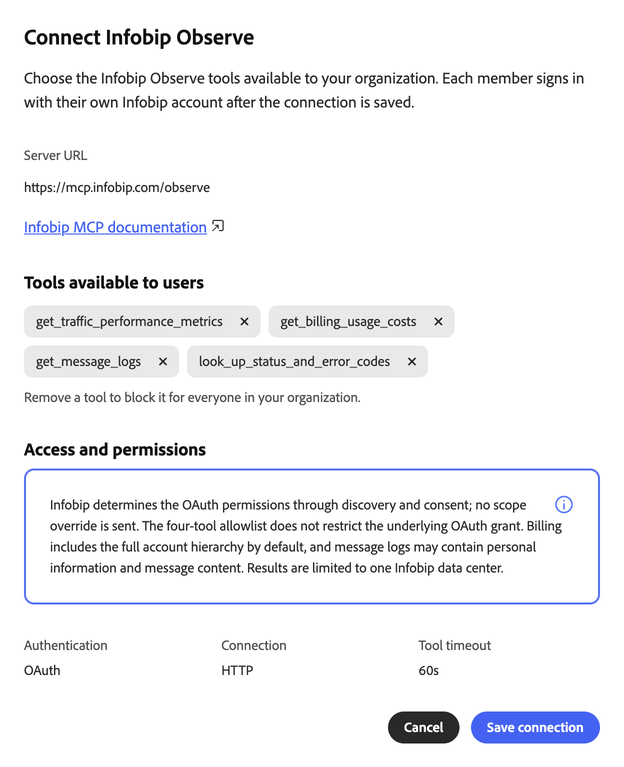

# Infobip Observe外部コネクタ {#infobip-observe}

[!DNL Infobip Observe]外部コネクタを使用して、Adobe CX Enterprise Coworkerの[!DNL Infobip] トラフィックとコストを確認します。 コネクタを設定したら、Coworkerにトラフィック指標、請求使用状況、メッセージログ、ステータスとエラーコードについて問い合わせます。 コネクタは、[!DNL Infobip]がホストする[!DNL Observe] モデル コンテキスト プロトコル （MCP） サーバーです。

>[!AVAILABILITY]
>
>[!DNL Infobip Observe]外部コネクタはベータ版です。 ドキュメントと機能は変更される場合があります。

## コネクタ設定 {#connector-configuration}

コネクタ設定プロセスには、次の2つの別々の部分があります。

* **組織の設定：**&#x200B;管理者は、組織全体に対して一度コネクタを設定し、メンバーが使用できるツールを承認します。
* **メンバーのログイン：**&#x200B;各メンバーは、自分の[!DNL Infobip] アカウントでログインします。 メンバーは、自分の[!DNL Infobip] アカウントが使用する権限を持つデータのみにアクセスできます。

コネクタには共有組織ログインがありません。 コネクタを使用するすべてのメンバーは、個別にログインします。 組織設定を保存しても、メンバーはログインせず、追加の[!DNL Infobip]権限も付与されません。

## 前提条件 {#prerequisites}

コネクタは、[!DNL Infobip] [!DNL Observe] MCP サーバーでのみ機能します。 [!DNL Infobip] メッセージ、プロビジョニング、またはアカウント管理のMCP サーバーに接続しません。

始める前に、次の項目を確認してください。

* **同僚アクセス：**&#x200B;組織コネクタを管理する権限を持つアカウントで、[!DNL Infobip Observe] コネクタが使用可能な組織内にあります。
* **[!DNL Infobip]アカウント：**&#x200B;対象のデータセンターの[!DNL Observe]へのアクセス権を持つ承認済み[!DNL Infobip] アカウント。 [!DNL Infobip]では、早期アクセス機能として[!DNL Observe]個のMCPを提供しています。 [!DNL Infobip]で使用権限とアカウントの適合性を確認します。
* **メンバーID:**&#x200B;自分の[!DNL Infobip] アカウントを持つメンバーと、意図されたデータにアクセスするための権限。
* **テスト用の承認済みスコープ：**&#x200B;請求、トラフィック、またはメッセージのログをクエリする前に、承認済みテスト範囲と非機密データ。

コネクタをテストするには、無料の[!DNL Infobip]体験版アカウントにサインアップしてください。 試用版アカウントでは、データの分離やコストのゼロは保証されません。 詳しくは、[!DNL Infobip] ドキュメントの[Infobip MCP サーバーの使用](https://www.infobip.com/docs/mcp/using-mcp){target="_blank"}および[MCP](https://www.infobip.com/docs/mcp/observe-mcp){target="_blank"}の監視を参照してください。

>[!IMPORTANT]
>
>スクリーンショット、チャット、サポートチケットで、パスワード、API キー、トークン、認証コード、同意とコールバック URLを絶対に共有しない。

## 接続とサインインモデル {#connection-model}

Coworkerは、次の設定を自動的に適用します。 OAuth アプリを作成したり、アプリの資格情報を入力したりすることはありません。

| 設定 | 値 |
| --- | --- |
| サーバーURL | `https://mcp.infobip.com/observe` |
| 運輸 | ストリーマブル HTTP |
| 認証サーバーの検出 | `https://mcp.infobip.com/observe/.well-known/oauth-authorization-server` |
| ログイン | 動的なクライアント登録を使用して、各メンバーがOAuthでログインします |
| OAuth設定 | 自動検出： 管理者は、クライアント ID、クライアントシークレット、スコープ、またはOAuth エンドポイントを入力しません。 |
| ツール選択 | 4つの承認済みツール： 管理者は選択範囲を絞り込むことができます。 |

[!DNL Infobip]件の検出と各メンバーの同意により、共同作業者が受け取るアクセスが決まります。 [!DNL Infobip]は、[!DNL Observe] MCPの`billing:usage:view`、`metrics:manage`、`messages-api:manage`および`error-codes:read`のスコープを文書化しています。 承認する前に、同意画面で要求されたアクセスを確認します。

[!DNL Infobip]は、他のMCP クライアントの[!DNL Observe] MCPに対するAPI キー認証もサポートしています。 CoworkerはこのコネクタにAPI キーを使用しません。 メンバーはOAuthのみでログインします。

## 組織のコネクタの設定 {#configure-organization}

管理者は、組織内のすべてのユーザーが[!DNL Infobip Observe] コネクタを利用できるようにします。 組織ページの変更は、組織内のすべてのユーザーに適用されます。 メンバーは組織の接続を設定できません。

1. **[!UICONTROL カスタマイズ]**&#x200B;を開き、**[!UICONTROL 組織]**&#x200B;を選択してから、**[!UICONTROL 外部コネクタ]**&#x200B;を選択します。

1. **[!UICONTROL Infobip Observe]**&#x200B;を見つけ、**[!UICONTROL Configure]**&#x200B;を選択します。

1. **[!UICONTROL Infobip Observe]**&#x200B;を接続ダイアログで、修正された&#x200B;**[!UICONTROL サーバーURL]**、`https://mcp.infobip.com/observe`を確認します。

   OAuth クライアント ID、クライアントシークレット、またはスコープを入力する必要はありません。

1. ユーザーが利用できる&#x200B;**[!UICONTROL ツール]**&#x200B;で、最初に選択した4つのツールを確認します。 組織のメンバーが使用すべきではないツールを削除します。 少なくとも1つのツールが残っている必要があります。

   詳しくは、[使用可能なツール ](#available-tools)を参照してください。

   {width="500" zoomable="yes"}

1. **[!UICONTROL 接続を保存]**&#x200B;を選択します。 次に、設定を再度開いて、ツールの選択が保持されていることを確認します。

保存中は、あなたまたはメンバーが[!DNL Infobip]にログインしていません。 自分で接続を確認するには、[ メンバーとしてログイン ](#sign-in-as-a-member)の説明に従ってログインします。

いずれかのツールを削除した後、4つのツールをすべて再度使用できるようにするには、**[!UICONTROL すべてのツールを復元]**&#x200B;を選択します。 このオプションは、承認された4つのツールのみを復元します。 共同作業者は、[!DNL Infobip]が後で追加するツールを有効にしません。 ツールが選択されていない設定は保存できません。

### 利用可能なツール {#available-tools}

[!DNL Infobip Observe] コネクタには、次のツールが用意されています。 [!DNL Infobip]は各ツールの制限を変更できるので、[!DNL Infobip]のドキュメントを確認してから使用してください。

| ツール | 目的 | 制限 |
| --- | --- | --- |
| `get_traffic_performance_metrics` | トラフィック、配信、エンゲージメントの指標を集約。 | 最大366日のデータ。 1時間単位のウィンドウは最大14日間、1日単位のウィンドウは最大93日間です。 デフォルトでサインイン済みアカウントのデータを返します。 サブアカウントを明示的に含めます。 |
| `get_billing_usage_costs` | 請求書に一致する使用量とコスト。 | 現在の月と過去2か月のカレンダー。 デフォルトでは、完全なアカウント階層が含まれます。 1 ヶ月のデータは翌月5日までの暫定的なものです。 |
| `get_message_logs` | 個々のメッセージのログ。 | 最後の48時間。 ログには、受信者ID、個人情報、メッセージコンテンツが含まれます。 |
| `look_up_status_and_error_codes` | 既知のステータスとエラーコード名の説明。 | リクエストごとに最大50個の名前。 [!DNL Infobip]は、結果から不明な名前を省略できます。 |

結果は1つの[!DNL Infobip] データセンターに制限されています。 ツール選択は、メンバーが共同作業で使用できるツールを制御します。 メンバーがログイン時に付与する[!DNL Infobip] アクセス、アカウント階層、または[!DNL Infobip]が適用する権限は絞り込まれません。

>[!IMPORTANT]
>
>メッセージログには、受信者IDやメッセージコンテンツなどの個人データを含めることができます。 請求情報は機密性が高く、デフォルトでは完全なアカウント階層をカバーしています。 これらのツールは、組織が使用を承認した場合にのみ有効にします。 明示的で承認済みのアカウントフィルターと限定的なクエリを使用できます。

## メンバーとしてログイン {#sign-in-as-a-member}

管理者がコネクタを設定すると、各メンバーは自分の[!DNL Infobip] アカウントでサインインします。 あなたのサインインはあなただけに属しています。 他のメンバーはあなたの資格情報を使用しません。

1. **[!UICONTROL カスタマイズ]**&#x200B;を開き、**[!UICONTROL ユーザー]**&#x200B;を選択してから、**[!UICONTROL 外部コネクタ]**&#x200B;を選択します。 **[!UICONTROL Infobip Observe]**&#x200B;を検索します。

   カードに「**[!UICONTROL 未設定]**」と「**[!UICONTROL まだ利用できません」と表示されている場合。 管理者がこの設定を行う必要があります。]**。管理者に[ コネクタの設定](#configure-organization)を依頼してください。

1. **[!UICONTROL ログイン]**&#x200B;を選択し、目的の[!DNL Infobip] アカウントを使用します。 シングルサインオン（SSO）、多要素認証（MFA）、同意プロンプトを自身で入力できます。 承認する前に、リクエストされたアクセス、アカウント、およびデータセンターを確認してください。

1. Coworkerに戻り、コネクタの詳細を開きます。 管理者が有効にしているツールを確認します。

   メンバーはツールを表示できますが、組織設定を変更することはできません。

1. **[!UICONTROL 接続をテスト]**&#x200B;を選択します。

   テストが成功すると、Coworkerが接続してツールを一覧表示できることが確認されます。 すべてのツールが正常に実行されるとは限りません。

1. 権限があり、管理者が`look_up_status_and_error_codes` ツールを有効にしている場合は、[接続を確認](#check-connection)で検索を実行します。

1. [!DNL Infobip] アカウントをコネクタから切断するには、**[!UICONTROL ログアウト]**&#x200B;を選択します。

   ログアウトしても、[!DNL Infobip]で付与したアクセス権が必ずしも取り消されるわけではありません。

## 接続を確認 {#check-connection}

コネクタがアカウントで機能することを確認するには、読み取り専用ルックアップを実行します。 管理者が`look_up_status_and_error_codes` ツールを有効にしていることを確認してください。 チャットを開始し、プロンプトを入力します。

プロンプトの例：

* 「Infobip Observeを使用して、ステータスコード NO_ERRORを検索し、その意味を説明します。 トラフィック指標、請求、またはメッセージログをクエリしないでください。」

エラーメッセージなしで`NO_ERROR`の説明が結果に含まれていることを確認してください。 検索が成功しても、トラフィック、請求、またはメッセージログツールがアカウントに対して機能することを確認できません。 接続をテストする場合にのみ、請求ログまたはメッセージログをクエリしないでください。

## アクセスのトラブルシューティング {#troubleshoot-access}

[!DNL Infobip] データにアクセスできない場合は、管理者に次の点を確認してください。

| 問題 | 確認すべきこと |
| --- | --- |
| **[!UICONTROL Infobip Observe]** コネクタがありません | コネクタが組織で使用可能であること、および組織コネクタを管理する権限があることを確認します。 必要に応じて、Adobe担当者にお問い合わせください。 |
| 同意またはログインが失敗する | 使用した[!DNL Infobip] アカウント、[!DNL Observe]の使用権限、およびデータセンターを確認してください。 ヘルプを求める際に、同意URL、コールバック URL、認証コードを共有しないでください。 |
| ログインは成功しますが、ツールが失敗します | 有効な[!DNL Infobip]権限、ログインしたアカウントとデータセンター、および[!DNL Infobip]が返すエラーを確認してください。 ログインが成功しても、ツールが正常に実行されていることを確認できません。 |
| ツールを使用できません | 管理者が有効にしているツールを確認します。 新しい[!DNL Infobip] ツールを自動的に有効にしません。 |
| 設定を保存できません | 少なくとも1つのツールを選択してください。 コネクタの提供を停止するには、代わりにコネクタを削除します。 |
| 請求結果には、予期しないアカウントが含まれます | 請求結果には、デフォルトで完全なアカウント階層が含まれます。 停止し、承認済みアカウントのフィルターと権限を確認します。 |
| メッセージログに機密データが表示される | クエリを停止し、後で実行するクエリを機密性のない承認済みデータに制限します。 生のログをチャットやサポートチケットに貼り付けないでください。 |
| ステータスコード検索は成功しますが、別のリクエストが失敗します | 失敗したリクエストを個別に調査します。 ルックアップが成功しても、すべてのツールまたはアカウントが機能するとは限りません。 |
