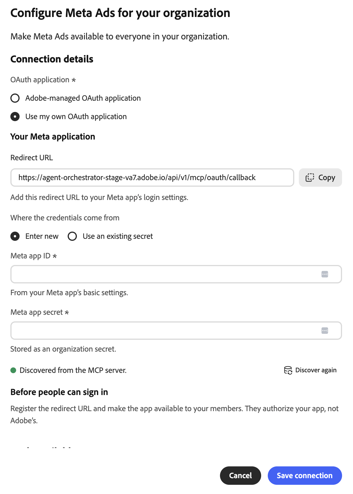

# Meta Ads外部コネクタ {#meta-ads}

[!DNL Meta Ads]外部コネクタを使用して、Adobe CX Enterprise Coworkerの[!DNL Meta]広告データを操作します。 コネクターを設定したら、同僚に広告パフォーマンスのレポート、キャンペーンとオーディエンスの管理、製品カタログの操作などを依頼します。 コネクタは、[!DNL Meta]によってホストされているモデル コンテキスト プロトコル （MCP） サーバーです。

>[!AVAILABILITY]
>
>[!DNL Meta Ads]外部コネクタはベータ版です。 ドキュメントと機能は変更される場合があります。

## コネクタ設定 {#connector-configuration}

コネクタ設定プロセスには、次の2つの別々の部分があります。

* **組織の設定：**&#x200B;管理者は、組織全体に対して1回コネクタを設定します。 管理者はOAuth アプリケーションを選択し、メンバーが使用できるツールを選択します。
* **メンバーのログイン：**&#x200B;各メンバーは、自分の[!DNL Facebook] アカウントでログインします。 メンバーは、自分の[!DNL Facebook] IDと承認済みアプリが許可する[!DNL Meta] アセットのみにアクセスできます。

組織設定を保存しても、メンバーがログインせず、広告アカウントへのアクセス権も付与されません。 各メンバーは個別にサインインする必要があります。

## 前提条件 {#prerequisites}

始める前に、次の項目を確認してください。

* **組織のセットアップ用：** Coworkerで組織コネクタを管理する権限を持つアカウント。
* **メンバーのログイン情報：**&#x200B;使用する広告アカウント、ビジネス、ページ、その他[!DNL Meta]個のアセットにアクセスできる[!DNL Facebook]個のアカウント。
* **独自のOAuth アプリの場合（オプション）:**&#x200B;組織が管理する[!DNL Meta] アプリと、そのアプリ IDおよびアプリ秘密鍵。

## 組織のコネクタの設定 {#configure-organization}

管理者は、組織内のすべてのユーザーが[!DNL Meta Ads] コネクタを利用できるようにします。 組織ページの変更は、組織内のすべてのユーザーに適用されます。

1. **[!UICONTROL カスタマイズ]**&#x200B;を開き、**[!UICONTROL 組織]**&#x200B;を選択してから、**[!UICONTROL 外部コネクタ]**&#x200B;を選択します。 **[!UICONTROL Meta Ads]** カードで、**[!UICONTROL Configure]**&#x200B;を選択します。

1. 組織の&#x200B;**[!UICONTROL Meta Adsの設定]** ダイアログで、**[!UICONTROL 接続の詳細]**&#x200B;を確認し、**[!UICONTROL OAuth アプリケーション]**&#x200B;を選択します。

   * **[!UICONTROL Adobeで管理されているOAuth アプリケーション &#x200B;]:** Adobeは[!DNL Meta Ads] アプリを提供しているので、アプリの資格情報を入力する必要はありません。 各メンバーは、保存後も自分の[!DNL Facebook] アカウントでログインします。

     {width="500" zoomable="yes"}

   * **[!UICONTROL 独自のOAuth アプリケーションを使用]:**&#x200B;組織が独自の[!DNL Meta] アプリを提供しています。 Adobe アプリではなく、メンバーがアプリを認証します。 **[!UICONTROL お使いのMeta アプリケーション]**&#x200B;で、次の手順を実行します。

     1. **[!UICONTROL リダイレクト URL]**&#x200B;をコピーし、[!DNL Meta] アプリのログイン設定に追加します。 リダイレクト URLは環境間で異なるため、ダイアログに表示されている値と正確に一致します。
     1. **[!UICONTROL 資格情報の取得元]**&#x200B;で、**[!UICONTROL 新しい]**&#x200B;を入力を選択し、**[!UICONTROL Meta アプリ ID]**&#x200B;と&#x200B;**[!UICONTROL Meta アプリ シークレット]**&#x200B;を入力します。 [!DNL Meta] アプリの基本設定でアプリ IDを見つけます。 同僚は、アプリの秘密鍵を組織の秘密鍵として保存します。 同じアプリに保存された資格情報を代わりに再利用するには、**[!UICONTROL 既存のシークレットを使用]**&#x200B;を選択します。
     1. ログインするメンバーがアプリを利用できるようにします。 [!DNL Meta] アプリ管理者に、意図した使用に必要な権限とアプリのレビュー要件を確認してもらいます。

     MCP サーバー&#x200B;**から検出された** インジケーターは、同僚がコネクタを見つけたことを確認します。 アプリの資格情報が有効であること、またはメンバーがサインインしていることを確認しません。 検出を更新するには、**[!UICONTROL もう一度見つける]**&#x200B;を選択します。

     {width="500" zoomable="yes"}

1. ユーザーが利用できる&#x200B;**[!UICONTROL ツール]**&#x200B;の下で、各ツールグループを展開し、組織に必要なツールを選択します。 すべてのツールを一度に変更するには、**[!UICONTROL すべてを選択]**&#x200B;または&#x200B;**[!UICONTROL すべてをクリア]**&#x200B;を使用します。 詳しくは、[&#x200B; ツールグループ &#x200B;](#tool-groups)を参照してください。 次に、**[!UICONTROL 接続を保存]**&#x200B;を選択します。

   {width="500" zoomable="yes"}

1. 保存された&#x200B;**[!UICONTROL meta-ads]** コネクタの詳細を確認します。 オプションで「**[!UICONTROL テスト]**」を選択して、同僚がコネクタツールを検出できることを確認します。

   | 設定 | 説明 |
   | --- | --- |
   | **[!UICONTROL ソース]** | [!DNL Meta Ads] MCP サーバー、`https://mcp.facebook.com/ads`。 |
   | **[!UICONTROL 認証]** | 認証方法`meta-ads_login`。 |
   | **[!UICONTROL 接続]** | 使用中のOAuth アプリケーションと独自のサインインステータス。 |
   | **[!UICONTROL ツール]** | メンバー用に選択されたツールで、**[!UICONTROL すべてを選択]**&#x200B;および&#x200B;**[!UICONTROL クリア]** コントロールと選択されたツールの数が含まれています。 |

   {width="700" zoomable="yes"}

コネクタの詳細に関する&#x200B;**[!UICONTROL ログインしていない]**&#x200B;状態は、組織ではなく、自分の接続を参照しています。 自分でコネクタを使用するには、**[!UICONTROL ログイン]**&#x200B;を選択し、[&#x200B; メンバーとしてログイン &#x200B;](#sign-in-as-a-member)の手順に従います。

組織へのコネクタの提供を停止するには、コネクタの詳細ページで「**[!UICONTROL 削除]**」を選択します。

### ツールグループ {#tool-groups}

[!DNL Meta Ads] コネクタは、ツールを次のグループに整理します。

* [!UICONTROL &#x200B; レポートとインサイト &#x200B;]
* [!UICONTROL 広告、キャンペーン、オーディエンス &#x200B;]
* [!UICONTROL &#x200B; カタログと製品]
* [!UICONTROL &#x200B; シグナルとデータセット &#x200B;]
* [!UICONTROL A/B テストとリフト調査]
* [!UICONTROL &#x200B; アクティビティログ &#x200B;]
* [!UICONTROL &#x200B; ヘルプとトラブルシューティング &#x200B;]

例えば、[!UICONTROL &#x200B; レポートとインサイト &#x200B;] グループには、`ads_insights_performance_trend`や`ads_insights_industry_benchmark`などのツールが含まれています。 各グループのツールは、[!DNL Meta]がコネクタを更新すると変更される可能性があります。

>[!IMPORTANT]
>
>すべてのツールが読み取り専用ではありません。 一部のツールでは、キャンペーン、予算、オーディエンス、カタログ、その他の広告アセットを変更できます。 組織がメンバーに使用するツールのみを選択します。

保存すると、選択せずに残したツールは、選択するまでメンバーが使用できなくなります。 メンバーが使用できるツールを確認するには、コネクタの詳細ページの「**[!UICONTROL 使用可能なツール]**」セクションを参照してください。

## メンバーとしてログイン {#sign-in-as-a-member}

管理者がコネクタを設定すると、各メンバーは自分の[!DNL Facebook] アカウントでサインインします。 ログインにアプリの秘密鍵またはアクセストークンは必要ありません。

1. **[!UICONTROL カスタマイズ]**&#x200B;を開き、**[!UICONTROL ユーザー]**&#x200B;を選択してから、**[!UICONTROL 外部コネクタ]**&#x200B;を選択します。

1. **[!UICONTROL Meta Ads]** カードで、**[!UICONTROL ログイン]**&#x200B;を選択します。

   カードに「**[!UICONTROL 設定されていません]**」と表示されている場合、またはコネクタが使用できない場合は、管理者に[&#x200B; コネクタの設定](#configure-organization)を依頼してください。

1. [!DNL Facebook]にログインして、シングルサインオン （SSO）、多要素認証（MFA）、同意、ID確認など、必要なプロンプトを入力します。

   これらのプロンプトの順序は、アカウントと組織のポリシーによって異なります。 初めてのユーザーには、権限を付与してアセットを選択するプロンプトが表示されることもあります。

1. [!DNL Facebook] アカウントと承認中のアプリを確認し、次のいずれかの操作を行います。

   * 以前の設定を維持するには、**[!UICONTROL 続行]**&#x200B;を選択します。
   * 承認を確認または変更するには、**[!UICONTROL 設定を編集]**&#x200B;を選択します。
   * 別の[!DNL Facebook] アカウントを使用するには、**[!UICONTROL 別のアカウントにログイン]**&#x200B;を選択します。

   Adobeで管理されているアプリを使用すると、[!DNL Adobe Experience Cloud]を承認できます。 独自の組織アプリでは、アプリ名とプロンプトが異なります。

   {width="400" zoomable="yes"}

   >[!IMPORTANT]
   >
   >アプリは、共有した情報への継続的なアクセスを受け取り、アプリがその情報にアクセスすると[!DNL Meta]件のレコードが記録されます。 組織が要求されたアクセスを承認した場合にのみ続行します。

1. [!DNL Facebook]さんがCoworkerに戻ったら、**[!UICONTROL meta-ads]** コネクタの詳細を開きます。 コネクタに「**[!UICONTROL Connected]**」と「**[!UICONTROL Signed in]**」が表示されていることを確認します。

   {width="700" zoomable="yes"}

1. 管理者&#x200B;**によって有効になっている** ツールを確認して、使用できるツールを確認します。

コネクタの詳細には、**[!UICONTROL ツールタイムアウト]**&#x200B;設定と次のコントロールも表示されます。

* **[!UICONTROL ツールを再読み込み]:** ツールのリストを更新します。
* **[!UICONTROL テスト &#x200B;]:**&#x200B;共同作業者がコネクタツールを検出できることを確認します。
* **[!UICONTROL ログアウト &#x200B;]:** [!DNL Facebook] アカウントをコネクタから切断します。

**[!UICONTROL Connected]**&#x200B;のステータスで、特定の広告アカウントへのアクセスが確認されないか、すべてのツールが正常に実行されます。 アクセスを確認するには、[広告アカウントへのアクセスを確認してください](#check-ad-account-access)。

## 広告アカウントへのアクセスを確認する {#check-ad-account-access}

使用できる広告アカウントを確認するには、チャットを開始し、読み取り専用プロンプトを入力します。

プロンプトの例：

* 「どのMeta広告アカウントにアクセスできますか？ 何も変えずにリストアップしてください」

管理者が`ads_get_ad_accounts` ツールを有効にしている場合、Coworkerはアクセス可能な広告アカウントを一覧表示します。 各アカウントについて、共同作業者は所有ビジネス、MCPの適格性、レポートの可用性を示します。 レポートを要求したり、アクションを実行したりする前に、アクセス可能なアカウントを選択します。

## アクセスのトラブルシューティング {#troubleshoot-access}

[!DNL Meta] アセットにアクセスできない場合は、次の点を確認してください。

| 面グラフ | 確認すべきこと |
| --- | --- |
| [!DNL Facebook] アカウント | 広告アカウントへのアクセス権を持つ[!DNL Facebook] アカウントでログインしました。 |
| アセットの権限 | [!DNL Facebook] アカウントには、使用する広告アカウント、ビジネス、またはページに対する権限があります。 |
| アプリの認証 | アプリを承認し、必要なアセットを共有しました。 認証を確認するには、ログアウトして再度ログインし、**[!UICONTROL 設定を編集]**&#x200B;を選択します。 |
| 有効なツール | 管理者は、ユーザーが利用できる&#x200B;**[!UICONTROL ツール]**&#x200B;の下で、必要なツールを有効にしました。 |
| 独自のOAuth アプリ | リダイレクト URLは正確に一致し、アプリ IDとアプリの秘密鍵は正しく、メンバーはアプリにアクセスできます。 [!DNL Meta] アプリ管理者に必要な権限を確認してください。 |
