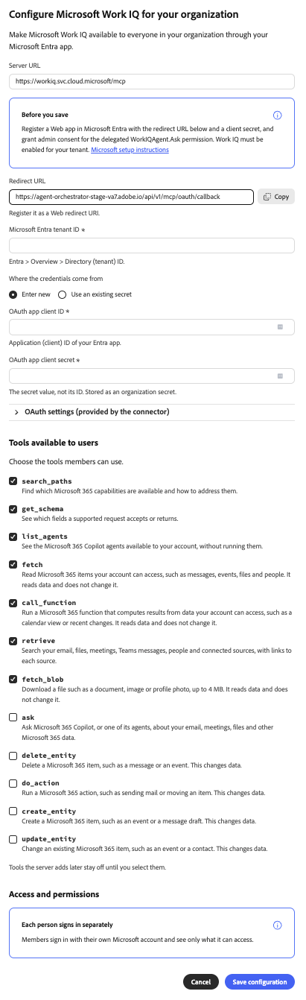

# Microsoft Work IQ外部コネクタ {#microsoft-work-iq}

[!DNL Microsoft Work IQ]外部コネクタを使用して、Adobe CX Enterprise Coworkerで[!DNL Microsoft 365] データを操作します。 コネクタを設定したら、同僚に電子メール、ファイル、会議、および[!DNL Microsoft Teams]件のメッセージの検索、カレンダーイベントの確認などを依頼します。 コネクタは、[!DNL Microsoft]によってホストされているモデル コンテキスト プロトコル （MCP） サーバーです。

>[!AVAILABILITY]
>
>[!DNL Microsoft Work IQ]外部コネクタはベータ版です。 ドキュメントと機能は変更される場合があります。

## コネクタ設定 {#connector-configuration}

コネクタ設定プロセスには、次の2つの別々の部分があります。

* **組織の設定：**&#x200B;管理者は、組織全体に対して1回コネクタを設定します。 管理者は[!DNL Microsoft Entra] アプリを接続し、メンバーが使用できるツールを選択します。
* **メンバーのログイン：**&#x200B;各メンバーは、自分の[!DNL Microsoft]の作業アカウントでログインします。 メンバーは、自分のアカウントがアクセスできるデータのみにアクセスできます。

組織設定を保存しても、メンバーはログインせず、追加の[!DNL Microsoft 365]権限も付与されません。 各メンバーは個別にサインインする必要があります。

**[!UICONTROL Microsoft Work IQ]** カードは、共有OAuth アプリについて言及しており、これはデプロイメントで設定されている場合にのみ使用できます。 アプリが既に提供されていると仮定しないでください。 このページでは、独自の[!DNL Microsoft Entra] アプリを接続する方法について説明します。

## 前提条件 {#prerequisites}

始める前に、次の項目を確認してください。

* **組織のセットアップ用：** Coworkerで組織コネクタを管理する権限を持つアカウント。
* **[!DNL Microsoft Entra] アプリの場合：** web アプリを登録し、管理者の同意を付与できる[!DNL Microsoft Entra]管理者。
* **ご利用の[!DNL Microsoft] テナントの場合：** [!DNL Work IQ]は、テナントに対して有効になっています。
* **メンバーのログインの場合：**&#x200B;使用するデータにアクセスできる対象となる[!DNL Microsoft]の作業アカウント。

## 組織のコネクタの設定 {#configure-organization}

管理者は、組織内のすべてのユーザーが[!DNL Microsoft Work IQ] コネクタを利用できるようにします。 組織ページの変更は、組織内のすべてのユーザーに適用されます。

1. **[!UICONTROL カスタマイズ]**&#x200B;を開き、**[!UICONTROL 組織]**&#x200B;を選択してから、**[!UICONTROL 外部コネクタ]**&#x200B;を選択します。 **[!UICONTROL Microsoft Work IQ]** カードで、**[!UICONTROL Configure]**&#x200B;を選択します。

1. **[!UICONTROL 組織のMicrosoft Work IQの設定]** ダイアログで、**[!UICONTROL サーバーURL]**、`https://workiq.svc.cloud.microsoft/mcp`を確認します。 次に、[!DNL Microsoft Entra] アプリを準備します。 [!DNL Microsoft]の要件については、ダイアログで「**[!UICONTROL Microsoftの設定手順]**」を選択してください。

   1. [!DNL Microsoft Entra]でweb アプリを登録するか、既存のアプリを使用してください。
   1. ダイアログから&#x200B;**[!UICONTROL リダイレクト URL]**&#x200B;をコピーし、この正確な値をアプリのweb リダイレクト URIとして登録します。 リダイレクト URLは環境によって異なるので、必ずダイアログからコピーしてください。
   1. クライアントシークレットを作成するか、既存のクライアントシークレットがまだ有効であることを確認します。 シークレット IDではなく、シークレット値が必要です。
   1. 委任された`WorkIQAgent.Ask`権限に対して管理者の同意を付与し、テナントに対して[!DNL Work IQ]が有効になっていることを確認します。

   **[!UICONTROL Microsoft Entra テナント ID]**&#x200B;に、テナント IDを入力します。 [!DNL Microsoft Entra]で、この値を&#x200B;**[!UICONTROL 概要]** > **[!UICONTROL ディレクトリ （テナント） ID]**&#x200B;で見つけます。

   {width="500" zoomable="yes"}

1. **[!UICONTROL 資格情報の取得元]**&#x200B;の下で、次のいずれかのオプションを選択します。

   * **[!UICONTROL 新規入力]:** **[!UICONTROL OAuth アプリクライアント ID]**&#x200B;で、[!DNL Microsoft Entra] アプリのアプリケーション （クライアント） IDを入力します。 **[!UICONTROL OAuth アプリ クライアント シークレット]**&#x200B;に、シークレット値を入力します。 Coworkerは、秘密値を組織の秘密鍵として保存します。
   * **[!UICONTROL 既存のシークレットを使用]:** クライアント ID ]**を保持する**[!UICONTROL  シークレットと、クライアント シークレット ]**を保持する**[!UICONTROL  シークレットで、アプリに保存されている組織シークレットを選択します。 適切なシークレットが使用できない場合は、代わりに&#x200B;**[!UICONTROL 新しい]**&#x200B;を入力を選択します。 テナント IDは個別に入力します。

   テナント ID、クライアント ID、およびクライアント秘密鍵はすべて同じアプリとテナントに属している必要があります。 保存したシークレットを再利用する場合は、クライアントシークレットの有効期限が切れていないことを確認します。 これらのアプリ資格情報は、メンバーがログインに使用する[!DNL Microsoft] パスワードとは別です。

   {width="500" zoomable="yes"}

1. ユーザーが利用できる&#x200B;**[!UICONTROL ツール]**&#x200B;で、組織が必要とするツールを選択します。 詳しくは、[使用可能なツール ](#available-tools)を参照してください。 **[!UICONTROL アクセスと権限]**&#x200B;を確認します。各ユーザーが個別にサインインしていることを確認してから、**[!UICONTROL 設定を保存]**&#x200B;を選択します。

   {zoomable="yes"}

1. 保存された&#x200B;**[!UICONTROL workiq]** コネクタの詳細を確認します。 オプションで「**[!UICONTROL テスト]**」を選択して、同僚がコネクタツールを検出できることを確認します。 保存後にツールを変更するには、[ ツール選択の変更](#change-tool-selection)を参照してください。

   | 設定 | 説明 |
   | --- | --- |
   | **[!UICONTROL ソース]** | [!DNL Work IQ] MCP サーバー、`https://workiq.svc.cloud.microsoft/mcp`。 |
   | **[!UICONTROL 認証]** | 認証方法`workiq_login`。 |
   | **[!UICONTROL ツールのタイムアウト]** | コネクタのツールのタイムアウト。 |
   | **[!UICONTROL 接続]** | 自分のサインインステータス。 |

   {width="500" zoomable="yes"}

コネクタの詳細に関する&#x200B;**[!UICONTROL ログインしていない]**&#x200B;状態は、組織ではなく、自分の接続を参照しています。 自分でコネクタを使用するには、**[!UICONTROL ログイン]**&#x200B;を選択し、[ メンバーとしてログイン ](#sign-in-as-a-member)の手順に従います。

組織へのコネクタの提供を停止するには、コネクタの詳細ページで「**[!UICONTROL 削除]**」を選択します。

### 利用可能なツール {#available-tools}

[!DNL Microsoft Work IQ] コネクタには、次のツールが用意されています。

| ツール | 説明 |
| --- | --- |
| `search_paths` | 使用可能な[!DNL Microsoft 365]機能とその対処方法を確認します。 |
| `get_schema` | サポートされているリクエストが受け入れたり返したりするフィールドを確認します。 |
| `list_agents` | お使いのアカウントで利用可能な[!DNL Microsoft 365 Copilot] エージェントを実行せずに確認します。 |
| `fetch` | メッセージ、イベント、ファイル、人物など、アカウントがアクセスできる[!DNL Microsoft 365]項目を読み取ります。 データは変更されません。 |
| `call_function` | カレンダービューや最近の変更など、アカウントがアクセスできるデータから結果を計算できます。 データは変更されません。 |
| `retrieve` | 電子メール、ファイル、会議、[!DNL Microsoft Teams]個のメッセージ、人物、接続されたソースを、各ソースへのリンクとともに検索します。 |
| `fetch_blob` | ドキュメント、画像、プロファイル写真などのファイルを最大4 MBまでダウンロードできます。 データは変更されません。 |
| `ask` | [!DNL Microsoft 365 Copilot]またはその担当者に、電子メール、会議、ファイル、その他[!DNL Microsoft 365]のデータについて質問します。 |
| `delete_entity` | メッセージやイベントなどの[!DNL Microsoft 365] アイテムを削除します。 データの変更： |
| `do_action` | メールの送信やアイテムの移動など、[!DNL Microsoft 365] アクションを実行します。 データの変更： |
| `create_entity` | イベントやメッセージの下書きなど、[!DNL Microsoft 365] アイテムを作成します。 データの変更： |
| `update_entity` | イベントや連絡先など、既存の[!DNL Microsoft 365]項目を変更します。 データの変更： |

>[!IMPORTANT]
>
>`delete_entity`、`do_action`、`create_entity`および`update_entity` ツールは、[!DNL Microsoft 365]のデータを変更します。 これらのツールを注意深く確認し、組織が使用するツールのみを選択します。

後でサーバーが追加したツールは、選択するまで使用できません。

### ツールの選択を変更 {#change-tool-selection}

保存後にメンバーが使用できるツールを変更するには、コネクタの詳細ページの「**[!UICONTROL ツール]**」セクションを使用します。

1. 個々のツールを選択またはクリアするか、**[!UICONTROL すべてを選択]**&#x200B;または&#x200B;**[!UICONTROL クリア]**&#x200B;を使用します。

1. **[!UICONTROL ツール選択を保存]**&#x200B;を選択します。

>[!CAUTION]
>
>**[!UICONTROL すべてのツールを表示]**&#x200B;を選択すると、現在の選択範囲が消去されます。 メンバーは、新しい選択範囲を保存するまで、ポリシーで除外されないすべてのツールを使用できます。 ツールのリストを表示する場合にのみ、**[!UICONTROL すべてのツールを表示]**&#x200B;を選択しないでください。

## メンバーとしてログイン {#sign-in-as-a-member}

管理者がコネクタを設定すると、各メンバーは自分の[!DNL Microsoft]作業アカウントでログインします。 ログインにアプリクライアントの秘密鍵は必要ありません。

1. **[!UICONTROL カスタマイズ]**&#x200B;を開き、**[!UICONTROL ユーザー]**&#x200B;を選択してから、**[!UICONTROL 外部コネクタ]**&#x200B;を選択します。

1. **[!UICONTROL Microsoft Work IQ]** カードで、**[!UICONTROL ログイン]**&#x200B;を選択します。

   カードに「**[!UICONTROL 設定されていません]**」と表示されている場合、またはコネクタが使用できない場合は、管理者に[ コネクタの設定](#configure-organization)を依頼してください。

1. [!DNL Microsoft] **[!UICONTROL アカウントを選択]**&#x200B;画面で、組織の作業アカウントを選択するか、**[!UICONTROL 別のアカウントを使用]**&#x200B;を選択します。

   お使いのブラウザーは、他のテナントのアカウントを含め、複数のアカウントを記憶している場合があります。 既にサインインしているアカウントは、必ずしも正しいとは限りません。 必要な[!DNL Microsoft 365] アクセス権を持つアカウントを選択してください。

   {width="400" zoomable="yes"}

1. パスワード、シングルサインオン（SSO）、パスワードレスサインイン、多要素認証（MFA）、その他の検証など、アカウントのサインイン手順を完了します。

   組織が承認するサインインフローにのみ[!DNL Microsoft]資格情報を入力してください。 コネクタのOAuth アプリフィールドに入力しないでください。

   {width="400" zoomable="yes"}

1. [!DNL Microsoft]が同意を求める場合は、リクエストを確認してください。

   >[!IMPORTANT]
   >
   >アプリを認識し、組織がリクエストされたアクセスを承認した場合にのみ続行します。

1. [!DNL Microsoft]さんがCoworkerに戻ったら、**[!UICONTROL workiq]** コネクタの詳細を開きます。 コネクタに「**[!UICONTROL Connected]**」と「**[!UICONTROL Signed in]**」が表示されていることを確認します。

   {width="700" zoomable="yes"}

1. 管理者&#x200B;]**によって有効になっている**[!UICONTROL  ツールを確認して、使用できるツールを確認します。

コネクタの詳細から、次の操作も実行できます。

* **[!UICONTROL テスト ]:**&#x200B;共同作業者がコネクタツールを検出できることを確認します。
* **[!UICONTROL ログアウト ]:** [!DNL Microsoft] アカウントをコネクタから切断します。

コネクタの詳細には、**[!UICONTROL ツールタイムアウト]**&#x200B;設定と&#x200B;**[!UICONTROL リフレッシュ]** コントロールも表示されます。

**[!UICONTROL Connected]**&#x200B;のステータスが、すべての[!DNL Microsoft 365] リソースにアクセスできること、またはすべてのツールが正常に実行されていることを確認しません。 アクセスを確認するには、[Microsoft 365 アクセスを確認してください](#check-access)。

## Microsoft 365へのアクセスを確認する {#check-access}

コネクタがデータを読み取れることを確認するには、チャットを開始し、読み取り専用プロンプトを入力します。

プロンプトの例：

* 「明日の私の会議を見つけて、ソースへのリンクを含めます。 何かを作成、更新、送信、または削除しないでください。

このプロンプトが機能するには、管理者がカレンダーデータを読み取ることができるツールを有効にし、アカウントがデータにアクセスできる必要があります。

## アクセスのトラブルシューティング {#troubleshoot-access}

ログインまたはアクセスに失敗した場合は、管理者に次の点を確認してください。

| 面グラフ | 確認すべきこと |
| --- | --- |
| [!DNL Microsoft] アカウント | 目的のテナントの適切な職場アカウントでログインしました。 |
| [!DNL Work IQ]件の可用性 | [!DNL Work IQ]は[!DNL Microsoft] テナントに対して有効になっています。 |
| リダイレクト URI | [!DNL Microsoft Entra] アプリには、Web リダイレクト URIとして登録されたダイアログからの正確なリダイレクト URLがあります。 |
| 管理者の同意 | 管理者は、委任された`WorkIQAgent.Ask`権限に対して管理者の同意を付与しました。 |
| クライアントシークレット | クライアントの秘密鍵の有効期限が切れておらず、コネクタは秘密鍵IDではなく秘密鍵の値を使用します。 |
| 保存した秘密鍵 | 選択した組織シークレットは、両方とも対象の[!DNL Microsoft Entra] アプリに属しています。 |
| ツール選択 | 1つのツールのみが失敗した場合、管理者はそのツールを有効にしました。 |
| [!DNL Microsoft 365]権限 | あなたのアカウントは要求されたデータへのアクセス権限を持っています。 |
