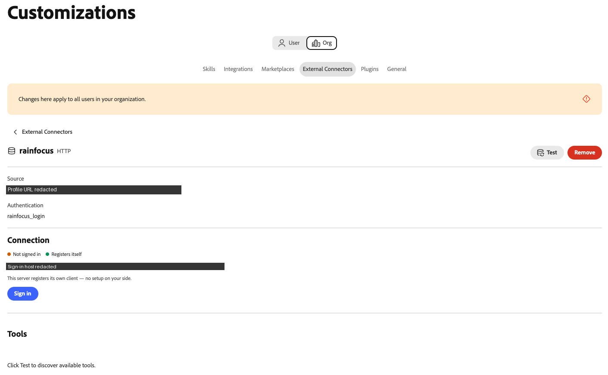

# RainFocus外部コネクタ {#rainfocus}

[!DNL RainFocus]外部コネクタを使用して、Adobe CX Enterprise Coworkerの[!DNL RainFocus] イベントデータを操作します。 コネクタを設定したら、[!DNL RainFocus] アカウントがアクセスできるセッション、参加者、カスタム属性について、同僚に問い合わせます。 コネクターは、[!DNL RainFocus]によってホストされているモデル コンテキスト プロトコル （MCP） サーバーである[!DNL RainFocus] MCP プロファイルを使用します。

>[!AVAILABILITY]
>
>[!DNL RainFocus]外部コネクタはベータ版です。 ドキュメントと機能は変更される場合があります。

## コネクタ設定 {#connector-configuration}

コネクタ設定プロセスには、次の3つの部分があります。

* **[!DNL RainFocus]の準備：** [!DNL RainFocus]管理者がMCP プロファイルをプロビジョニングし、そのツールを有効にし、プロファイル URLを提供します。 各メンバーには、適切な役割の[!DNL RainFocus] アカウントが必要です。
* **組織の設定：**&#x200B;共同作業者の管理者は、組織全体のMCP プロファイル URLを1回保存します。 コネクターは、読み取りツールの固定リストを有効にします。
* **メンバーのログイン：**&#x200B;各メンバーは、自分の[!DNL RainFocus] アカウントでログインします。 メンバーは、自分の[!DNL RainFocus]の役割とプロファイルが許可するデータのみにアクセスできます。

組織設定を保存しても、メンバーはログインせず、[!DNL RainFocus]権限も付与せず、[!DNL RainFocus] データツールも実行されません。 各メンバーは個別にサインインする必要があります。

## 前提条件 {#prerequisites}

始める前に、次の項目を確認してください。

* **Coworker アクセス：** [!DNL RainFocus] コネクタが使用可能な組織で、組織の設定が有効になっているCoworker管理者アカウント。
* **MCP プロファイル：** プロビジョニングされた[!DNL RainFocus] MCP プロファイルとその完全なHTTPS プロファイル URLは、[!DNL RainFocus]管理者から提供されます。 詳しくは、[MCP プロファイル URLの取得](#get-profile-url)を参照してください。
* **メンバーアカウント：**&#x200B;各メンバーに対して、必要なデータへのアクセス権を付与するセキュリティ役割を持つ[!DNL RainFocus] アカウント。

Coworkerにクライアント ID、クライアント秘密鍵、またはアクセストークンを入力しないでください。 各メンバーは、自分のアカウントで[!DNL RainFocus]にログインします。

## [!DNL RainFocus] アクセスを準備 {#prepare-rainfocus}

Coworkerでコネクタを設定する前に、[!DNL RainFocus]でMCP プロファイルとメンバーアクセスを準備します。 [!DNL RainFocus]は、プロファイル、有効なツール、メンバーの役割、および任意の料金を所有しています。 Coworkerには、組織のプロファイル URLとツールリスト、および各メンバーのログインが保存されます。

### MCP プロファイル URLの取得 {#get-profile-url}

[!DNL RainFocus]は通常、顧客の要件に基づいてMCP プロファイルを設定します。 [!DNL RainFocus]管理者がプロファイルを設定した場合、プロセスは次のようになります。

1. [!DNL RainFocus]で、**[!UICONTROL 統合スイート]** > **[!UICONTROL アクティブプロファイル]** > **[!UICONTROL MCP プロファイル]**&#x200B;を開き、プロファイルを作成します。
1. ユースケースに必要なツールのみを有効にし、他のツールはオフのままにします。
1. 生成されたMCP サーバーのURLをコピーします。 URLはプロファイルに固有です。

コネクタを設定するCoworker管理者に完全なURLを与えます。 プロファイル名を推測したり、自分でURLを作成したりしないでください。 詳しくは、[RainFocus MCP プロファイルのお知らせ](https://www.rainfocus.com/company/news-press/rainfocus-launches-ai-agent-connectivity-for-event-data-with-mcp-profiles/)を参照してください。

### メンバーのアクセスを確認 {#confirm-member-access}

各メンバーは、自分の[!DNL RainFocus] アカウントでログインします。 アカウントのセキュリティ役割と、プロファイルで有効になっているツールによって、メンバーがアクセスできるデータが制御されます。 [!DNL RainFocus]管理者に、各メンバーがタスクに対して最も権限の少ない役割を持っていることを確認するように依頼します。

## 組織のコネクタの設定 {#configure-organization}

管理者は、組織内のすべてのユーザーが[!DNL RainFocus] コネクタを利用できるようにします。 組織ページの変更は、組織内のすべてのユーザーに適用されます。 **[!UICONTROL 組織]** スコープは、組織の設定がオンになっている管理者にのみ表示されます。

1. **[!UICONTROL カスタマイズ]**&#x200B;を開き、**[!UICONTROL 組織]**&#x200B;を選択してから、**[!UICONTROL 外部コネクタ]**&#x200B;を選択します。
1. Beta ラベルを持ち、**[!UICONTROL 設定されていません]**&#x200B;と表示されている&#x200B;**[!UICONTROL RainFocus]** カードを検索します。 **[!UICONTROL Configure]**&#x200B;を選択します。

1. **[!UICONTROL RainFocusの設定]** ダイアログで、**[!UICONTROL 開発プロファイル URL]**&#x200B;を入力します。 [!DNL RainFocus]管理者が指定した完全なMCP プロファイル URLを使用します。

   URLは`https://`で始まる必要があります。 スペース、バックスラッシュ、クエリ文字列（`?`）、フラグメント（`#`）、ユーザー名またはパスワード、デフォルト以外のポート、または`.`または`..` パスセグメントを含めることはできません。 URLがルールと一致しない場合、Coworkerはルールを説明するメッセージを表示します。 共同作業者はURLの形式のみを確認します。 プロファイルが存在するか、使用できるかは確認されません。

1. **[!UICONTROL アクセスと権限]**&#x200B;および&#x200B;**[!UICONTROL 修正された読み取りツールの修正]**&#x200B;のセクションを確認します。 コネクターは10個の読み取りツールをすべて有効にし、このダイアログで追加、削除、または編集することはできません。 一部のツールでは、参加者の個人データや一括書き出しが返されます。 詳しくは、[使用可能なツール ](#available-tools)を参照してください。

   {width="500" zoomable="yes"}

1. **[!UICONTROL 接続を保存]**&#x200B;を選択します。 Coworkerは接続を保存しますが、フォームを編集したりキャンセルしたりすることはできません。

保存に失敗した場合、ダイアログに「**[!UICONTROL 接続を保存できませんでした]**」と表示され、入力したURLが保持されます。 保存に失敗した場合でも、一部の設定が保存される場合があります。 設定を再度開き、もう一度試す前に確認してください。 変更の競合を避けるには、コネクタを一度に1人の管理者のみが設定するようにしてください。

### 保存された設定を確認する {#verify-configuration}

接続を保存したら、設定を確認します。

1. 保存後、保存されたコネクタの詳細がダイアログで開きます。 **[!UICONTROL 外部コネクタ]** リストに戻り、**[!UICONTROL RainFocus]** カードに&#x200B;**[!UICONTROL 設定が保存され]**&#x200B;設定と&#x200B;**[!UICONTROL 設定を表示]**&#x200B;が表示されていることを確認します。
1. ページを再読み込みし、**[!UICONTROL 設定を表示]**&#x200B;を選択します。
1. 次の詳細を確認します。

   * **[!UICONTROL Source]**&#x200B;には、入力したプロファイル URLが表示されます。
   * **[!UICONTROL 認証]**&#x200B;が存在します。
   * **[!UICONTROL ツール ポリシー]** > **[!UICONTROL 許可されているツール名またはパターン]**&#x200B;には、[使用可能なツール ](#available-tools) セクションと同じ10個のツールが一覧表示されます。

1. 自分の接続を確認するには、**[!UICONTROL テスト]**&#x200B;を選択します。 共同作業者からログインを求められた場合は、[ メンバーとしてログイン ](#sign-in-as-a-member)の説明に従って、独自の[!DNL RainFocus] アカウントを使用してください。

   **[!UICONTROL テスト]**&#x200B;は、サーバーのツールを一覧表示し、**[!UICONTROL ツール]**&#x200B;の数を更新します。 サーバーがツールを返さない場合、詳細に&#x200B;**[!UICONTROL 0個のツールが使用可能であることが表示されます]**。 テストが失敗した場合、詳細に「**[!UICONTROL 接続に失敗しました]**」と表示されます。

   {width="700" zoomable="yes"}

コネクタの詳細に関する&#x200B;**[!UICONTROL 接続]**、**[!UICONTROL テスト]**、およびサインイン制御は、自分の接続にのみ適用されます。 管理者としてログインすると、メンバーはログインしません。 テストが成功した場合は、ツールのみがリストされます。 テストでは、[!DNL RainFocus] データツールを実行しないか、メンバーが特定のデータにアクセスできることを確認していません。

コネクタの詳細には、プロファイル URLを編集するオプションはありません。 **[!UICONTROL 削除]**&#x200B;は確認を開き、組織全体の接続を削除します。 削除は、トラブルシューティング手順ではなく、管理者による意図的な決定として扱います。

### 利用可能なツール {#available-tools}

[!DNL RainFocus] コネクタは、10個の読み取りツールの固定リストを有効にします。

| ツール | データ領域 |
| --- | --- |
| `get_attendeeInfo` | 参加者 |
| `get_attendee_load` | 参加者 |
| `get_attendee_search` | 参加者 |
| `get_attribute_load` | カスタム属性 |
| `get_attribute_search` | カスタム属性 |
| `get_attributevalue_load` | カスタム属性 |
| `get_entityDataDump_attendee` | 参加者、一括書き出し |
| `get_entityDataDump_session` | セッション、一括書き出し |
| `get_session_load` | Sessions |
| `get_session_search` | Sessions |

このリストに含まれていないツール （後で[!DNL RainFocus]が追加するツールを含む）は、自動的に有効になっていません。 このリストは、データへのアクセスを引き続き制御する[!DNL RainFocus]個のセキュリティ役割またはプロファイルのツール設定に置き換わりません。

>[!IMPORTANT]
>
>いくつかのツールは、参加者に関する個人データと連絡先情報を返すことができます。 2つのツールでデータを一括エクスポートすると、結果が大きくなる場合があります。 読み取りには、[!DNL RainFocus]条件に基づいて料金が発生する場合もあります。 メンバーがログインする前に、データガバナンスの所有者とこれらのツールを確認します。

## メンバーとしてログイン {#sign-in-as-a-member}

管理者がコネクタを設定すると、各メンバーは自分の[!DNL RainFocus] アカウントでサインインします。 ログインにクライアント ID、クライアント秘密鍵、またはアクセストークンは必要ありません。

1. **[!UICONTROL カスタマイズ]**&#x200B;を開き、**[!UICONTROL 外部コネクタ]**&#x200B;を選択します。 メンバーは、デフォルトで&#x200B;**[!UICONTROL User]** スコープを使用します。 **[!UICONTROL RainFocus]** カードを検索します。
1. カードに「**[!UICONTROL 未使用」と表示されている場合。 管理者がこの設定を行う必要があります。]**。管理者に[ コネクタの設定](#configure-organization)を依頼してください。 メンバーは自分のプロファイル URLを入力できません。
1. カードのステータスを確認します。 カードに&#x200B;**[!UICONTROL ログインが必要]**、**[!UICONTROL 接続済み]**、**[!UICONTROL 管理者による設定]**、または&#x200B;**[!UICONTROL 接続が失敗]**&#x200B;のステータスが表示されます。

   **[!UICONTROL 管理者による設定]**&#x200B;とは、共同作業者がログイン状態を確認できないことを意味します。 ログインまたはログアウトしているという意味ではありません。

1. 「**[!UICONTROL ログイン]**」を選択します。 カードの詳細を開き、**[!UICONTROL 接続]** セクションで&#x200B;**[!UICONTROL ログイン]**&#x200B;を選択することもできます。 [!DNL RainFocus] ウィンドウで、サインイン、シングルサインオン （SSO）、多要素認証（MFA）、同意プロンプトを完了します。 承認したアクセス権を確認します。

   **[!UICONTROL Discover authorization]**&#x200B;が表示された場合、Coworkerはサーバーのサインインの詳細を読み取り、そのツールは読み取りません。 検出に失敗した場合、またはパネルから&#x200B;**[!UICONTROL クライアント ID]**&#x200B;または&#x200B;**[!UICONTROL クライアントシークレット]**&#x200B;の入力を求められた場合は、停止して管理者にお問い合わせください。 資格情報を入力または推測しないでください。

   {width="700" zoomable="yes"}

1. 同僚に戻り、ステータスが&#x200B;**[!UICONTROL Connected]**&#x200B;であることを確認します。 クローズしたサインインウィンドウだけでは、成功を確認できません。 ウィンドウを早めに閉じると、何も変わりません。もう一度やり直すことができます。
1. カードの詳細を開き、管理者の設定を確認します。 **[!UICONTROL サーバーURL]**、**[!UICONTROL ログインしたユーザー]**、**[!UICONTROL 認証]**&#x200B;および&#x200B;**[!UICONTROL 管理者が有効にしたツール]**&#x200B;を表示できます。
1. カードの&#x200B;**[!UICONTROL テスト]**&#x200B;を選択するか、詳細の&#x200B;**[!UICONTROL 接続をテスト]**&#x200B;して、アカウントとの接続を確認します。

   テストが成功した場合、[!DNL RainFocus]さんがあなたのアカウントを使用して、利用可能なツールの数で応答したことが示されます。 テストでは、ツールのみがリストされます。 データツールを実行したり、特定のイベントやレコードへのアクセスを確認したりすることはありません。 ログインを更新してツールを再度一覧表示するには、**[!UICONTROL 更新]**&#x200B;を選択します。 Coworkerがログインを更新できない場合、代わりにボタンに&#x200B;**[!UICONTROL ツールを再読み込み]**&#x200B;と表示され、ツールのリストが再度表示されます。

1. テストが失敗した場合、Coworkerは&#x200B;**[!UICONTROL RainFocusに接続できませんでした]**、と&#x200B;**[!UICONTROL 再試行]**&#x200B;および&#x200B;**[!UICONTROL 技術的な詳細]**&#x200B;を表示します。 ログアウトしている場合は、再度ログインします。 問題が解決しない場合は、管理者にお問い合わせください。

メンバーは、ログイン、ログアウト、テスト、更新、および有効なツールの表示を行うことができます。 メンバーは、組織の接続を変更または削除したり、プロファイル URLを編集したり、ツールを変更したりすることはできません。 詳細を開くすべてのメンバーは、プロファイル URLを表示できます。 管理者がログインすると、他のメンバーはログインしません。

[!DNL RainFocus] アカウントをコネクタから切断するには、**[!UICONTROL ログアウト]**&#x200B;を選択します。 いつでも再度ログインできます。

## イベントデータへのアクセスを確認 {#check-event-access}

[!DNL RainFocus] データを使用できることを確認するには、狭いリクエストで読み取り専用チェックを実行します。 使用することを承認されたイベントを使用し、このチェックのために参加者データまたは一括書き出しを返すツールを回避します。 チャットを開始し、プロンプトを入力します。

プロンプトの例：

* 「RainFocusを使って、私がアクセスできるセッションを5つまで見つけてください。 これらのフィールドが返された場合は、セッションタイトルとIDのみを表示します。 データの書き出し、参加者の情報の返送、変更は行わないでください。」

結果に期待されるセッションが含まれていることを確認します。 結果が空の場合は、必ずしもコネクタが機能していないことを意味するわけではありません。 ログインした[!DNL RainFocus] アカウント、セキュリティの役割、およびプロファイルで有効になっているツールを確認してください。 結果が予想外に大きい場合や、機密データが含まれる場合は、リクエストを停止して絞り込みます。

## アクセスのトラブルシューティング {#troubleshoot-access}

[!DNL RainFocus] データにアクセスできない場合は、管理者に次の点を確認してください。

| 問題 | 確認すべきこと |
| --- | --- |
| **[!UICONTROL RainFocus]** カードがありません | コネクタが組織で使用可能であることをAdobe担当者に確認します。 |
| **[!UICONTROL 組織]**&#x200B;のスコープがありません | 自分が管理者であり、組織の設定が有効になっていることを確認します。 |
| 共同作業者はプロファイル URLを拒否します | メッセージのルールに従います。 [!DNL RainFocus]管理者の完全なプロファイル URLを使用して、プロファイル名を推測しないでください。 |
| **[!UICONTROL 接続を保存できませんでした]**&#x200B;が表示されます | 一部の設定が保存される場合があります。 設定を再度開き、もう一度試す前に確認してください。 コネクタを一度に1人の管理者のみが設定していることを確認してください。 |
| カードに「**[!UICONTROL まだ利用できません」と表示されます。 管理者がこの設定を行う必要があります。]** | 組織の設定がありません。 管理者に[ コネクタの設定](#configure-organization)を依頼します。 |
| **[!UICONTROL クライアント ID]**&#x200B;または&#x200B;**[!UICONTROL クライアントシークレット]**&#x200B;のログインを要求するか、検出に失敗します | 停止し、管理者に連絡してください。 資格情報を入力したり、推測したり、アプリを登録したりしないでください。 |
| [!DNL RainFocus]でアクセスを承認すると、ログインが失敗します | 使用した[!DNL RainFocus] アカウントとセキュリティの役割を確認してください。 Adobeの担当者と[!DNL RainFocus]に、お使いの環境のサインイン設定を確認するように依頼します。 ログイン URLを共有しないでください。 |
| **[!UICONTROL テスト]**&#x200B;は成功しましたが、データ要求は失敗しました | **[!UICONTROL テスト]**&#x200B;では、ツールのみが一覧表示されます。 [!DNL RainFocus] セキュリティの役割、プロファイルで有効になっているツール、ツールに必要なフィルターを確認してください。 |
| ログインすると、**[!UICONTROL Couldn&#39;t connect to RainFocus]**&#x200B;が表示されます | **[!UICONTROL もう一度やり直す]**&#x200B;を選択します。 問題が解決しない場合は、管理者にお問い合わせください。 |
| 結果が予期せず大きい、または機密データを含む | リクエストを停止して絞り込みます。 チケットやチャットに生のイベントデータを貼り付けないでください。 |

サポートにお問い合わせの際は、エラーテキスト、エラーの時間、お客様の環境のみを含めてください。 技術情報、プロファイル URL、サインインキャプチャ、パスワード、トークン、認証コードは共有しないでください。
