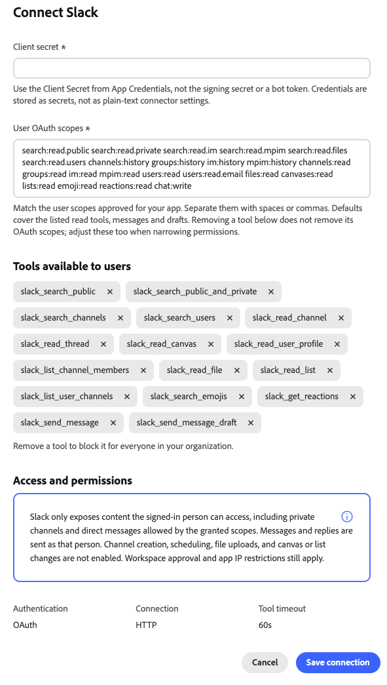
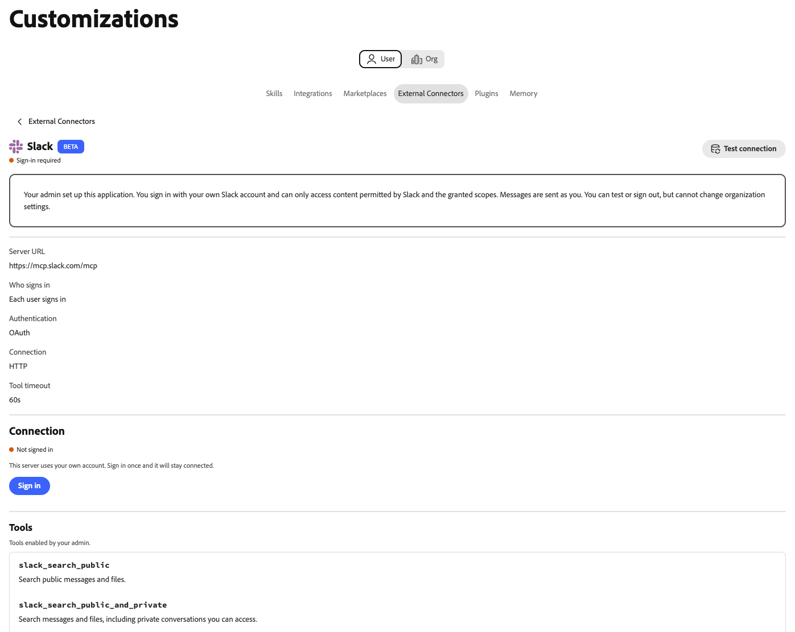

# Slack外部コネクタ {#slack}

[!DNL Slack]外部コネクタを使用して、Adobe CX Enterprise Coworkerで[!DNL Slack]の会話を操作します。 コネクタを設定したら、Coworkerにメッセージとファイルの検索、チャネルとスレッドの読み取り、人物の検索を依頼します。 管理者がこれらのツールを有効にしている場合は、メッセージや返信を送信することもできます。 コネクタは、[!DNL Slack]がホストする公式リモート モデル コンテキスト プロトコル （MCP） サーバーを使用します。

>[!AVAILABILITY]
>
>[!DNL Slack]外部コネクタはベータ版です。 ドキュメントと機能は変更される場合があります。

## コネクタ設定 {#connector-configuration}

コネクタ設定プロセスには、次の3つの部分があります。

* **[!DNL Slack]アプリの準備：** [!DNL Slack] アプリの所有者は、対象アプリを準備し、Coworker リダイレクト URLを登録し、ユーザーの範囲を設定します。 Adobeは、管理された[!DNL Slack] アプリを提供しません。
* **組織の設定：**&#x200B;共同作業者の管理者は、組織全体に対して1回コネクタを設定します。 管理者はアプリの資格情報を入力し、ユーザーのOAuth スコープとメンバーが使用できるツールを選択します。
* **メンバーのログイン：**&#x200B;各メンバーは、自分の[!DNL Slack] アカウントでログインします。 メンバーは、自分の[!DNL Slack] アカウントがアクセスできるコンテンツのみにアクセスできます。

コネクターは、共有ボットまたは共有[!DNL Slack] IDを使用しません。 共同作業者は、ログインしているメンバーとしてメッセージを送信し、返信します。 組織設定を保存しても、メンバーはログインせず、追加の[!DNL Slack] アクセスも許可されません。 各メンバーは個別にサインインする必要があります。

## 前提条件 {#prerequisites}

始める前に、次の項目を確認してください。

* **同僚アクセス：**&#x200B;組織コネクタを管理する権限を持つアカウントで、[!DNL Slack] コネクタが使用可能な組織内にあります。
* **A [!DNL Slack] アプリ：** ワークスペース用に承認された内部アプリまたは[!DNL Slack Marketplace] アプリ。 また、承認されたユーザーの範囲を確認し、アプリ設定を編集できるアプリの所有者が必要です。
* **アプリの資格情報：** アプリのクライアント IDとクライアントの秘密鍵。資格情報を処理するための承認済みプロセスを通じて共有されます。
* **ツールとスコープの決定：**&#x200B;組織が有効にする予定の読み取り、メッセージ、ドラフトのツール、およびユーザーOAuth スコープをリクエストする予定です。
* **テストワークスペースまたはチャネル：** テストに同意したメンバーとの接続を確認する場所。 顧客または実稼動チャネルでテストメッセージを送信しないでください。

>[!IMPORTANT]
>
>スクリーンショット、チャット、サポートチケットでクライアントの秘密鍵、アクセストークン、その他の資格情報を絶対に共有しない。 設定ダイアログのセキュアフィールドにのみ資格情報を入力します。

## Slack アプリの準備 {#prepare-slack-app}

Coworkerでコネクタを設定する前に、アプリ所有者が[!DNL Slack] アプリを準備します。 ワークスペースまたは組織のアプリ管理者が承認する必要がある場合もあります。 [!DNL Slack]の要件については、[!DNL Slack]開発者向けドキュメントの[Slack MCP server](https://docs.slack.dev/ai/slack-mcp-server/)を参照してください。

### 対象アプリの選択 {#choose-eligible-app}

[!DNL Slack]は、[!DNL Slack Marketplace]で公開されている内部カスタム アプリとアプリに対してのみ、そのMCP サーバーをサポートしています。 組織外に配布されている非掲載アプリは、[!DNL Slack] MCP サーバーを使用できません。 パブリックディストリビューションをオンにするだけでは、アプリは対象になりません。

1. アプリを所有するワークスペースまたは組織、およびアプリの所有者を選択します。
1. [Slack アプリ管理](https://api.slack.com/apps)で、そのワークスペースに新しいアプリを作成します。 既存の適格なアプリを再利用するには、まず所有者から承認を得る必要があります。
1. アプリ設定で、**[!UICONTROL 基本情報]** > **[!UICONTROL アプリ資格情報]**&#x200B;を選択します。 **[!UICONTROL クライアント ID]**&#x200B;と&#x200B;**[!UICONTROL クライアントシークレット]**&#x200B;に注意してください。

   Coworkerには、これら2つの値のみを入力します。 アプリ ID、署名シークレット、ボットトークン、またはアプリレベルのトークンは使用しないでください。

### リダイレクト URLを登録 {#register-redirect-url}

[!DNL Slack] アプリにCoworker リダイレクト URLを登録します。

1. [組織のコネクタの設定](#configure-organization)の説明に従って、Coworkerで&#x200B;**[!UICONTROL Connect Slack]** ダイアログを開きます。 **[!UICONTROL リダイレクト URL]**&#x200B;の値をコピーします。

   ダイアログを開いて、設定を完了または保存する前にURLをコピーできます。

1. [!DNL Slack] アプリの設定で、**[!UICONTROL OAuth &amp; Permissions]**&#x200B;を選択します。 **[!UICONTROL リダイレクト URL]**&#x200B;で、完全なリダイレクト URLを追加してから保存します。

設定している環境の同僚ダイアログからリダイレクト URLを常にコピーします。 正確なスキーム、ホスト名、ポートが存在する場合、およびパスを登録します。 自分でURLを作成したり、別の環境からリダイレクト URLを再利用したりしないでください。 複数の環境を使用する場合は、各リダイレクト URLを個別に登録します。

### ユーザー範囲の設定 {#set-user-scopes}

コネクタは、各メンバーのアカウントを認証するユーザーOAuth スコープを使用します。 ボットスコープは使用しません。

1. [!DNL Slack] アプリ設定で、**[!UICONTROL OAuth &amp; Permissions]** > **[!UICONTROL スコープ]** > **[!UICONTROL ユーザートークンスコープ]**&#x200B;を選択します。
1. 組織が承認するユーザー範囲を追加します。 Coworkerの[ デフォルトのスコープ ](#review-scopes)と比較し、リクエストするスコープのみを追加します。

   既定のスコープは、Coworkerの既定の機能セットです。[!DNL Slack]が必要とする最小値ではありません。 古い`search:read` スコープではなく、詳細な`search:read.*` スコープを使用してください。 アプリマニフェストでは、ユーザースコープは`oauth_config.scopes.bot`ではなく`oauth_config.scopes.user`に属しています。

`chat:write` ユーザースコープでは、共同作業者がログインしているメンバーとしてメッセージを送信できます。 組織でメッセージを送信しない場合は、メッセージを除外します。

ワークスペースまたは[!DNL Slack]のエンタープライズ組織では、アプリの承認とスコープのレビューが必要になる場合があります。 アプリの承認が各メンバーの同意に取って代わることはありません。 [!DNL Slack Marketplace]個のアプリのみを許可するポリシーは、内部アプリをブロックできます。 詳しくは、[ ワークスペースのアプリ承認の管理](https://slack.com/help/articles/222386767-Manage-app-approval-for-your-workspace)を参照してください。

アプリで許可されたIP アドレス制限を使用している場合、[!DNL Slack]はMCP リクエストにも適用します。 許可するアドレスを確認するには、Adobe担当者にお問い合わせください。 IP アドレス範囲を推測しないでください。 セマンティック検索などの一部の機能は、[!DNL Slack] プランによって異なります。

### アプリ設定を元に戻せません {#review-irreversible-settings}

Coworkerは、クライアント IDとクライアントシークレットを使用して、機密OAuth クライアントとして接続します。 [!DNL Slack]個のアプリ設定の一部を元に戻すことができません。変更する前に、次の点を確認してください。

* **コード交換のプルーフ キー（PKCE）:**&#x200B;このコネクタの[!DNL Slack] PKCE設定を確認せずに有効にしないでください。 [!DNL Slack]は、この設定がアプリをパブリッククライアントに変更し、これを元に戻すことができるのは[!DNL Slack] サポートのみであることを文書化します。 詳しくは、[PKCEの使用](https://docs.slack.dev/authentication/using-pkce/)を参照してください。
* **トークンのローテーション：** [!DNL Slack] トークンのローテーションは、オンにした後にオフにすることはできません。 このアプリの電源を入れる前に、Adobe担当者にお問い合わせください。 詳しくは、[ トークンのローテーションの使用](https://docs.slack.dev/authentication/using-token-rotation/)を参照してください。

### ボット機能は必要ありません {#bot-features-not-required}

コネクタにはボット機能は必要ありません。 ボットトークンの範囲、[!DNL Events API] リクエスト URL、インタラクティブなリクエスト URL、着信Webhook、スラッシュコマンド、[!DNL Socket Mode]、アプリレベルのトークンは必要ありません。 既存のアプリが別の目的でこれらの機能を利用している場合は、それを維持しましょう。

[!DNL Slack] MCP サーバーは、動的クライアント登録またはサーバー送信イベント （SSE）をサポートしていません。 Coworkerは、登録されたアプリとStreamable HTTP トランスポートを使用します。

## 組織のコネクタの設定 {#configure-organization}

管理者は、組織内のすべてのユーザーが[!DNL Slack] コネクタを利用できるようにします。 組織ページの変更は、組織内のすべてのユーザーに適用されます。 メンバーがログインする前に、[Slack アプリの準備](#prepare-slack-app)を完了します。

1. **[!UICONTROL カスタマイズ]**&#x200B;を開き、**[!UICONTROL 組織]**&#x200B;を選択してから、**[!UICONTROL 外部コネクタ]**&#x200B;を選択します。 **[!UICONTROL Slack]** カードで、**[!UICONTROL Configure]**&#x200B;を選択します。

   **[!UICONTROL Connect Slack]** ダイアログが開きます。 コネクターは、固定された[!DNL Slack] MCP サーバーURL `https://mcp.slack.com/mcp`を使用します。 個人用の接続ではなく、この構成の組織範囲を使用してください。

1. [ リダイレクト URLの登録](#register-redirect-url)の説明に従って、**[!UICONTROL Slack アプリケーション]**&#x200B;の&#x200B;**[!UICONTROL リダイレクト URL]**&#x200B;がアプリに登録されていることを確認してください。 次に、アプリの&#x200B;**[!UICONTROL クライアント ID]**&#x200B;と&#x200B;**[!UICONTROL クライアントシークレット]**&#x200B;を入力します。 両方のフィールドが必須です。

   アプリ ID、署名秘密鍵、またはボットトークンは入力しないでください。 Coworkerは、資格情報をプレーンテキストコネクタ設定としてではなく、シークレットとして保存します。

   {width="500" zoomable="yes"}

1. **[!UICONTROL ユーザーのOAuth スコープ]**&#x200B;を確認します。 詳しくは、[ ユーザーのOAuth スコープの確認](#review-scopes)を参照してください。

1. ユーザーが利用できる&#x200B;**[!UICONTROL ツール]**&#x200B;の下で、メンバーが使用しないツールをすべて削除します。 少なくとも1つのツールが残っている必要があります。 詳しくは、[使用可能なツール ](#available-tools)を参照してください。

1. **[!UICONTROL アクセスと権限]**&#x200B;を確認し、**[!UICONTROL 接続を保存]**&#x200B;を選択します。 **[!UICONTROL Slack]** カードに&#x200B;**[!UICONTROL 設定が保存されました]**。

   ダイアログには、**[!UICONTROL 認証]** メソッド、**[!UICONTROL 接続]** タイプ、および&#x200B;**[!UICONTROL ツールタイムアウト]**&#x200B;も表示されます。 資格情報フィールドまたはスコープ リストが空の場合、共同作業者は設定を保存しません。

   ページを再読み込みし、**[!UICONTROL 設定を表示]**&#x200B;を選択し、設定とツール選択が保存されていることを確認してからメンバーがログインします。

   {width="500" zoomable="yes"}

保存中は、あなたまたはメンバーが[!DNL Slack]にログインしていません。 接続を確認するには、「[ メンバーとしてログイン ](#sign-in-as-a-member)」の説明に従って、自分としてログインします。

### ユーザーのOAuth スコープの確認 {#review-scopes}

**[!UICONTROL ユーザーOAuth スコープ]** フィールドが必要です。 スコープをスペースまたはコンマで区切り、アプリに対して承認されたユーザーのスコープと一致させます。 デフォルトでは、フィールドには次の22個のスコープが含まれています。

```text
search:read.public search:read.private search:read.im search:read.mpim search:read.files search:read.users channels:history groups:history im:history mpim:history channels:read groups:read im:read mpim:read users:read users:read.email files:read canvases:read lists:read emoji:read reactions:read chat:write
```

ワークスペースで、すべてのデフォルトのスコープを承認できない場合があります。 アプリの所有者と共に、リクエストされたスコープを確認します。

>[!IMPORTANT]
>
>デフォルトのスコープには、プライベートチャネル、グループメッセージ、ダイレクトメッセージなどのプライベートコンテンツが含まれます。 また、`chat:write`も含まれます。これは、共同作業者がログインしているメンバーとしてメッセージや返信を送信できるようにします。 自社でメッセージ送信ツールを有効にするかどうかを明示的に決定します。 ツールを削除しても、そのOAuth スコープは削除されません。 メンバーにメッセージを送信させたくない場合は、`slack_send_message` ツールと`chat:write` スコープを削除します。

ツールの選択とOAuth スコープは独立しています。 アクセスを絞り込む場合は、ツールリストとスコープフィールドの両方を確認します。 有効なツールでは、メンバーにアカウントのアクセス権より多い[!DNL Slack] アクセス権を与えません。

### 利用可能なツール {#available-tools}

[!DNL Slack] コネクタには、次の16個のツールが用意されています。 デフォルトでは、これらはすべてメンバーが利用できます。

| 機能 | ツール |
| --- | --- |
| 検索 | `slack_search_public` |
| 検索 | `slack_search_public_and_private` |
| 検索 | `slack_search_channels` |
| 検索 | `slack_search_users` |
| 会話を読む | `slack_read_channel` |
| 会話を読む | `slack_read_thread` |
| 会話を読む | `slack_list_channel_members` |
| 会話を読む | `slack_list_user_channels` |
| コンテンツとプロファイルを読む | `slack_read_canvas` |
| コンテンツとプロファイルを読む | `slack_read_user_profile` |
| コンテンツとプロファイルを読む | `slack_read_file` |
| コンテンツとプロファイルを読む | `slack_read_list` |
| 絵文字と反応 | `slack_search_emojis` |
| 絵文字と反応 | `slack_get_reactions` |
| メッセージとドラフト | `slack_send_message` |
| メッセージとドラフト | `slack_send_message_draft` |

コネクタは読み取り専用ではありません。 メンバーは、`slack_send_message` ツールを削除しない限り、メッセージを送信したり、返信したりできます。 チャネルの作成、スケジュールされたメッセージ、ファイルのアップロード、リアクションの追加、キャンバスまたはリストの変更は含まれません。

## メンバーとしてログイン {#sign-in-as-a-member}

管理者がコネクタを設定すると、各メンバーは自分の[!DNL Slack] アカウントでサインインします。 ログインにクライアントシークレットは必要ありません。

1. **[!UICONTROL カスタマイズ]**&#x200B;を開き、**[!UICONTROL ユーザー]**&#x200B;を選択してから、**[!UICONTROL 外部コネクタ]**&#x200B;を選択します。

1. **[!UICONTROL Slack]** カードを検索します。 カードに「**[!UICONTROL 未設定]**」と「**[!UICONTROL まだ利用できません」と表示されている場合。 管理者がこの設定を行う必要があります。]**。管理者に[ コネクタの設定](#configure-organization)を依頼してください。

   組織のクライアントの秘密鍵を要求したり、コピーしたりしないでください。

1. 管理者がコネクタを設定すると、**[!UICONTROL Slack]** カードに&#x200B;**[!UICONTROL ログインが必要]**&#x200B;と表示されます。 カードで&#x200B;**[!UICONTROL サインイン]**&#x200B;を選択します。

   **[!UICONTROL Slack]** コネクタの詳細を開くこともできます。 ログインする前に、**[!UICONTROL 接続]** セクションに&#x200B;**[!UICONTROL ログインしていません]**、および&#x200B;**[!UICONTROL ログイン]** ボタンが表示されます。

   {width="700" zoomable="yes"}

1. 使用する[!DNL Slack] アカウントとワークスペースを使用して、[!DNL Slack]の承認を完了します。 要求された権限とワークスペースの承認要件を確認します。

   >[!IMPORTANT]
   >
   >アプリを認識し、組織がリクエストされたアクセスを承認した場合にのみ続行します。

1. 同僚に戻り、接続ステータスを確認します。 **[!UICONTROL 接続をテスト]**&#x200B;を選択し、[接続に依存する前にSlack アクセス ](#check-access)を確認します。

1. メッセージ施策を注意深く検証。 共同作業者は、メッセージと返信を[!DNL Slack] アカウントとして送信します。

メンバーとして、接続をテストしたりログアウトしたりすることはできますが、組織の設定を変更することはできません。 アクセスできるのは、[!DNL Slack]と許可されたスコープが許可するコンテンツのみです。 このコンテンツには、自分の[!DNL Slack] アカウントがアクセスできる場合にのみ、プライベート会話が含まれます。

[!DNL Slack] アカウントをコネクタから切断するには、**[!UICONTROL ログアウト]**&#x200B;を選択します。

## Slackへのアクセスを確認する {#check-access}

コネクタが[!DNL Slack] コンテンツを読み取れることを確認するには、チャットを開始し、読み取り専用プロンプトを入力します。 管理者が`slack_list_user_channels` ツールを有効にしていることを確認してください。

プロンプトの例：

* 「Slackを使用して、自分が属しているチャネルを5つまでリストアップします。 チャネル名のみを表示します。 メッセージを送信したり、ドラフトを作成したり、何かを変更したりしないでください。

組織でメッセージングツールを有効にしている場合は、テスト用に別枠で設定したチャネルでのみ、承認を得て送信をテストします。 2人目のメンバーに個別にサインインするように依頼し、各メンバーが自分の[!DNL Slack] コンテンツのみを表示することを確認します。

## アクセスのトラブルシューティング {#troubleshoot-access}

設定、ログイン、またはアクセスに失敗した場合は、管理者に次の点を確認してください。

| 問題 | 確認すべきこと |
| --- | --- |
| 設定を保存できません | クライアント IDとクライアントシークレットの両方を入力し、少なくとも1つのユーザーOAuth スコープを保持し、少なくとも1つのツールを保持します。 アプリ ID、署名秘密鍵、またはボットトークンは入力しないでください。 |
| **[!UICONTROL リダイレクト URL]**&#x200B;がないか、[!DNL Slack]がリダイレクトの不一致を報告しています | スキーム、ホスト、ポート、パスを含む、同僚ダイアログからの完全なリダイレクト URLと、[!DNL Slack] アプリに保存された&#x200B;**[!UICONTROL リダイレクト URL]**&#x200B;を比較します。 URLが見つからない場合や値が異なる場合は、Adobe担当者にお問い合わせください。 |
| [!DNL Slack] ログインまたはリクエストが失敗しました | アプリの承認、許可されたユーザー範囲、ログインした[!DNL Slack] アカウントとワークスペース、アプリに対するIP アドレスの制限を確認します。 リクエストが失敗し続ける場合は、ログアウトしてから、再度ログインします。 |
| 読み取りまたは送信アクションを使用できません | 組織のツール選択、要求および付与されたスコープ、メンバーの[!DNL Slack]権限を確認してください。 これらの設定は独立しています。 |
| メンバーはアプリ設定を変更できません | この動作は、組織が管理する接続に対して期待されます。 管理者に尋ねます。 メンバーは、組織のクライアントの秘密鍵を入力できません。 |
