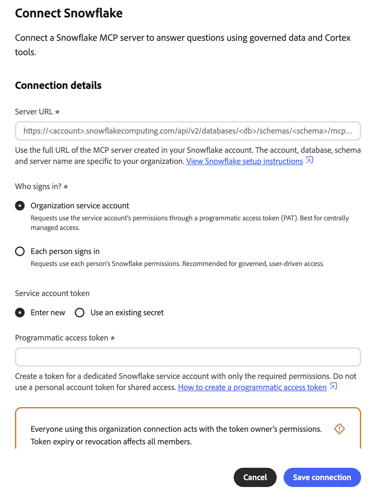
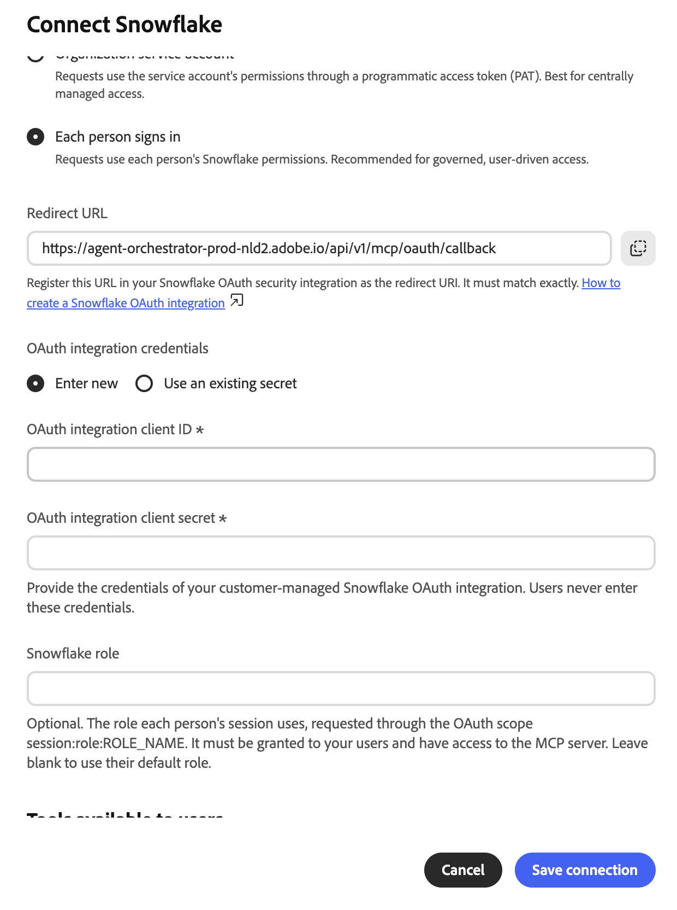
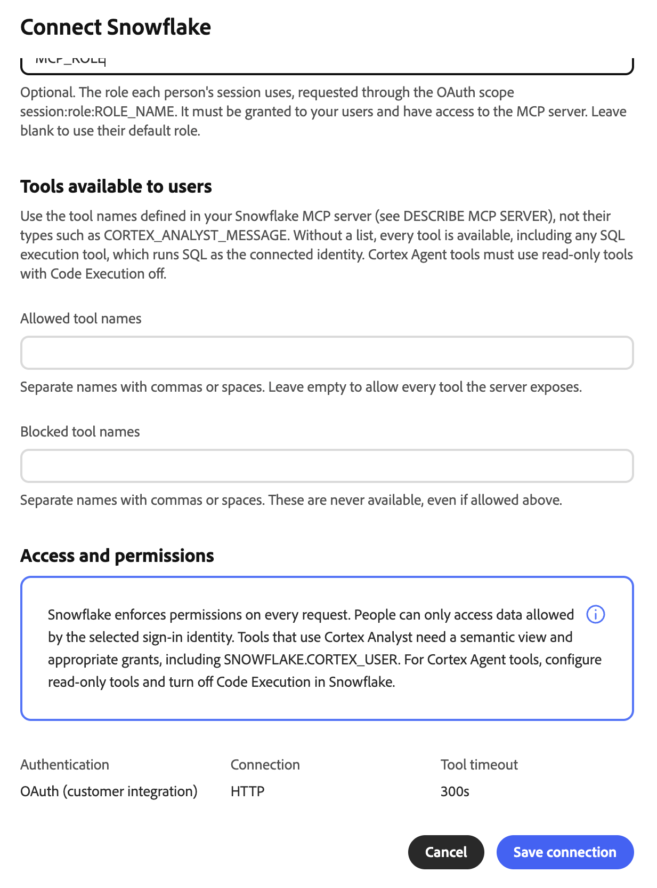
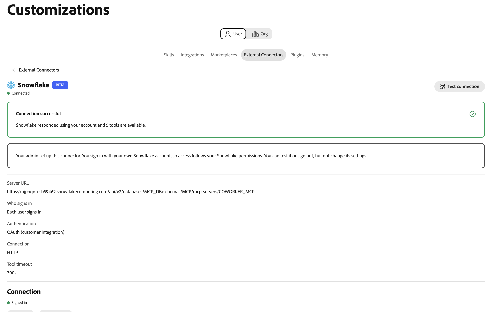

# Snowflake Cortex AI外部コネクタ {#snowflake}

[!DNL Snowflake Cortex AI]外部コネクタを使用して、Adobe CX Enterprise Coworkerの平易な言葉で[!DNL Snowflake] データについて質問します。 コネクターは、Coworkerを[!DNL Snowflake] アカウント内の[!DNL Snowflake]管理モデル コンテキスト プロトコル （MCP） サーバーにリンクします。 次に、共同作業者は、サーバーが公開するツール（[!DNL Cortex Analyst]、[!DNL Cortex Search]、SQL ツールなど）を使用できます。

>[!AVAILABILITY]
>
>[!DNL Snowflake Cortex AI]外部コネクタはベータ版です。 ドキュメントと機能は変更される場合があります。

## コネクタ設定 {#connector-configuration}

コネクタ設定プロセスには、次の2つの別々の部分があります。

* **組織の設定：**&#x200B;管理者は、Coworkerを既存の[!DNL Snowflake] MCP サーバーに接続し、ユーザーがログインする方法を選択し、メンバーが使用できるツールを選択します。
* **メンバーのアクセス：**&#x200B;のメンバーは、サインインオプションに応じて、共有組織IDまたは自分の[!DNL Snowflake] IDのいずれかで接続を使用します。

管理者は、次のいずれかのログインオプションを選択します。

| オプション | 管理者が提供すること | アクセスの仕組み |
| --- | --- | --- |
| **[!UICONTROL 組織サービスアカウント]** | サービス アカウントの[!DNL Snowflake] プログラマティック アクセス トークン （PAT）。 | すべてのメンバーは、サービスアカウントの権限を使用します。 トークンの有効期限または失効は、すべてのメンバーに影響します。 |
| **[!UICONTROL 各人が]**&#x200B;にサインインします | [!DNL Snowflake] OAuth統合のクライアント IDとクライアント秘密鍵、およびオプションの[!DNL Snowflake]役割。 | 各メンバーは自分の[!DNL Snowflake] IDでログインし、アクセスは[!DNL Snowflake]権限に従います。 |

いずれのオプションも、選択したIDがまだ持っていない[!DNL Snowflake]権限を付与しません。 [!DNL Snowflake]は、すべてのリクエストに対して権限を適用します。

## 前提条件 {#prerequisites}

共同作業者は既存の[!DNL Snowflake] MCP サーバーに接続します。 サーバーやそのツールは作成しません。 始める前に、次の項目を確認してください。

* **組織のセットアップ用：** Coworkerで組織コネクタを管理する権限を持つアカウント。
* **[!DNL Snowflake] MCP サーバーの場合：** データベース、スキーマ、サーバー名を含む、サーバーの完全なHTTPS URL。
* **サービスアカウントオプションの場合：**&#x200B;専用サービスアカウントのPAT。 サービスアカウントの役割は、MCP サーバーとそのツールに必要な権限のみを持つ必要があります。
* **個人ごとのサインインオプションの場合：** クライアント IDとクライアント秘密鍵を使用した[!DNL Snowflake]のOAuth統合。 また、Coworker リダイレクト URLを登録し、統合を設定できる[!DNL Snowflake]管理者が必要です。

>[!IMPORTANT]
>
>PAT、OAuth クライアントシークレット、またはスクリーンショット、チャット、サポートチケット内の他の資格情報を絶対に共有しないでください。 組織シークレットと最小権限[!DNL Snowflake] IDを使用します。

### Snowflake MCP サーバーの設定 {#configure-snowflake-mcp-server}

[!DNL Snowflake]管理者は、コネクタを設定する前に、[!DNL Snowflake]で次のタスクを完了する必要があります。

1. MCP サーバーを作成し、公開するツールを定義します。
1. 必要な役割にMCP サーバー、そのツール、および基になるオブジェクトへのアクセス権を付与します。

   MCP サーバーへのアクセスは、すべてのツールまたはオブジェクトへのアクセスを自動的に許可するわけではありません。

1. 使用するサインインオプションの認証を設定します。

   * サービスアカウントオプションの場合は、サービスアカウントのPATを作成します。
   * 個人単位のサインインオプションの場合は、更新トークンを発行するOAuth統合を作成します。

手順については、次の[!DNL Snowflake] ドキュメントを参照してください。

* [Snowflakeで管理されているMCP サーバー](https://docs.snowflake.com/en/user-guide/snowflake-cortex/cortex-agents-mcp){target="_blank"}
* [MCP サーバーの作成](https://docs.snowflake.com/en/sql-reference/sql/create-mcp-server){target="_blank"}
* [アクセス制御の概要](https://docs.snowflake.com/en/user-guide/security-access-control-overview){target="_blank"}
* [カスタムクライアント用のSnowflake OAuthの設定](https://docs.snowflake.com/en/user-guide/oauth-custom){target="_blank"}
* [セキュリティ統合の作成（Snowflake OAuth）](https://docs.snowflake.com/en/sql-reference/sql/create-security-integration-oauth-snowflake){target="_blank"}
* [認証にプログラマティックアクセストークンを使用する](https://docs.snowflake.com/en/user-guide/programmatic-access-tokens){target="_blank"}

## 組織のコネクタの設定 {#configure-organization}

管理者は、組織内のすべてのユーザーが[!DNL Snowflake Cortex AI] コネクタを利用できるようにします。 組織ページの変更は、組織内のすべてのユーザーに適用されます。

1. **[!UICONTROL カスタマイズ]**&#x200B;を開き、**[!UICONTROL 組織]**&#x200B;を選択してから、**[!UICONTROL 外部コネクタ]**&#x200B;を選択します。 **[!UICONTROL Snowflake Cortex AI]** カードで、**[!UICONTROL Configure]**&#x200B;を選択します。

1. **[!UICONTROL Connect Snowflake Cortex AI]** ダイアログで、[!DNL Snowflake] MCP サーバーの完全なURLを&#x200B;**[!UICONTROL サーバーURL]**&#x200B;に入力します。 URLはHTTPSを使用し、次のパターンに従う必要があります。

   ```text
   https://<account-host>/api/v2/databases/<database>/schemas/<schema>/mcp-servers/<server-name>
   ```

   [!DNL Snowflake] アカウントとMCP サーバーの正確なURLを使用します。 アカウントのホスト名に、エンコードされたアンダースコア （`%5F`）を含むアンダースコアを含めることはできません。 URLに資格情報を含めないでください。 共同作業者は、保存する前にHTTPS スキーム、ホスト、およびパスを確認します。

1. **[!UICONTROL 誰がログインしますか？]**&#x200B;で、サインインオプションを選択し、設定を完了します。

   * **[!UICONTROL 組織サービスアカウント ]:**&#x200B;要求は、プログラマティックアクセストークン（PAT）を介してサービスアカウントの権限を使用します。 このオプションは、一元管理されたアクセスに使用します。 個人アカウントではなく、範囲が狭い役割を持つ専用のサービスアカウントを使用します。

     {width="500" zoomable="yes"}

     | 設定 | 説明 |
     | --- | --- |
     | **[!UICONTROL サービスアカウントトークン]** | トークンの取得元を選択します。 **[!UICONTROL Enter new]**&#x200B;を選択してPATを入力するか、**[!UICONTROL 既存のシークレット]**&#x200B;を使用して、既にトークンを含む組織シークレットを再利用します。 既存の秘密鍵には、生のトークンだけでなく、`Authorization` ヘッダーの完全な値を含める必要があります。 |
     | **[!UICONTROL プログラマティック アクセス トークン]** | **[!UICONTROL 新しい]**&#x200B;を入力する場合は必須です。 必要な権限のみを持つ専用の[!DNL Snowflake] サービスアカウントのトークンを作成します。 手順については、ダイアログで「**[!UICONTROL プログラマティックアクセストークンの作成方法]**」を選択します。 共同作業者は、トークンを組織の秘密鍵として保存します。 |

     >[!IMPORTANT]
     >
     >この接続を使用するすべてのユーザーは、トークン所有者の権限に従って行動します。 トークンが期限切れになったり、取り消されたりすると、すべてのメンバーに対して接続が機能しなくなります。

     PATを作成して使用するには、[!DNL Snowflake] ネットワーク ポリシーと認証ポリシーを適用できます。 トークンの作成または認証がブロックされている場合は、[!DNL Snowflake]管理者にこれらのポリシーを確認するように依頼します。

   * **[!UICONTROL 各ユーザーが]:**&#x200B;にサインインすると、各ユーザーの[!DNL Snowflake]権限が使用されます。 このオプションは、管理されたユーザー駆動型アクセスに使用します。

     {width="500" zoomable="yes"}

     | 設定 | 説明 |
     | --- | --- |
     | **[!UICONTROL リダイレクト URL]** | 読み取り専用： このURLをコピーし、[!DNL Snowflake] OAuth セキュリティ統合でリダイレクト URIとして登録します。 値は正確に一致する必要があります。 手順については、ダイアログで「**[!UICONTROL Snowflake OAuth統合の作成方法]**」を選択します。 リダイレクト URLは環境によって異なるので、必ずダイアログからコピーしてください。 |
     | **[!UICONTROL OAuth統合資格情報]** | 資格情報の取得元を選択してください。 「**[!UICONTROL 新しい]**&#x200B;を入力」を選択してクライアント IDとクライアント秘密鍵を入力するか、**[!UICONTROL 既存の秘密鍵]**&#x200B;を使用して、それらを含む組織の秘密鍵を選択します。 |
     | **[!UICONTROL OAuth統合クライアント ID]** | **[!UICONTROL 新しい]**&#x200B;を入力する場合は必須です。 顧客管理の[!DNL Snowflake] OAuth統合のクライアント ID。 |
     | **[!UICONTROL OAuth統合クライアント秘密鍵]** | **[!UICONTROL 新しい]**&#x200B;を入力する場合は必須です。 同じOAuth統合のクライアント秘密鍵。 メンバーはこれらの資格情報を入力できません。 |
     | **[!UICONTROL Snowflake ロール]** | オプション。 OAuth スコープ `session:role:ROLE_NAME`を通じて要求された、各セッションが使用する役割。 役割はメンバーに付与され、MCP サーバーにアクセスできる必要があります。 各メンバーのデフォルトの役割を使用するには、フィールドを空白のままにします。 |

     Coworkerは、アカウント URLからOAuth エンドポイントを取得し、更新トークンをリクエストします。 更新トークンを発行するようにOAuth統合を設定します。 要求されたスコープだけでは、統合設定は上書きされません。

     共同作業者は役割名を大文字に変換します。 引用符で囲んだ小文字の名前で作成された役割は使用できません。 OAuth統合が役割をブロックするか、メンバーに役割がない場合、サインインまたはアクセスが失敗する可能性があります。

1. **[!UICONTROL ユーザーが利用できるツール]**&#x200B;で、メンバーが使用できるツールを選択します。 各[!DNL Snowflake] MCP サーバーは独自のツールを定義するため、ダイアログには固定リストは表示されません。 MCP サーバーで定義されているツール名を入力します。`CORTEX_ANALYST_MESSAGE`などのツールの種類は入力しません。 ツール名を表示するには、[!DNL Snowflake]で`DESCRIBE MCP SERVER`を実行します。

   {width="500" zoomable="yes"}

   | 設定 | 説明 |
   | --- | --- |
   | **[!UICONTROL 許可されているツール名]** | メンバーが使用できるツール。 名前はコンマまたはスペースで区切ります。 ブロックされたツールを除き、サーバーが公開するすべてのツールを許可するには、フィールドを空のままにします。 |
   | **[!UICONTROL ブロックされたツール名]** | メンバーが絶対に使えないツール。 名前はコンマまたはスペースで区切ります。 ブロックしたツールも許可した場合でも、利用できなくなります。 |

   >[!IMPORTANT]
   >
   >**[!UICONTROL 許可されたツール名]**&#x200B;を空のままにすると、メンバーはSQL実行ツールを含むすべてのツールを使用できます。 SQL実行ツールは、接続されたIDとしてSQLを実行します。 サーバー上のツール定義を確認し、組織が必要とするツールのみを許可します。

   ツールの説明は、[!DNL Snowflake]権限やその他のアクセス制御の代わりにはなりません。 [!DNL Cortex Analyst] ツールの場合、`SNOWFLAKE.CORTEX_USER` データベースの役割を含め、セマンティック ビューと必要な付与を設定します。 [!DNL Cortex Agent] ツールの場合は、読み取り専用ツールを設定し、[!DNL Snowflake]でコード実行をオフにします。 メンバーはツール選択を変更できません。

1. **[!UICONTROL アクセスと権限]**&#x200B;を確認し、**[!UICONTROL 接続を保存]**&#x200B;を選択します。 **[!UICONTROL Snowflake Cortex AI]** カードに&#x200B;**[!UICONTROL Configuration saved]**&#x200B;が表示されます。

   **[!UICONTROL 設定を表示]**&#x200B;を選択して、サーバーのURL、認証タイプ、ツールポリシーを確認します。 次に、**[!UICONTROL 接続をテスト]**&#x200B;を選択して、アクセスを確認し、サーバーツールを検出します。

   新しい[!DNL Snowflake]接続では、300秒のツールタイムアウトが使用されます。 タイムアウトが保存されていない古い接続では、デフォルトの60秒が使用される場合があります。 既存の接続に対して表示されるタイムアウトを確認します。

テストが成功しても、すべてのメンバーがすべてのツールまたは[!DNL Snowflake] オブジェクトを利用できるとは限りません。

## コネクタをメンバーとして使用 {#use-as-member}

管理者がコネクタを設定したら、独自の&#x200B;**[!UICONTROL カスタマイズ]** ビューからコネクタを開きます。

1. **[!UICONTROL カスタマイズ]**&#x200B;を開き、**[!UICONTROL ユーザー]**&#x200B;を選択してから、**[!UICONTROL 外部コネクタ]**&#x200B;を選択します。

   **[!UICONTROL Snowflake Cortex AI]** カードに&#x200B;**[!UICONTROL 未設定]**&#x200B;と表示されている場合は、管理者に[ コネクタの設定](#configure-organization)を依頼してください。

1. **[!UICONTROL Snowflake Cortex AI]**&#x200B;を開きます。 コネクタの詳細は、メンバーに対して読み取り専用です。 サーバーのURL、資格情報、ツールの選択は変更できません。

1. 接続で組織サービスアカウントを使用する場合、リクエストでは組織のIDが使用されます。 ログインする必要はありません。 PATを入力または共有しないでください。

1. 接続でユーザーごとのログインを使用している場合は、ログインを開始し、目的の[!DNL Snowflake] アカウントで認証します。 必要なシングルサインオン（SSO）または多要素認証（MFA）の手順を完了します。 リクエストされた組織、アプリケーション、および役割が表示された場合は、確認します。

1. 必要に応じて、**[!UICONTROL 接続をテスト]**&#x200B;を選択します。 テストが成功すると、**[!UICONTROL 接続が成功]**&#x200B;し、使用可能なツールの数が表示されます。

   {width="700" zoomable="yes"}

   テストが成功する前に、詳細には、管理者が許可したツール名のみが表示されるか、テストの実行を求めるメッセージが表示される場合があります。 テストの後、各ツールが説明とともに表示されます。

   {width="700" zoomable="yes"}。

この例のツールは、1つの[!DNL Snowflake] MCP サーバーで定義されています。 表示されるツールは、サーバーと管理者のツール選択によって異なります。

接続の認証の詳細は、PAT、マシン OAuth、または個人ごとのOAuthを使用しているかどうかを示します。 [!DNL Snowflake] アカウントを切断するには、**[!UICONTROL ログアウト]**&#x200B;を選択します。

**[!UICONTROL Connected]** ステータスは、特定のツールまたはデータオブジェクトへのアクセスを保証するものではありません。 [!DNL Snowflake]件の付与、ポリシー、および選択した役割が引き続き適用されます。

## アクセスのトラブルシューティング {#troubleshoot-access}

設定、ログイン、またはアクセスに失敗した場合は、管理者に次の点を確認してください。

| 問題 | 確認すべきこと |
| --- | --- |
| サーバーURLが拒否されました | URLはHTTPSと完全な`/api/v2/databases/<database>/schemas/<schema>/mcp-servers/<server-name>` パスを使用します。 アカウントのホスト名にはアンダースコアがなく、URLには資格情報がありません。 |
| PATを作成または使用できません | ネットワークポリシー、認証ポリシー、トークンの有効期限、サービスアカウントの役割。 既存の秘密鍵を使用する場合は、完全な`Authorization` ヘッダー値が含まれていることを確認します。 |
| OAuth リダイレクト URLが一致しません | [!DNL Snowflake] OAuth統合には、同じCoworker環境からの正確なリダイレクト URLがあります。 |
| ログインは成功しますが、リクエストは失敗します | 役割はメンバーに付与され、OAuth統合によって許可されます。 統合の問題はトークンを更新し、クライアント IDと秘密鍵は意図した統合に属します。 |
| ツールが見つからないか拒否されました | **[!UICONTROL 許可されたツール名]**&#x200B;と&#x200B;**[!UICONTROL ブロックされたツール名]**&#x200B;の設定、MCP サーバーでのツールの使用状況、サーバー、ツール、および基になるオブジェクトの[!DNL Snowflake]付与。 |
| ツールのコールアウトがタイムアウトする | コネクタの詳細に対する&#x200B;**[!UICONTROL ツールのタイムアウト]**。 新しい接続は300秒を使用します。 タイムアウトが保存されていない古い接続では、60秒が使用される場合があります。 |
